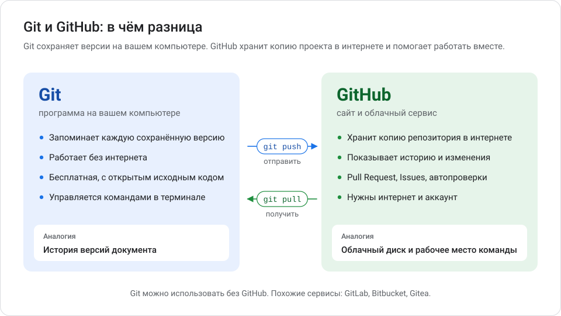
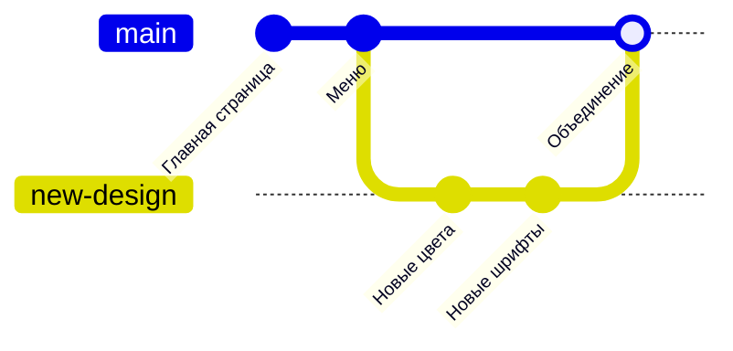
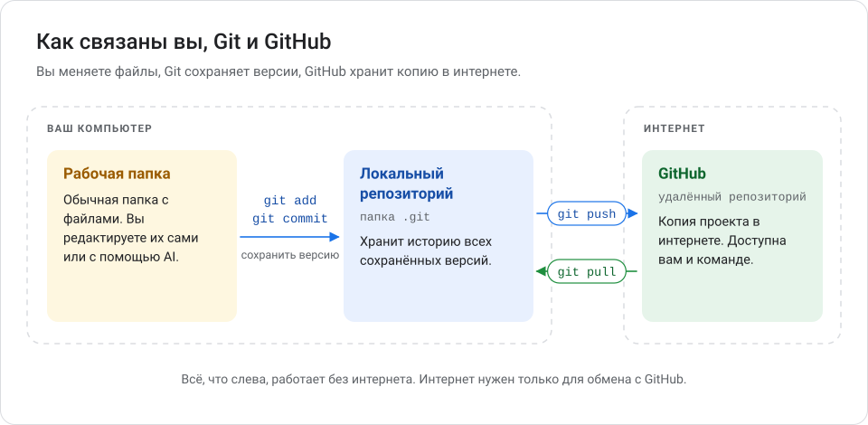
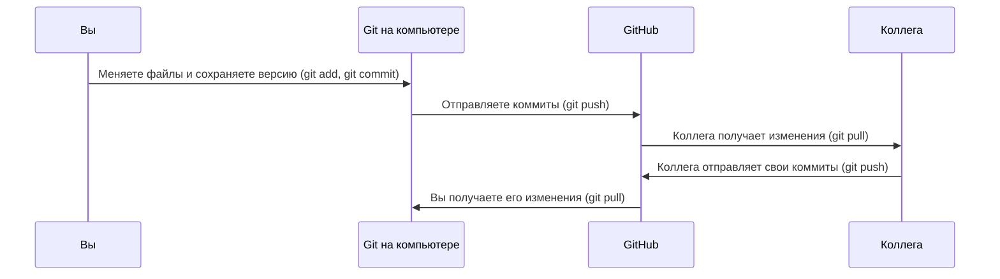

# Глава 1. Git и GitHub: основы

В этой главе нет команд. Здесь вы разберётесь, что такое Git и GitHub, зачем они нужны и какими словами о них говорят разработчики. Все остальные главы опираются на эти понятия.

**Вы научитесь:**

- объяснять, чем Git отличается от GitHub;
- понимать слова «репозиторий», «коммит», «ветка», «история изменений»;
- представлять, как файлы попадают с вашего компьютера на GitHub.

**Время:** около 30 минут. **Понадобится:** ничего, кроме внимания.

<!-- toc -->
**Содержание главы**

- [1.1. Зачем нужен контроль версий](#11-зачем-нужен-контроль-версий)
- [1.2. Что такое Git](#12-что-такое-git)
- [1.3. Что такое GitHub](#13-что-такое-github)
- [1.4. Git и GitHub: в чём разница](#14-git-и-github-в-чём-разница)
- [1.5. Главные понятия](#15-главные-понятия)
- [1.6. Бытовая аналогия](#16-бытовая-аналогия)
- [1.7. Как связаны вы, Git и GitHub](#17-как-связаны-вы-git-и-github)
- [1.8. Чего Git не делает](#18-чего-git-не-делает)
- [Проверьте себя](#проверьте-себя)
- [Что дальше](#что-дальше)
<!-- /toc -->

## 1.1. Зачем нужен контроль версий

Представьте, что вы пишете диплом. Через месяц в папке лежат файлы:

```text
диплом.docx
диплом_новый.docx
диплом_новый_исправленный.docx
диплом_финал.docx
диплом_финал_точно_финал.docx
```

Уже непонятно, чем один файл отличается от другого и какой из них правильный. А если над дипломом работают двое, станет ещё хуже: правки будут теряться при пересылке.

С программами то же самое, только файлов сотни. Поэтому разработчики используют **систему контроля версий**.

> **Система контроля версий** (СКВ, по-английски *version control system*, VCS) — программа, которая запоминает изменения файлов. С её помощью можно посмотреть, кто, когда и что изменил, и вернуться к любой сохранённой версии.

Пример. Вы поменяли цвет кнопки на сайте, и сайт сломался. Система контроля версий покажет, какие именно строки вы изменили, и позволит вернуть файл к вчерашнему состоянию за одну команду.

Что даёт контроль версий:

| Возможность | Что это значит на практике |
| --- | --- |
| История | Видно каждое сохранённое изменение: кто, когда, зачем |
| Откат | Можно вернуться к рабочей версии, если что-то сломалось |
| Эксперименты | Можно пробовать новое, не трогая рабочую версию |
| Командная работа | Несколько человек меняют один проект, и правки не теряются |
| Резервная копия | Копия проекта хранится на сервере (если вы её туда отправили) |

## 1.2. Что такое Git

> **Git** — бесплатная программа для контроля версий. Её устанавливают на компьютер и управляют ею командами в терминале или через программы с кнопками.

Git создал Линус Торвальдс в 2005 году для разработки ядра Linux. Сегодня это самая распространённая система контроля версий в мире. Git — программа с открытым исходным кодом: её код может прочитать любой.

Главное о Git:

- **Работает на вашем компьютере.** Интернет для сохранения версий не нужен.
- **Сохраняет версии только по вашей команде.** Git не делает это автоматически, как облачный диск.
- **Хранит всю историю внутри проекта** — в скрытой папке `.git`.
- **Распределённый.** У каждого участника есть полная копия проекта со всей историей.

Пример. Вы написали первую страницу сайта и сказали Git: «Сохрани эту версию с подписью „Добавить главную страницу“». Через неделю вы сможете открыть именно эту версию, даже если с тех пор сто раз меняли файл.

## 1.3. Что такое GitHub

> **GitHub** — сайт и облачный сервис, где хранят Git-проекты и работают над ними вместе. Адрес: [github.com](https://github.com/).

GitHub принадлежит компании Microsoft. Базовые возможности бесплатны.

Что умеет GitHub:

- хранить копию проекта в интернете;
- показывать файлы, историю и изменения прямо в браузере;
- давать доступ коллегам;
- обсуждать изменения перед тем, как принять их (**Pull Request**, глава 5);
- вести список задач и ошибок (**Issues**);
- автоматически проверять код (**GitHub Actions**, глава 11).

Пример. Вы работаете над сайтом дома и в офисе. Дома вы отправляете изменения на GitHub, в офисе скачиваете их оттуда. Проект всегда одинаковый на обоих компьютерах.

## 1.4. Git и GitHub: в чём разница



|  | Git | GitHub |
| --- | --- | --- |
| Что это | Программа | Сайт и облачный сервис |
| Где работает | На вашем компьютере | В интернете |
| Нужен интернет | Нет | Да |
| Нужен аккаунт | Нет | Да |
| Главная задача | Сохранять версии файлов | Хранить проекты и помогать работать вместе |
| Аналогия | История версий документа | Облачный диск и рабочее место команды |

Git можно использовать без GitHub. GitHub — один из сервисов для Git-проектов. Похожие сервисы: GitLab, Bitbucket, Gitea. В этой методичке мы используем GitHub.

## 1.5. Главные понятия

Эти слова встретятся в каждой главе. Не нужно заучивать их сейчас: возвращайтесь сюда или в [словарь терминов](glossary.md).

### Репозиторий

> **Репозиторий** (*repository*, сокращённо «репо») — папка проекта, за которой следит Git, вместе со всей историей её изменений.

Пример. Папка `my-site` с файлами `index.html` и `style.css` — обычная папка. После команды `git init` в ней появляется скрытая папка `.git`, и `my-site` становится репозиторием.

Репозитории бывают двух видов:

- **Локальный** — на вашем компьютере.
- **Удалённый** (*remote*) — на сервере, например на GitHub. Обычно его называют `origin`.

### Коммит

> **Коммит** (*commit*) — сохранённый снимок проекта. У каждого коммита есть автор, дата, сообщение и уникальный номер.

Пример коммита:

```text
commit 3f2a9c1
Автор:     Иван Петров
Дата:      11 октября 2026
Сообщение: Добавить страницу контактов
```

Номер `3f2a9c1` — это начало **хеша**: длинного уникального кода из цифр и букв. По нему Git находит коммит. Обычно хватает первых 7 символов.

Аналогия: коммит похож на сохранение в компьютерной игре. Вы сохранились перед сложным уровнем и всегда можете к этому моменту вернуться.

### История изменений

> **История изменений** — цепочка коммитов от самого первого до последнего.

Пример истории (сначала новые):

```text
3f2a9c1 Добавить страницу контактов
b71e0d4 Исправить опечатку в меню
5c9a2e8 Добавить главную страницу
```

По истории видно, как проект развивался, и можно вернуться к любому коммиту.

### Ветка

> **Ветка** (*branch*) — отдельная линия работы над проектом. Изменения в одной ветке не влияют на другие, пока вы их не объедините.

Основная ветка обычно называется `main`. В ней лежит стабильная, рабочая версия.

Пример. Вы хотите попробовать новый дизайн сайта, но не уверены в результате. Вы создаёте ветку `new-design` и работаете в ней. Если дизайн понравится, вы объедините ветку с `main`. Если нет — просто удалите ветку, и `main` останется нетронутой.



### Отправить и получить изменения

- **Отправить** (*push*, «запушить») — передать ваши коммиты с компьютера на GitHub.
- **Получить** (*pull*, «спулить») — скачать новые коммиты с GitHub к себе.
- **Клонировать** (*clone*) — скачать проект с GitHub целиком, со всей историей.

## 1.6. Бытовая аналогия

| Понятие Git | На что похоже |
| --- | --- |
| Git | Функция «История версий» в текстовом редакторе |
| Репозиторий | Папка проекта с журналом всех изменений |
| Коммит | Сохранение в игре с подписью |
| История | Список всех сохранений |
| Ветка | Черновик, где можно пробовать, не портя чистовик |
| Слияние (*merge*) | Перенос удачных правок из черновика в чистовик |
| GitHub | Облачный диск, где команда видит проект и обсуждает правки |
| push | Загрузить свои сохранения в облако |
| pull | Скачать из облака чужие сохранения |

У аналогии есть предел: облачный диск синхронизирует файлы сам, а Git сохраняет и отправляет изменения только по вашей команде.

## 1.7. Как связаны вы, Git и GitHub



Обычный день работы с проектом выглядит так:



Все команды из схемы вы освоите в главах 3 и 4.

## 1.8. Чего Git не делает

Git — надёжный инструмент, но не волшебный. Важно знать его границы:

- **Git не сохраняет автоматически.** В историю попадает только то, что вы закоммитили.
- **Локальный репозиторий — не резервная копия.** Если диск сломается, а вы не отправили коммиты на GitHub, история пропадёт вместе с диском.
- **Git не защищает секреты.** Пароль, попавший в коммит, остаётся в истории (глава 6).
- **Git плохо подходит для больших файлов** — видео, архивов, дистрибутивов. GitHub не принимает файлы больше 100 МБ.
- **Git не проверяет, работает ли программа.** Он сохранит и сломанную версию, если вы её закоммитите.

## Проверьте себя

1. Нужен ли интернет, чтобы сохранить версию проекта в Git?
2. Чем репозиторий отличается от обычной папки?
3. Вы попробовали новый дизайн, и он не понравился. Как ветка помогает в такой ситуации?
4. Чем Git отличается от облачного диска?

<details>
<summary>Ответы</summary>

1. Нет. Git работает на компьютере. Интернет нужен только для обмена с GitHub.
2. В репозитории есть скрытая папка `.git` с историей всех коммитов.
3. Вы работали в отдельной ветке, поэтому `main` не изменилась. Ветку можно просто удалить.
4. Облачный диск синхронизирует файлы сам. Git сохраняет версии только по вашей команде и хранит полную историю изменений.

</details>

## Что дальше

В [главе 2](02_ustanovka_i_nastroyka.md) вы установите Git на Windows и сделаете первую настройку.
