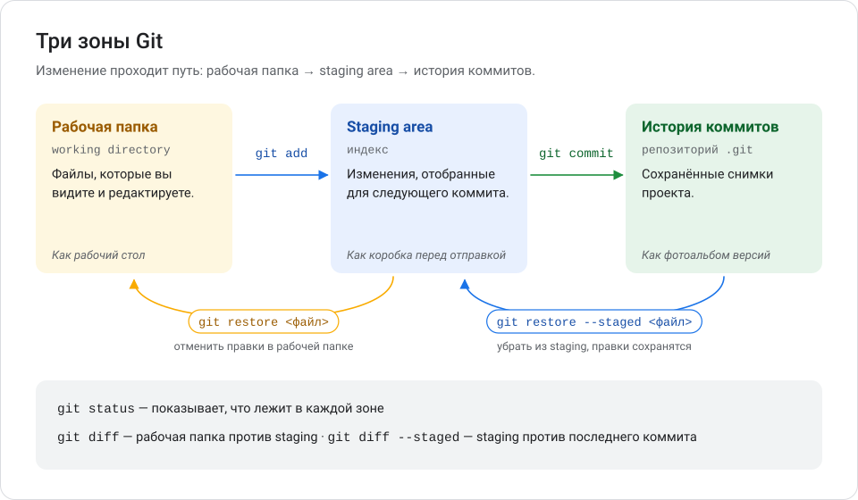
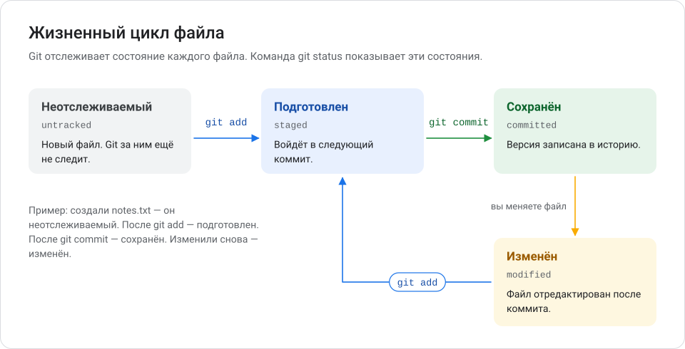
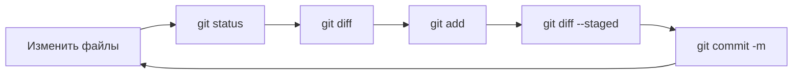
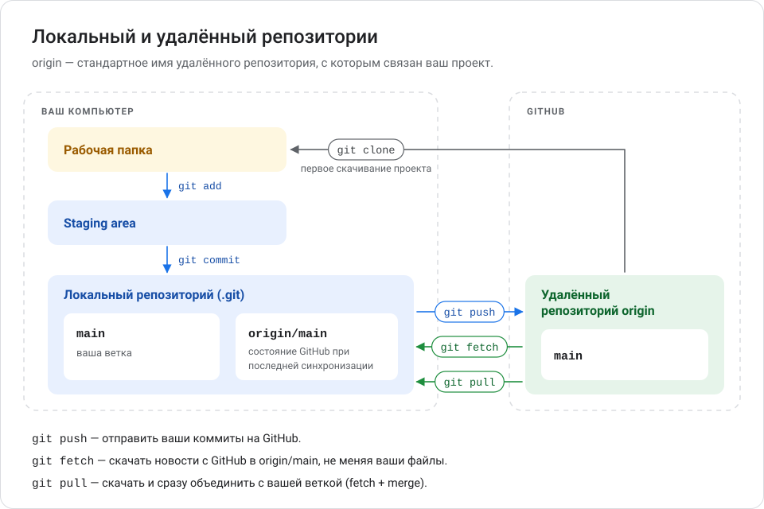

# Глава 3. Основные команды Git

В этой главе вы создадите первый репозиторий и освоите десять команд, которыми разработчики пользуются каждый день. Каждая команда описана по одному шаблону: что делает, когда нужна, как выглядит, пример, результат, проверка и типичные ошибки.

**Вы научитесь:**

- создавать репозиторий и сохранять версии файлов;
- понимать разницу между рабочей папкой, staging area и историей;
- смотреть историю и изменения;
- понимать, как работают `clone`, `push`, `pull` и `fetch`.

**Время:** 1,5–2 часа. **Понадобится:** установленный и настроенный Git ([глава 2](02_ustanovka_i_nastroyka.md)).

<!-- toc -->
**Содержание главы**

- [3.1. Три зоны Git](#31-три-зоны-git)
- [3.2. Подготовка учебной папки](#32-подготовка-учебной-папки)
- [3.3. git init — создать репозиторий](#33-git-init--создать-репозиторий)
- [3.4. git status — посмотреть состояние](#34-git-status--посмотреть-состояние)
- [3.5. git add — подготовить изменения](#35-git-add--подготовить-изменения)
- [3.6. git commit — сохранить версию](#36-git-commit--сохранить-версию)
- [3.7. git log — посмотреть историю](#37-git-log--посмотреть-историю)
- [3.8. git diff — посмотреть изменения](#38-git-diff--посмотреть-изменения)
- [3.9. git clone — скачать репозиторий](#39-git-clone--скачать-репозиторий)
- [3.10. git push — отправить коммиты на GitHub](#310-git-push--отправить-коммиты-на-github)
- [3.11. git pull — получить изменения с GitHub](#311-git-pull--получить-изменения-с-github)
- [3.12. git fetch — узнать, что нового, ничего не меняя](#312-git-fetch--узнать-что-нового-ничего-не-меняя)
- [3.13. Шпаргалка](#313-шпаргалка)
- [Проверьте себя](#проверьте-себя)
- [Что дальше](#что-дальше)
<!-- /toc -->

## 3.1. Три зоны Git

Прежде чем запускать команды, разберёмся, где «живут» изменения. Это самая важная идея главы.



> **Рабочая папка** (*working directory*) — обычная папка проекта с файлами, которые вы открываете и редактируете.

> **Staging area** (также «индекс», «область подготовки») — список изменений, которые войдут в следующий коммит. Вы сами решаете, что туда положить.

> **История коммитов** — сохранённые снимки проекта внутри папки `.git`.

Аналогия с посылкой:

1. **Рабочая папка** — ваш стол. На нём лежат вещи, некоторые вы меняете.
2. **Staging area** — коробка. Вы кладёте в неё только то, что хотите отправить.
3. **Коммит** — заклеенная и подписанная коробка. Её содержимое больше не меняется.

Зачем нужен промежуточный шаг? Допустим, вы исправили опечатку в одном файле и начали большую новую функцию в другом. Staging area позволяет сохранить опечатку отдельным коммитом, а недоделанную функцию — оставить на столе.

Каждый файл в репозитории находится в одном из состояний:



| Состояние | Английский термин в выводе Git | Что значит |
| --- | --- | --- |
| Неотслеживаемый | `Untracked files` | Новый файл, Git за ним ещё не следит |
| Изменён | `Changes not staged for commit` / `modified` | Файл изменён, но изменения не в staging |
| Подготовлен | `Changes to be committed` | Изменения в staging, войдут в коммит |
| Сохранён | `nothing to commit, working tree clean` | Всё сохранено, отличий нет |

## 3.2. Подготовка учебной папки

Создайте папку для упражнений и перейдите в неё:

```powershell
mkdir ~\projects\git-practice
cd ~\projects\git-practice
```

Создайте первый файл в Блокноте:

```powershell
notepad hello.txt
```

Блокнот спросит, создать ли новый файл. Нажмите **Да**, напишите строку `Привет, Git!`, сохраните (<kbd>Ctrl</kbd>+<kbd>S</kbd>) и закройте Блокнот.

> [!TIP]
> Создавайте и редактируйте текстовые файлы в Блокноте или в редакторе кода. Блокнот Windows 11 сохраняет файлы в кодировке UTF-8, и русский текст в Git отображается правильно.

> [!NOTE]
> Примеры вывода в этой главе получены в Git для Windows. Хеши коммитов, даты и пути у вас будут другими — это нормально.

## 3.3. git init — создать репозиторий

**Что делает.** Превращает обычную папку в Git-репозиторий: создаёт в ней скрытую папку `.git`, где будет храниться история.

**Когда нужна.** Один раз — в начале работы над новым проектом, который ещё не на GitHub.

**Как выглядит.**

```powershell
git init
```

**Пример.**

```powershell
cd ~\projects\git-practice
git init
```

**Что произойдёт.**

```text
Initialized empty Git repository in C:/Users/Ivan/projects/git-practice/.git/
```

Перевод: «Создан пустой Git-репозиторий в ...». Файлы проекта не изменились, появилась только папка `.git`.

**Как проверить.**

```powershell
ls -Force
```

В списке появится папка `.git`. Она скрытая, поэтому без `-Force` её не видно.

**Типичные ошибки.**

- **Запуск не в той папке.** Например, в домашней папке `C:\Users\Ivan` — тогда Git начнёт следить за всеми вашими документами. Перед `git init` проверьте папку командой `pwd`. Если ошиблись, удалите появившуюся папку `.git` в Проводнике (включите показ скрытых элементов).
- **Повторный `git init`** в существующем репозитории ничего не ломает, но и не нужен. Git напишет `Reinitialized existing Git repository`.
- **Удаление папки `.git`** удаляет всю историю проекта. Никогда не трогайте её вручную без необходимости.
- **Ветка `master` вместо `main`.** Значит, не выполнена настройка `init.defaultBranch` из главы 2. Переименуйте ветку: `git branch -M main`.

## 3.4. git status — посмотреть состояние

**Что делает.** Показывает, в какой ветке вы находитесь и в каком состоянии файлы: что изменено, что подготовлено к коммиту, что Git ещё не отслеживает.

**Когда нужна.** Постоянно. Перед каждой командой, которая что-то меняет, и после неё. Это самая безопасная команда: она только смотрит.

**Как выглядит.**

```powershell
git status
```

**Пример.** В папке `git-practice` есть новый файл `hello.txt`:

```powershell
git status
```

**Что произойдёт.**

```text
On branch main

No commits yet

Untracked files:
  (use "git add <file>..." to include in what will be committed)
	hello.txt

nothing added to commit but untracked files present (use "git add" to track)
```

Как читать:

| Строка | Перевод |
| --- | --- |
| `On branch main` | Вы в ветке `main` |
| `No commits yet` | Коммитов пока нет |
| `Untracked files:` | Неотслеживаемые файлы |
| `(use "git add <file>..." ...)` | Подсказка: чтобы включить файл в коммит, используйте `git add` |
| `nothing added to commit but untracked files present` | В коммит ничего не добавлено, но есть неотслеживаемые файлы |

**Как проверить.** Команда сама и есть проверка. Если всё сохранено, вы увидите:

```text
On branch main
nothing to commit, working tree clean
```

«Сохранять нечего, рабочая папка чистая».

**Типичные ошибки.**

- `fatal: not a git repository (or any of the parent directories): .git` — вы не в репозитории. Перейдите в папку проекта (`cd`) или создайте репозиторий (`git init`).
- Привычка пропускать `git status`. Именно эта команда показывает, что вы сейчас закоммитите.

## 3.5. git add — подготовить изменения

**Что делает.** Кладёт изменения в staging area — «коробку», которая уйдёт в следующий коммит.

**Когда нужна.** Перед каждым коммитом.

**Как выглядит.**

```powershell
git add <файл>          # один файл
git add <файл1> <файл2>  # несколько файлов
git add .               # все изменения в текущей папке и вложенных
```

Текст после `#` — комментарий для вас, набирать его не нужно.

**Пример.**

```powershell
git add hello.txt
git status
```

**Что произойдёт.**

```text
On branch main

No commits yet

Changes to be committed:
  (use "git rm --cached <file>..." to unstage)
	new file:   hello.txt
```

Файл перешёл в раздел `Changes to be committed` — «изменения, которые будут закоммичены».

**Как проверить.** `git status` показывает файл в разделе `Changes to be committed`.

**Типичные ошибки.**

- **`git add .` без проверки.** Команда добавит всё подряд, включая случайные и секретные файлы. Сначала посмотрите `git status`, а лишнее внесите в `.gitignore` ([глава 6](06_oshibki_i_vosstanovlenie.md)).
- **`fatal: pathspec 'helo.txt' did not match any files`** — опечатка в имени файла. Используйте <kbd>Tab</kbd> для автодополнения.
- **Предупреждение** `warning: in the working copy of 'hello.txt', LF will be replaced by CRLF the next time Git touches it` — не ошибка. Git сообщает, что приведёт концы строк к формату Windows (см. главу 2).
- **Изменили файл после `git add`.** В коммит попадёт версия на момент `git add`. Чтобы добавить новые правки, выполните `git add` ещё раз.

## 3.6. git commit — сохранить версию

**Что делает.** Создаёт коммит — снимок всего, что лежит в staging area, с вашим сообщением.

**Когда нужна.** Когда закончен логический кусок работы: исправлена ошибка, добавлен раздел, программа снова работает.

**Как выглядит.**

```powershell
git commit -m "Сообщение"
```

`-m` (от *message*) — сообщение коммита прямо в команде. Без `-m` Git откроет редактор, чтобы вы написали сообщение там.

**Пример.**

```powershell
git commit -m "Добавить файл hello.txt"
```

**Что произойдёт.**

```text
[main (root-commit) 3e7e53a] Добавить файл hello.txt
 1 file changed, 1 insertion(+)
 create mode 100644 hello.txt
```

| Часть | Значение |
| --- | --- |
| `main` | Ветка, в которую записан коммит |
| `root-commit` | Самый первый коммит репозитория |
| `3e7e53a` | Короткий хеш — номер коммита (у вас будет другой) |
| `1 file changed, 1 insertion(+)` | Изменён 1 файл, добавлена 1 строка |

**Как проверить.**

```powershell
git status
git log --oneline
```

`git status` покажет `nothing to commit, working tree clean`, а `git log --oneline` — ваш коммит.

**Как писать сообщения коммитов.**

- Коротко описывайте, *что* изменено: «Добавить страницу контактов», «Исправить опечатку в меню».
- Начинайте с глагола. Хорошо подходит повелительная форма («Добавить», «Исправить»).
- Укладывайтесь в 50–70 символов. Подробности можно добавить в описание (см. ниже).
- Плохие примеры: «правки», «asdf», «исправил всё».

Сообщение с подробным описанием: каждый `-m` — отдельный абзац.

```powershell
git commit -m "Исправить расчёт скидки" -m "Скидка считалась от суммы без учёта доставки."
```

**Типичные ошибки.**

- **`Author identity unknown *** Please tell me who you are.`** — не указаны имя и почта. Выполните настройку из [главы 2](02_ustanovka_i_nastroyka.md#24-первая-настройка-git).
- **`nothing to commit, working tree clean`** или **`no changes added to commit`** — staging area пуста. Сначала `git add`.
- **Открылся редактор, и вы не знаете, что делать.** Вы запустили `git commit` без `-m`. Напишите сообщение в первой строке, сохраните файл и закройте редактор. Если открылся Vim — нажмите <kbd>Esc</kbd>, наберите `:wq`, <kbd>Enter</kbd>.
- **`Aborting commit due to empty commit message`** — сообщение оказалось пустым, коммит не создан. Повторите с `-m "..."`.

> [!TIP]
> Делайте коммиты часто и маленькими порциями. Маленький коммит легче понять, проверить и отменить.

## 3.7. git log — посмотреть историю

**Что делает.** Показывает историю коммитов: от новых к старым.

**Когда нужна.** Чтобы вспомнить, что делали; найти хеш коммита для отмены или сравнения; проверить, что коммит создан.

**Как выглядит.**

```powershell
git log                        # подробно
git log --oneline              # одна строка на коммит
git log --oneline --graph --all  # с рисунком веток
git log -3                     # только три последних коммита
git log -- hello.txt           # только коммиты, затронувшие файл
```

**Пример.** Измените `hello.txt` (добавьте вторую строку `Это моя вторая строка.`), затем:

```powershell
git add hello.txt
git commit -m "Добавить вторую строку"
git log
```

**Что произойдёт.**

```text
commit 554a88af3ad71c11f9f2266871fa35166d108af3 (HEAD -> main)
Author: Иван Петров <ivan.petrov@example.com>
Date:   Sun Oct 11 15:39:31 2026 +0500

    Добавить вторую строку

commit 3e7e53a6756bdfb7b9b64862f7cca442f031f7e5
Author: Иван Петров <ivan.petrov@example.com>
Date:   Sun Oct 11 15:39:30 2026 +0500

    Добавить файл hello.txt
```

`HEAD -> main` означает: вы сейчас здесь, на последнем коммите ветки `main`.

> **HEAD** — указатель «вы находитесь здесь». Обычно он указывает на последний коммит текущей ветки.

Короткий вид:

```powershell
git log --oneline
```

```text
554a88a (HEAD -> main) Добавить вторую строку
3e7e53a Добавить файл hello.txt
```

**Как проверить.** Количество строк в `git log --oneline` равно количеству коммитов в ветке.

**Типичные ошибки.**

- **Терминал «завис», внизу `:` или `(END)`.** Длинная история открылась в режиме постраничного просмотра. Листайте клавишами <kbd>↑</kbd> <kbd>↓</kbd> или пробелом, выход — клавиша <kbd>Q</kbd>.
- **`fatal: your current branch 'main' does not have any commits yet`** — коммитов ещё нет. Сначала сделайте первый коммит.

## 3.8. git diff — посмотреть изменения

**Что делает.** Показывает построчно, что изменилось: какие строки добавлены, какие удалены.

**Когда нужна.** Перед `git add` и перед `git commit` — чтобы убедиться, что сохраняете именно то, что хотели. Особенно важно после изменений, сделанных AI ([глава 7](07_git_s_claude_code.md)).

**Как выглядит.**

```powershell
git diff                 # рабочая папка против staging area
git diff --staged        # staging area против последнего коммита
git diff <коммит1> <коммит2>  # разница между двумя коммитами
git diff --stat          # только список файлов и число строк
```

**Пример.** Добавьте в `hello.txt` строку `Третья строка.` и сохраните файл. Затем:

```powershell
git diff
```

**Что произойдёт.**

```diff
diff --git a/hello.txt b/hello.txt
index d404783..8e1f0aa 100644
--- a/hello.txt
+++ b/hello.txt
@@ -1,2 +1,3 @@
 Привет, Git!
 Это моя вторая строка.
+Третья строка.
```

Как читать:

| Фрагмент | Значение |
| --- | --- |
| `--- a/hello.txt` | Старая версия файла |
| `+++ b/hello.txt` | Новая версия файла |
| `@@ -1,2 +1,3 @@` | Было 2 строки начиная с 1-й, стало 3 |
| Строка с `+` (зелёная) | Добавлена |
| Строка с `-` (красная) | Удалена |
| Строка без знака | Не изменилась, показана для контекста |

Изменённая строка выглядит как пара: удалённая старая (`-`) и добавленная новая (`+`).

**Как проверить.** После `git add hello.txt` команда `git diff` ничего не покажет: изменения ушли в staging. Их видно через `git diff --staged`.

**Типичные ошибки.**

- **«`git diff` ничего не показывает, хотя я менял файл».** Изменения уже в staging — используйте `git diff --staged`. Или файл новый (неотслеживаемый) — `git diff` не показывает новые файлы до `git add`.
- **Длинный вывод «завис».** Это постраничный просмотр, выход — <kbd>Q</kbd>.

Завершите пример — сохраните третью строку:

```powershell
git add hello.txt
git commit -m "Добавить третью строку"
```

### Ежедневный цикл

Команды 3.4–3.8 складываются в цикл, который вы будете повторять постоянно:



## 3.9. git clone — скачать репозиторий

Следующие четыре команды работают с удалённым репозиторием на GitHub. Попробовать их на практике вы сможете в [главе 4](04_rabota_s_github.md), когда создадите аккаунт и репозиторий.



**Что делает.** Скачивает репозиторий с GitHub на компьютер целиком: все файлы и всю историю. Заодно запоминает адрес GitHub-репозитория под именем `origin`.

**Когда нужна.** Один раз — чтобы начать работать с проектом, который уже есть на GitHub.

**Как выглядит.**

```powershell
git clone <адрес>              # в новую папку с именем репозитория
git clone <адрес> <папка>      # в папку с другим именем
```

**Пример.**

```powershell
cd ~\projects
git clone https://github.com/ivan-petrov/my-site.git
```

**Что произойдёт.**

```text
Cloning into 'my-site'...
remote: Enumerating objects: 12, done.
...
Receiving objects: 100% (12/12), done.
```

Появится папка `my-site` с файлами проекта и папкой `.git`.

**Как проверить.**

```powershell
cd my-site
git log --oneline
git remote -v
```

`git log` покажет историю, `git remote -v` — адрес на GitHub.

**Типичные ошибки.**

- **`fatal: destination path 'my-site' already exists and is not an empty directory`** — такая папка уже есть. Перейдите в другую папку или укажите другое имя.
- **`remote: Repository not found`** — опечатка в адресе, или репозиторий приватный, а у вашей учётной записи нет доступа.
- **Клонирование внутрь другого репозитория.** Перед `git clone` выполните `git status`: должно быть `fatal: not a git repository`. Значит, вы вне репозитория.

> [!NOTE]
> Кнопка **Download ZIP** на GitHub скачивает только файлы — без истории и без связи с GitHub. Чтобы работать с проектом через Git, используйте `git clone`.

## 3.10. git push — отправить коммиты на GitHub

**Что делает.** Отправляет ваши новые коммиты из локального репозитория в удалённый.

**Когда нужна.** После коммитов — чтобы сохранить их на GitHub и показать коллегам.

**Как выглядит.**

```powershell
git push -u origin main   # первый раз для ветки: отправить и запомнить связь
git push                  # в следующие разы
```

- `origin` — имя удалённого репозитория;
- `main` — какую ветку отправить;
- `-u` — запомнить, что локальная `main` связана с `origin/main`. После этого хватает короткого `git push`.

**Пример.**

```powershell
git push
```

**Что произойдёт.**

```text
Enumerating objects: 5, done.
...
To https://github.com/ivan-petrov/my-site.git
   554a88a..9b1c2d3  main -> main
```

`554a88a..9b1c2d3` — на GitHub ветка `main` передвинулась с коммита `554a88a` на `9b1c2d3`.

**Как проверить.** Обновите страницу репозитория на GitHub: там появятся новые коммиты. В терминале:

```powershell
git status
```

```text
On branch main
Your branch is up to date with 'origin/main'.
```

«Ваша ветка совпадает с `origin/main`».

**Типичные ошибки.**

- **`! [rejected] main -> main (fetch first)`** — на GitHub есть коммиты, которых у вас нет. Сначала `git pull`, потом снова `git push`.
- **`error: src refspec main does not match any`** — в репозитории нет ветки `main`: либо ещё нет коммитов, либо ветка называется `master`. Проверьте `git status` и `git branch`.
- **Ошибки входа в GitHub** — см. [главу 4](04_rabota_s_github.md) и [главу 6](06_oshibki_i_vosstanovlenie.md).

## 3.11. git pull — получить изменения с GitHub

**Что делает.** Скачивает новые коммиты с GitHub и сразу объединяет их с вашей текущей веткой. По сути это две команды подряд: `git fetch` и `git merge`.

**Когда нужна.** Перед началом работы и перед `git push`, если над проектом работает кто-то ещё (или вы сами с другого компьютера).

**Как выглядит.**

```powershell
git pull
```

**Пример.** Коллега отправил на GitHub изменения в `README.md`.

```powershell
git pull
```

**Что произойдёт.**

```text
From https://github.com/ivan-petrov/my-site
   554a88a..9b1c2d3  main       -> origin/main
Updating 554a88a..9b1c2d3
Fast-forward
 README.md | 2 ++
 1 file changed, 2 insertions(+)
```

`Fast-forward` — «перемотка вперёд»: ваша ветка просто догнала GitHub. Если новых коммитов нет, Git напишет `Already up to date.`

**Как проверить.** `git log --oneline` покажет новые коммиты, а `git status` — `Your branch is up to date with 'origin/main'`.

**Типичные ошибки.**

- **Открылся редактор с текстом `Merge branch 'main' of ...`.** И у вас, и на GitHub были разные новые коммиты, и Git создаёт коммит слияния. Сохраните файл и закройте редактор — сообщение уже заполнено.
- **`CONFLICT (content): Merge conflict in ...`** — вы и коллега изменили одни и те же строки. Как это исправить — в [главе 6](06_oshibki_i_vosstanovlenie.md#61-что-такое-конфликт-слияния).
- **`fatal: Need to specify how to reconcile divergent branches`** — Git не знает, как объединять разошедшиеся ветки. Выполните один раз `git config --global pull.rebase false` и повторите `git pull`.
- **`error: Your local changes to the following files would be overwritten by merge`** — у вас есть незакоммиченные изменения в тех же файлах. Сначала закоммитьте их (`git add`, `git commit`).

## 3.12. git fetch — узнать, что нового, ничего не меняя

**Что делает.** Скачивает новые коммиты с GitHub, но **не трогает** ваши файлы и вашу ветку. Новые коммиты попадают в `origin/main` — «закладку», которая помнит состояние GitHub.

**Когда нужна.** Чтобы спокойно посмотреть, что изменилось на GitHub, прежде чем объединять.

**Как выглядит.**

```powershell
git fetch
```

**Пример.**

```powershell
git fetch
git status
```

**Что произойдёт.**

```text
From https://github.com/ivan-petrov/my-site
   554a88a..9b1c2d3  main       -> origin/main
```

```text
On branch main
Your branch is behind 'origin/main' by 1 commit, and can be fast-forwarded.
  (use "git pull" to update your local branch)
```

«Ваша ветка отстаёт от `origin/main` на 1 коммит».

**Как проверить.** Посмотрите новые коммиты и изменения до объединения:

```powershell
git log --oneline main..origin/main   # коммиты, которых у вас ещё нет
git diff main origin/main             # что они меняют
```

Если всё в порядке — `git pull` (или `git merge origin/main`).

**Типичные ошибки.**

- **«Сделал `git fetch`, а файлы не изменились».** Так и задумано: `fetch` только скачивает. Чтобы применить изменения, выполните `git pull`.

| | `git fetch` | `git pull` |
| --- | --- | --- |
| Скачивает коммиты с GitHub | Да | Да |
| Меняет ваши файлы и ветку | Нет | Да |
| Может вызвать конфликт | Нет | Да |
| Когда использовать | Посмотреть, что нового | Получить и сразу применить |

## 3.13. Шпаргалка

| Команда | Назначение |
| --- | --- |
| `git init` | Создать репозиторий в текущей папке |
| `git status` | Посмотреть состояние файлов |
| `git add <файл>` | Подготовить изменения к коммиту |
| `git add .` | Подготовить все изменения в папке |
| `git commit -m "..."` | Сохранить версию с сообщением |
| `git log --oneline` | Короткая история коммитов |
| `git log --oneline --graph --all` | История с рисунком всех веток |
| `git diff` | Изменения, ещё не добавленные в staging |
| `git diff --staged` | Изменения, которые войдут в коммит |
| `git clone <адрес>` | Скачать репозиторий с GitHub |
| `git push` | Отправить коммиты на GitHub |
| `git pull` | Скачать и применить изменения с GitHub |
| `git fetch` | Скачать изменения, не применяя их |
| `git remote -v` | Показать адреса удалённых репозиториев |

Полную документацию по любой команде открывает `git help <команда>`, например `git help commit`. Краткую справку прямо в терминале — `git commit -h`.

## Проверьте себя

Выполните в папке `git-practice`:

1. Создайте файл `notes.txt` с любым текстом. Какое состояние покажет `git status`?
2. Подготовьте и закоммитьте файл с сообщением «Добавить заметки».
3. Измените `notes.txt`. Что покажут `git diff` и `git diff --staged` до и после `git add`?
4. Сколько коммитов покажет `git log --oneline`?

<details>
<summary>Ожидаемый результат</summary>

1. Файл в разделе `Untracked files`.
2. `git add notes.txt`, затем `git commit -m "Добавить заметки"`. Git выведет строку вида `[main 1a2b3c4] Добавить заметки`.
3. До `git add`: `git diff` показывает изменения, `git diff --staged` — ничего. После `git add` — наоборот.
4. Четыре коммита, если вы выполнили все примеры главы: «Добавить файл hello.txt», «Добавить вторую строку», «Добавить третью строку», «Добавить заметки» (пятый появится, если закоммитите изменение из пункта 3).

</details>

## Что дальше

В [главе 4](04_rabota_s_github.md) вы создадите аккаунт на GitHub и отправите туда свой проект.
