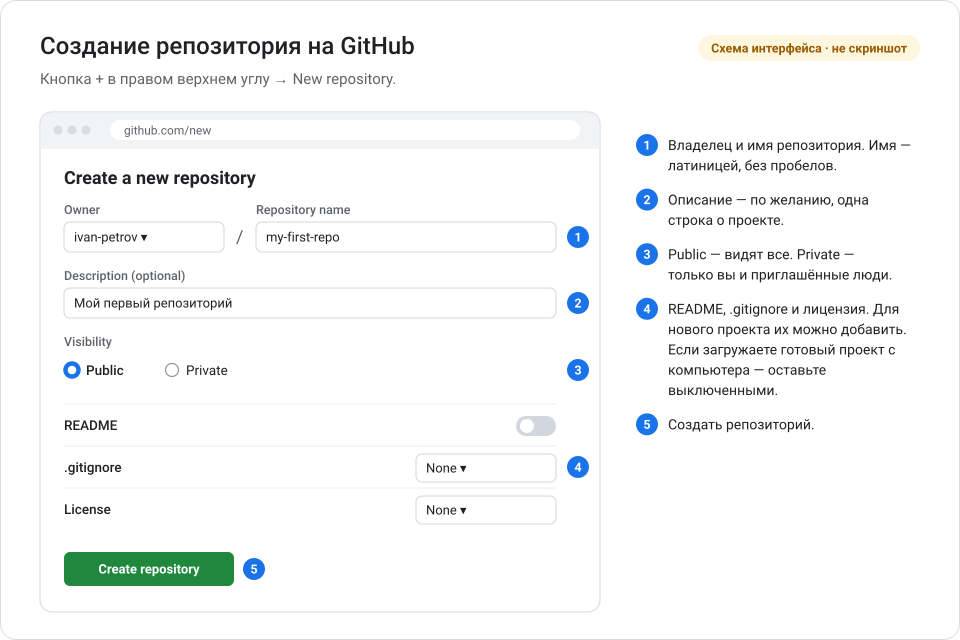
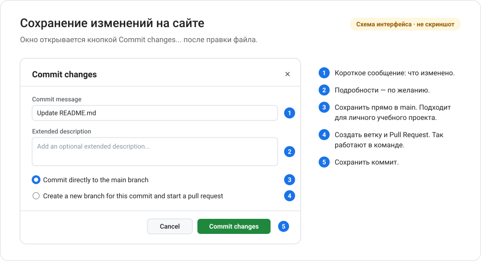
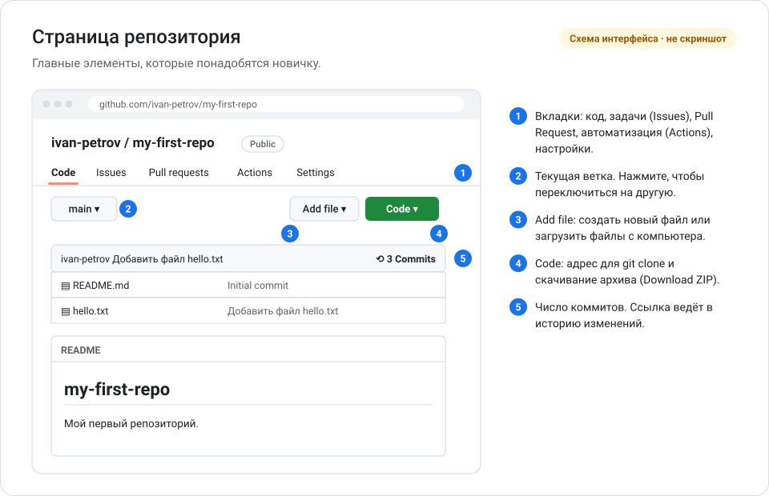
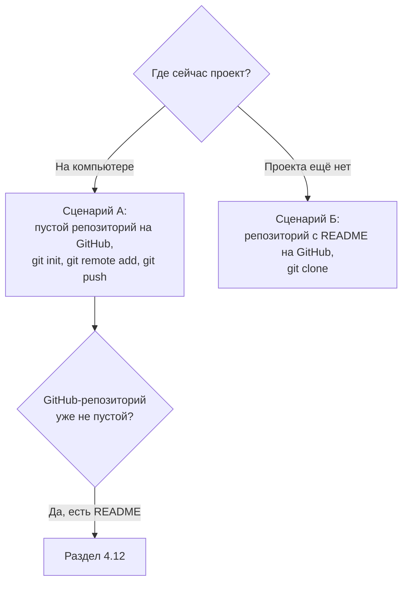

# Глава 4. Работа с GitHub

В этой главе вы заведёте аккаунт на GitHub, научитесь работать с репозиторием через сайт и отправите туда проект со своего компьютера.

**Вы научитесь:**

- создавать аккаунт и репозиторий на GitHub;
- добавлять, изменять и удалять файлы через сайт;
- смотреть историю изменений и скачивать проекты;
- входить в GitHub из терминала;
- отправлять на GitHub существующий и новый проект.

**Время:** 1,5–2 часа. **Понадобится:** установленный Git ([глава 2](02_ustanovka_i_nastroyka.md)), почтовый ящик и браузер.

<!-- toc -->
**Содержание главы**

- [4.1. Аккаунт на GitHub](#41-аккаунт-на-github)
- [4.2. Настройка приватности почты](#42-настройка-приватности-почты)
- [4.3. Создание репозитория на сайте](#43-создание-репозитория-на-сайте)
- [4.4. Что такое README.md](#44-что-такое-readmemd)
- [4.5. Работа с файлами через сайт](#45-работа-с-файлами-через-сайт)
- [4.6. История изменений на сайте](#46-история-изменений-на-сайте)
- [4.7. Скачать проект](#47-скачать-проект)
- [4.8. Вход в GitHub из терминала](#48-вход-в-github-из-терминала)
- [4.9. Удалённый репозиторий: git remote](#49-удалённый-репозиторий-git-remote)
- [4.10. Отправка проекта на GitHub: сценарий А — проект уже на компьютере](#410-отправка-проекта-на-github-сценарий-а--проект-уже-на-компьютере)
- [4.11. Сценарий Б — новый проект с нуля](#411-сценарий-б--новый-проект-с-нуля)
- [4.12. Если на GitHub уже есть README.md](#412-если-на-github-уже-есть-readmemd)
- [4.13. Ежедневная синхронизация](#413-ежедневная-синхронизация)
- [Проверьте себя](#проверьте-себя)
- [Что дальше](#что-дальше)
<!-- /toc -->

## 4.1. Аккаунт на GitHub

1. Откройте [github.com/signup](https://github.com/signup).
2. Введите почту, придумайте пароль и **имя пользователя** (*username*, логин).
3. Подтвердите почту: GitHub пришлёт код или ссылку. Без подтверждения нельзя, например, создавать репозитории.
4. Пройдите короткую анкету или пропустите её.

Можно также войти через аккаунт Google или Apple — кнопки **Continue with Google** / **Continue with Apple** на странице регистрации.

Советы по логину:

- логин станет частью адресов ваших проектов: `github.com/ivan-petrov/my-site`;
- выбирайте короткий и нейтральный — его увидят будущие работодатели и коллеги;
- допустимы латинские буквы, цифры и дефис.

### Двухфакторная аутентификация

> **Двухфакторная аутентификация** (2FA) — вход с двумя проверками: пароль плюс одноразовый код из приложения на телефоне или физический ключ. Даже если пароль украдут, без второго фактора войти не получится.

GitHub требует 2FA от всех, кто отправляет код на GitHub.com. Когда придёт ваша очередь, GitHub покажет напоминание и даст 45 дней на настройку. Не откладывайте:

1. Установите на телефон приложение-аутентификатор (любое, которое поддерживает одноразовые коды TOTP).
2. На GitHub: аватар в правом верхнем углу → **Settings** → **Password and authentication** → **Enable two-factor authentication**.
3. Отсканируйте QR-код приложением и введите код из него.
4. **Сохраните коды восстановления** (*recovery codes*) в надёжном месте. Без них при потере телефона доступ к аккаунту восстановить очень трудно.

Источник: [About mandatory two-factor authentication](https://docs.github.com/en/authentication/securing-your-account-with-two-factor-authentication-2fa/about-mandatory-two-factor-authentication).

## 4.2. Настройка приватности почты

Почта из настроек Git попадает в каждый коммит. В публичном репозитории её видят все. Чтобы скрыть настоящий адрес:

1. **Settings** → **Emails**.
2. Включите **Keep my email addresses private**. Ниже GitHub покажет ваш скрытый адрес вида `12345678+ivan-petrov@users.noreply.github.com`.
3. Включите **Block command line pushes that expose my email** — GitHub не примет push, если в коммите окажется ваш настоящий адрес.
4. Укажите скрытый адрес в Git:

```powershell
git config --global user.email "12345678+ivan-petrov@users.noreply.github.com"
```

Новые коммиты будут подписаны скрытым адресом, и GitHub всё равно свяжет их с вашим профилем.

> [!NOTE]
> Коммиты, сделанные раньше, сохранят старый адрес. Если GitHub отклоняет push из-за почты, исправьте адрес в последнем коммите: `git commit --amend --reset-author --no-edit` (только для коммита, который ещё не отправлен).

Источник: [Email addresses reference](https://docs.github.com/en/account-and-profile/reference/email-addresses-reference).

## 4.3. Создание репозитория на сайте

1. Нажмите **+** в правом верхнем углу → **New repository**.
2. Заполните форму:



*Схематическое изображение, а не снимок экрана. Реальный интерфейс GitHub может выглядеть иначе.*

3. Нажмите **Create repository**.

### Public или Private

| | Public (публичный) | Private (приватный) |
| --- | --- | --- |
| Кто видит | Все в интернете | Только вы и приглашённые люди |
| Когда выбирать | Открытые проекты, портфолио, учебные проекты без личных данных | Рабочие проекты, личные заметки, всё, что не должно быть открытым |
| Что важно помнить | Видны все файлы и **вся история**, включая старые коммиты | Приватность не отменяет правил: секреты в Git хранить нельзя и здесь |

Видимость можно изменить позже: **Settings** → раздел **Danger Zone** → **Change repository visibility**.

> [!WARNING]
> Публичный репозиторий виден сразу и всем. Перед тем как сделать репозиторий публичным, проверьте всю историю на пароли, ключи и личные данные ([глава 6](06_oshibki_i_vosstanovlenie.md#611-почему-нельзя-хранить-секреты-в-репозитории)).

### README, .gitignore и лицензия

В форме есть три необязательных пункта:

- **README** — создаёт файл `README.md` с названием проекта (см. раздел 4.4).
- **.gitignore** — список файлов, которые Git должен игнорировать. GitHub предлагает готовые шаблоны для языков программирования (Python, Node и другие).
- **License** — лицензия: условия, на которых другие могут использовать ваш код. Выбор лицензии подробно разобран в [главе 10](10_litsenzii_i_avtorskie_prava.md).

Как поступить:

| Ваша ситуация | README, .gitignore, лицензия |
| --- | --- |
| Новый проект, вы начнёте его с GitHub (сценарий Б1) | Включите README; .gitignore и лицензию — по желанию |
| Проект уже лежит на компьютере (сценарий А) | **Оставьте всё выключенным** — репозиторий должен быть пустым |

Почему это важно, объяснено в [разделе 4.12](#412-если-на-github-уже-есть-readmemd).

### Создать репозиторий из терминала

Если установлен GitHub CLI (раздел 4.8, способ 2), пустой репозиторий на GitHub можно создать и связать с папкой проекта одной командой. Выполните её в папке, где уже есть хотя бы один коммит:

```powershell
gh repo create my-site --private --source=. --remote=origin --push
```

| Часть | Значение |
| --- | --- |
| `gh repo create my-site` | Создать на GitHub репозиторий `my-site` |
| `--private` или `--public` | Видимость |
| `--source=.` | Взять код из текущей папки |
| `--remote=origin` | Добавить удалённый репозиторий с именем `origin` |
| `--push` | Сразу отправить коммиты |

Это короткий вариант сценария А (раздел 4.10). Новичку полезно сначала пройти сценарий пошагово, чтобы понимать, что делает каждая команда. Справка: [gh repo create](https://cli.github.com/manual/gh_repo_create).

## 4.4. Что такое README.md

> **README.md** — главная страница проекта. GitHub автоматически показывает её под списком файлов. Обычно в README рассказывают, что это за проект, как его установить и как им пользоваться.

`.md` означает **Markdown** — простой язык разметки текста. Вы пишете обычный текст с несколькими значками, а GitHub превращает его в оформленную страницу:

| Вы пишете | GitHub показывает |
| --- | --- |
| `# Заголовок` | Крупный заголовок |
| `## Подзаголовок` | Заголовок поменьше |
| `**жирный**` | **жирный** |
| `- пункт` | Маркированный список |
| `1. пункт` | Нумерованный список |
| `[текст](https://example.com)` | Ссылка |
| `` `код` `` | `код` |

Пример минимального README:

```markdown
# Мой сайт

Учебный сайт-визитка.

## Как открыть

Откройте файл `index.html` в браузере.
```

Как написать профессиональный README, разобрано в [главе 9](09_standarty_i_oformlenie_proektov.md#93-readmemd--главная-страница-проекта).

## 4.5. Работа с файлами через сайт

Небольшие правки удобно делать прямо в браузере. Каждое изменение на сайте — это коммит, как в терминале.

### Создать файл

1. На странице репозитория: **Add file** → **Create new file**.
2. Введите имя файла. Чтобы создать папку, напишите имя с косой чертой: `docs/notes.md`.
3. Напишите содержимое.
4. Нажмите **Commit changes...**, введите сообщение коммита и нажмите **Commit changes**.



*Схематическое изображение, а не снимок экрана. Реальный интерфейс GitHub может выглядеть иначе.*

### Загрузить файлы с компьютера

1. **Add file** → **Upload files**.
2. Перетащите файлы в окно или нажмите **choose your files**.
3. Внизу введите сообщение и нажмите **Commit changes**.

Ограничения загрузки через браузер: до 25 МБ на файл и до 100 файлов за раз. Для больших проектов используйте Git в терминале.

### Изменить файл

1. Откройте файл и нажмите значок карандаша (**Edit this file**).
2. Внесите правки. Вкладка **Preview** покажет результат для Markdown.
3. **Commit changes...** → сообщение → **Commit changes**.

### Удалить файл

1. Откройте файл.
2. Нажмите **...** (три точки) в правом верхнем углу файла → **Delete file**.
3. **Commit changes...** → сообщение → **Commit changes**.

> [!IMPORTANT]
> Удалённый файл исчезает только из текущей версии. В истории он остаётся, и любой, кто видит репозиторий, может открыть старый коммит. Поэтому удаление файла не спасает от утечки секрета ([глава 11](11_bezopasnost_i_avtomatizatsiya.md#118-если-секрет-попал-в-историю)).

### После правок на сайте

Изменения, сделанные на сайте, есть только на GitHub. Чтобы получить их на компьютере, выполните `git pull` в папке проекта.

### То же через терминал

Всё, что вы делаете с файлами на сайте, можно сделать в терминале в папке склонированного репозитория. Разница в том, что в терминале вы сначала сохраняете изменения у себя (коммит), а потом отправляете их на GitHub (`git push`).

| Действие | На сайте | В терминале |
| --- | --- | --- |
| Создать файл | **Add file** → **Create new file** | `notepad notes.md`, затем `git add notes.md`, `git commit -m "Добавить заметки"`, `git push` |
| Загрузить файлы | **Add file** → **Upload files** | Скопируйте файлы в папку проекта, затем `git add .`, `git commit`, `git push` |
| Изменить файл | Значок карандаша | Отредактируйте файл, затем `git add`, `git commit`, `git push` |
| Удалить файл | **...** → **Delete file** | `git rm notes.md`, `git commit -m "Удалить заметки"`, `git push` |
| Переименовать файл | Измените имя в режиме редактирования | `git mv old.md new.md`, `git commit`, `git push` |
| Посмотреть историю | Ссылка с числом коммитов | `git log --oneline` |

> **`git rm <файл>`** удаляет файл из папки и сразу подготавливает удаление к коммиту. Файл можно вернуть, пока вы не сделали коммит: `git restore --staged <файл>`, затем `git restore <файл>`. После коммита старая версия остаётся в истории.

Пример удаления через терминал:

```powershell
git rm notes.md
git status
git commit -m "Удалить заметки"
git push
```

```text
rm 'notes.md'
On branch main
Your branch is up to date with 'origin/main'.

Changes to be committed:
  (use "git restore --staged <file>..." to unstage)
	deleted:    notes.md
```

## 4.6. История изменений на сайте



*Схематическое изображение, а не снимок экрана. Реальный интерфейс GitHub может выглядеть иначе.*

- **История всего проекта.** Нажмите на число коммитов над списком файлов (например, **3 Commits**). Откроется список коммитов, как в `git log`.
- **Один коммит.** Нажмите на сообщение коммита — увидите, какие строки изменились, как в `git diff`. Добавленные строки зелёные, удалённые — красные.
- **История файла.** Откройте файл и нажмите **History**.
- **Кто изменил строку.** Откройте файл и переключитесь в режим **Blame**: рядом с каждой строкой будет коммит, который её изменил последним.

## 4.7. Скачать проект

Есть два способа, и они дают разный результат.

| | Download ZIP | git clone |
| --- | --- | --- |
| Где | **Code** → **Download ZIP** | `git clone <адрес>` в терминале |
| Что получите | Только файлы текущей версии | Файлы и всю историю |
| Связь с GitHub | Нет | Да, можно делать `pull` и `push` |
| Когда использовать | Просто посмотреть или запустить чужой проект | Работать с проектом через Git |

Адрес для клонирования: **Code** → вкладка **HTTPS** → кнопка копирования. Адрес выглядит так: `https://github.com/ivan-petrov/my-site.git`.

```powershell
cd ~\projects
git clone https://github.com/ivan-petrov/my-site.git
cd my-site
```

## 4.8. Вход в GitHub из терминала

Когда вы отправляете изменения (`git push`) или работаете с приватным репозиторием, GitHub спрашивает, кто вы. **Пароль от аккаунта для этого не подходит**: с 13 августа 2021 года GitHub не принимает пароли в командах Git.

Если вы попробуете ввести пароль, увидите:

```text
remote: Support for password authentication was removed on August 13, 2021.
```

Есть три способа войти.

### Способ 1. Git Credential Manager — вход через браузер (рекомендуется)

**Git Credential Manager** (GCM) — программа, которая хранит данные для входа. Она устанавливается вместе с Git для Windows.

1. Выполните первую команду, которой нужен GitHub, например `git push`.
2. Откроется окно GCM. Выберите вход через браузер (**Sign in with your browser**).
3. В браузере войдите в GitHub и подтвердите доступ (**Authorize**).
4. Вернитесь в терминал — команда продолжит работу.

GCM запомнит вход в **Диспетчере учётных данных Windows**. В следующий раз ничего вводить не придётся.

### Способ 2. GitHub CLI

**GitHub CLI** (`gh`) — официальная программа GitHub для терминала. Кроме входа, она умеет создавать репозитории и Pull Request.

```powershell
winget install --id GitHub.cli -e --source winget
```

Закройте и снова откройте терминал, чтобы он увидел новую программу, затем:

```powershell
gh auth login
```

Отвечайте на вопросы: `GitHub.com` → `HTTPS` → `Yes` (настроить Git) → `Login with a web browser`. Скопируйте показанный код и вставьте его в открывшемся браузере.

### Способ 3. Персональный токен доступа

> **Персональный токен доступа** (*personal access token*, PAT) — длинный секретный ключ, который заменяет пароль в командах Git. Токен можно ограничить: дать доступ только к нужным репозиториям, только на чтение, на определённый срок.

GitHub рекомендует **fine-grained** токены (они начинаются с `github_pat_`). Создать: **Settings** → **Developer settings** → **Personal access tokens** → **Fine-grained tokens** → **Generate new token**. Для отправки изменений токену нужно разрешение на запись содержимого репозитория: **Repository permissions** → **Contents** → **Read and write**. При первом `git push` откроется окно Git Credential Manager — выберите вход по токену (**Token**) и вставьте его. Если GCM не установлен, Git спросит логин и пароль в терминале — вместо пароля вставьте токен.

> [!CAUTION]
> Токен — такой же секрет, как пароль. Не храните его в файлах проекта, не отправляйте в чатах и не показывайте AI-ассистентам. Если токен утёк — сразу удалите его на GitHub и создайте новый.

### А как же SSH?

**SSH-ключ** — ещё один способ входа: пара файлов-ключей на компьютере, публичную часть которых вы добавляете на GitHub. Он удобен опытным пользователям, но требует больше настройки. Для начала хватит способа 1. Инструкция: [Connecting to GitHub with SSH](https://docs.github.com/en/authentication/connecting-to-github-with-ssh).

## 4.9. Удалённый репозиторий: git remote

> **Удалённый репозиторий** (*remote*) — копия репозитория на сервере, с которой ваш локальный репозиторий обменивается коммитами. У него есть короткое имя и адрес.

По соглашению главный удалённый репозиторий называют `origin`. `git clone` настраивает его сам, а при `git init` его нужно добавить вручную.

| Команда | Что делает |
| --- | --- |
| `git remote add origin <адрес>` | Запомнить адрес GitHub-репозитория под именем `origin` |
| `git remote -v` | Показать удалённые репозитории и их адреса (`-v` — *verbose*, подробно) |
| `git remote set-url origin <адрес>` | Заменить адрес, если ошиблись |
| `git remote remove origin` | Забыть удалённый репозиторий (на GitHub ничего не удаляется) |

Пример вывода `git remote -v`:

```text
origin  https://github.com/ivan-petrov/my-site.git (fetch)
origin  https://github.com/ivan-petrov/my-site.git (push)
```

`(fetch)` — адрес для скачивания, `(push)` — для отправки. Обычно они совпадают.

### Что значит git push -u origin main

```powershell
git push -u origin main
```

| Часть | Значение |
| --- | --- |
| `git push` | Отправить коммиты |
| `-u` | Запомнить связь: локальная `main` ↔ `origin/main` (полная форма — `--set-upstream`) |
| `origin` | Куда отправить — в удалённый репозиторий с именем `origin` |
| `main` | Какую ветку отправить |

`-u` нужен один раз для каждой новой ветки. Потом достаточно `git push` и `git pull` без параметров: Git уже знает, куда и откуда.

### Что значит git branch -M main

```powershell
git branch -M main
```

Переименовывает текущую ветку в `main` (`-M` — переименовать, даже если ветка с таким именем уже есть). Нужна, если ваш репозиторий создан с веткой `master`. Если ветка уже называется `main`, команда ничего не меняет — её можно выполнить для надёжности.

## 4.10. Отправка проекта на GitHub: сценарий А — проект уже на компьютере

У вас есть папка с проектом, например `C:\Users\Ivan\projects\my-site`. Отправим её на GitHub.



**Шаг 1. Откройте терминал в папке проекта.**

```powershell
cd ~\projects\my-site
```

**Шаг 2. Создайте репозиторий** (если папка ещё не репозиторий — проверьте командой `git status`):

```powershell
git init
```

**Шаг 3. Создайте `.gitignore`**, чтобы не отправить лишнее:

```powershell
New-Item .gitignore
notepad .gitignore
```

Впишите в него то, что не должно попасть на GitHub, например:

```gitignore
# Секреты и личные настройки
.env
*.key

# Временные и служебные файлы
*.log
Thumbs.db
desktop.ini
```

Подробнее о `.gitignore` — в [главе 6](06_oshibki_i_vosstanovlenie.md#612-gitignore-что-не-должно-попасть-в-git).

**Шаг 4. Проверьте, что будет сохранено.**

```powershell
git add .
git status
```

Внимательно просмотрите список `Changes to be committed`. Если там есть пароли, ключи, личные документы или большие файлы — уберите их из staging командой `git rm --cached <файл>` (в репозитории ещё нет коммитов, поэтому `git restore --staged` здесь не сработает), добавьте их в `.gitignore` и снова выполните `git add .` и `git status`.

**Шаг 5. Сделайте первый коммит.**

```powershell
git commit -m "Первый коммит"
```

**Шаг 6. Создайте пустой репозиторий на GitHub.** **+** → **New repository** → имя (например, `my-site`) → видимость → README, .gitignore и лицензию **не добавляйте** → **Create repository**. GitHub покажет страницу **Quick setup** с адресом репозитория. Скопируйте адрес HTTPS.

**Шаг 7. Свяжите локальный репозиторий с GitHub.**

```powershell
git remote add origin https://github.com/ivan-petrov/my-site.git
git remote -v
```

Ожидаемый результат:

```text
origin  https://github.com/ivan-petrov/my-site.git (fetch)
origin  https://github.com/ivan-petrov/my-site.git (push)
```

**Шаг 8. Убедитесь, что ветка называется main.**

```powershell
git branch -M main
```

**Шаг 9. Отправьте проект.**

```powershell
git push -u origin main
```

При первом push откроется окно входа (раздел 4.8). Ожидаемый результат:

```text
Enumerating objects: 5, done.
...
To https://github.com/ivan-petrov/my-site.git
 * [new branch]      main -> main
branch 'main' set up to track 'origin/main'.
```

**Шаг 10. Проверьте.** Обновите страницу репозитория в браузере — там появятся ваши файлы. В терминале:

```powershell
git status
```

```text
On branch main
Your branch is up to date with 'origin/main'.

nothing to commit, working tree clean
```

Все команды сценария А подряд:

```powershell
cd ~\projects\my-site
git init
# создать и заполнить .gitignore
git add .
git status
git commit -m "Первый коммит"
# создать ПУСТОЙ репозиторий на GitHub и скопировать адрес
git remote add origin https://github.com/ivan-petrov/my-site.git
git remote -v
git branch -M main
git push -u origin main
```

## 4.11. Сценарий Б — новый проект с нуля

### Вариант Б1. Начать с GitHub (рекомендуется для нового проекта)

Это самый простой путь: репозиторий сразу правильно связан, и конфликтов с README не будет.

1. На GitHub: **+** → **New repository** → имя `my-new-project` → **включите README** → **Create repository**.
2. Скопируйте адрес: **Code** → **HTTPS**.
3. Склонируйте репозиторий:

```powershell
cd ~\projects
git clone https://github.com/ivan-petrov/my-new-project.git
cd my-new-project
```

4. Создайте файлы проекта, например `index.html`.
5. Сохраните и отправьте:

```powershell
git add .
git status
git commit -m "Добавить главную страницу"
git push
```

`-u` не нужен: после `git clone` связь с `origin/main` уже настроена.

### Вариант Б2. Начать на компьютере

Создайте папку, файлы и дальше действуйте по сценарию А:

```powershell
mkdir ~\projects\my-new-project
cd ~\projects\my-new-project
git init
notepad README.md
git add .
git commit -m "Первый коммит"
git remote add origin https://github.com/ivan-petrov/my-new-project.git
git branch -M main
git push -u origin main
```

Репозиторий на GitHub в этом варианте тоже должен быть **пустым**.

## 4.12. Если на GitHub уже есть README.md

Частая ситуация: вы создали репозиторий на GitHub с README, а потом пытаетесь отправить туда проект с компьютера (сценарий А). Push не проходит:

```text
To https://github.com/ivan-petrov/my-site.git
 ! [rejected]        main -> main (fetch first)
error: failed to push some refs to 'https://github.com/ivan-petrov/my-site.git'
hint: Updates were rejected because the remote contains work that you do not
hint: have locally. ...
```

**Почему.** На GitHub есть коммит с README, которого нет у вас. Ваш проект и репозиторий на GitHub — две независимые истории. Git не перезаписывает чужую историю молча.

Выберите один из способов.

### Способ 1. Пересоздать репозиторий (если на GitHub ничего ценного)

1. На GitHub: **Settings** → **Danger Zone** → **Delete this repository**.
2. Создайте репозиторий заново, **без README**.
3. Выполните `git push -u origin main`.

> [!WARNING]
> Удаление репозитория на GitHub необратимо: пропадут все файлы, Issues и Pull Request. Используйте этот способ, только если репозиторий только что создан и в нём ничего нет, кроме автоматического README.

### Способ 2. Объединить две истории

```powershell
git pull origin main --allow-unrelated-histories --no-rebase --no-edit
```

| Параметр | Зачем |
| --- | --- |
| `origin main` | Откуда взять изменения |
| `--allow-unrelated-histories` | Разрешить объединить две независимые истории. Без него Git ответит `fatal: refusing to merge unrelated histories` |
| `--no-rebase` | Объединить слиянием (merge) — самый понятный для новичка способ |
| `--no-edit` | Не открывать редактор, взять стандартное сообщение коммита слияния |

Если README.md есть и у вас, и на GitHub, Git сообщит о конфликте:

```text
Auto-merging README.md
CONFLICT (add/add): Merge conflict in README.md
Automatic merge failed; fix conflicts and then commit the result.
```

Откройте `README.md` в Блокноте. Вы увидите обе версии между маркерами:

```text
<<<<<<< HEAD
# Мой сайт
Описание
=======
# my-site
>>>>>>> b9a3c4f2e69e8f1a7796471dda0a3b0812e6919d
```

Оставьте нужный текст, удалите строки с `<<<<<<<`, `=======`, `>>>>>>>`, сохраните файл. Затем:

```powershell
git add README.md
git commit -m "Объединить с README из GitHub"
git push -u origin main
```

Подробнее о конфликтах — в [главе 6](06_oshibki_i_vosstanovlenie.md#61-что-такое-конфликт-слияния).

### Способ 3. Склонировать и перенести файлы

1. Склонируйте GitHub-репозиторий в **новую** папку: `git clone <адрес> my-site-new`.
2. Скопируйте в неё файлы проекта через Проводник (кроме папки `.git`!).
3. В новой папке: `git add .`, `git commit -m "Добавить файлы проекта"`, `git push`.

Минус способа: история старого локального репозитория не перенесётся.

> [!CAUTION]
> В интернете часто советуют `git push --force`. Эта команда **перезапишет** историю на GitHub вашей версией, и всё, чего нет у вас, пропадёт. Не используйте её, пока не понимаете последствий ([глава 6](06_oshibki_i_vosstanovlenie.md)).

## 4.13. Ежедневная синхронизация

Когда проект уже на GitHub, рабочий день выглядит так:

```powershell
# начало работы
git pull

# работа: изменения, проверки, коммиты
git status
git add <файлы>
git commit -m "Что сделано"

# конец работы или законченная задача
git push
```

Правило: **pull перед началом работы, push после коммитов**. Так меньше конфликтов, а GitHub всегда хранит свежую копию.

## Проверьте себя

1. Создайте на GitHub публичный репозиторий `git-practice` **без** README.
2. Отправьте туда учебный репозиторий из главы 3 по сценарию А.
3. Отредактируйте `hello.txt` прямо на сайте и закоммитьте изменение.
4. Получите это изменение на компьютере.
5. Посмотрите историю на сайте и в терминале. Совпадает ли она?

<details>
<summary>Ожидаемый результат</summary>

1. Пустой репозиторий со страницей **Quick setup**.
2. `git remote add origin https://github.com/<логин>/git-practice.git`, `git branch -M main`, `git push -u origin main`. На сайте видны `hello.txt`, `notes.txt` и все коммиты.
3. Новый коммит в истории на сайте.
4. `git pull` выводит `Fast-forward` и имя изменённого файла.
5. Да. `git log --oneline` показывает те же коммиты и хеши, что и список коммитов на сайте.

</details>

## Что дальше

В [главе 5](05_vetki_i_pull_requests.md) вы научитесь работать с ветками и Pull Request.
