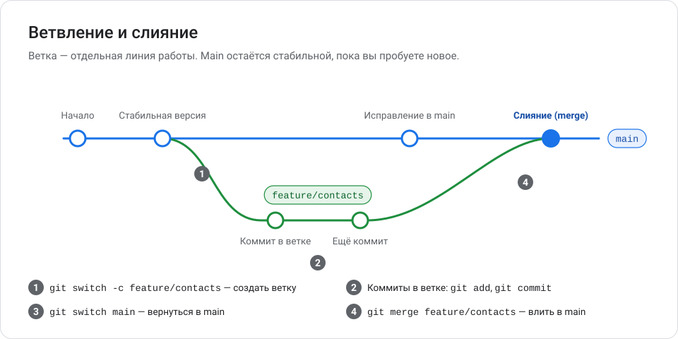
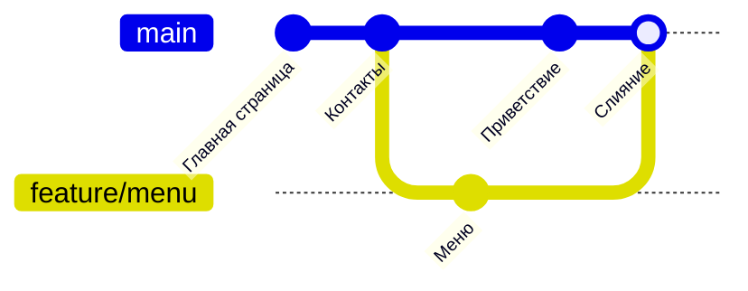
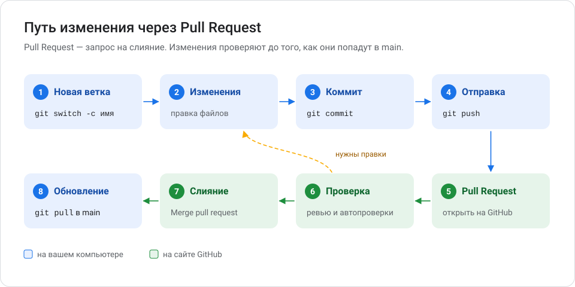
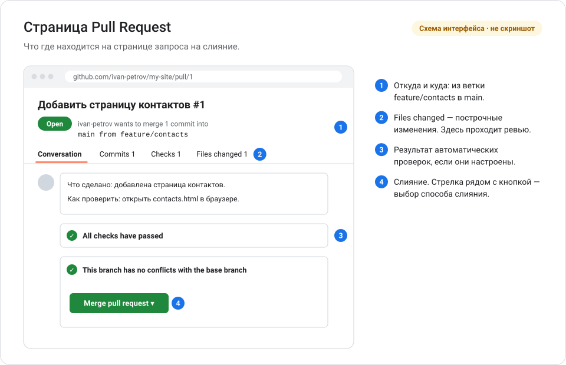
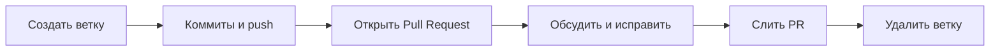

# Глава 5. Ветки и Pull Request

Ветки позволяют пробовать новое, не ломая рабочую версию. Pull Request — способ показать изменения другим и обсудить их до того, как они попадут в основную ветку. Так работают почти все команды разработчиков.

**Вы научитесь:**

- создавать ветки и переключаться между ними;
- объединять ветки командой `git merge`;
- отправлять ветку на GitHub и открывать Pull Request;
- просматривать изменения перед объединением.

**Время:** 1,5 часа. **Понадобится:** репозиторий, связанный с GitHub ([глава 4](04_rabota_s_github.md)).

<!-- toc -->
**Содержание главы**

- [5.1. Что такое ветка](#51-что-такое-ветка)
- [5.2. Зачем нужна main](#52-зачем-нужна-main)
- [5.3. Создание и переключение веток](#53-создание-и-переключение-веток)
- [5.4. Объединение веток — git merge](#54-объединение-веток--git-merge)
- [5.5. Отправка ветки на GitHub](#55-отправка-ветки-на-github)
- [5.6. Что такое Pull Request](#56-что-такое-pull-request)
- [5.7. Работа через Pull Request: пошагово](#57-работа-через-pull-request-пошагово)
- [5.8. Просмотр изменений перед объединением](#58-просмотр-изменений-перед-объединением)
- [5.9. Командная работа](#59-командная-работа)
- [5.10. Шпаргалка](#510-шпаргалка)
- [Проверьте себя](#проверьте-себя)
- [Что дальше](#что-дальше)
<!-- /toc -->

## 5.1. Что такое ветка

> **Ветка** (*branch*) — независимая линия разработки. Коммиты в одной ветке не появляются в другой, пока вы не объедините ветки.

Технически ветка — это просто подвижная метка, которая указывает на последний коммит линии. Когда вы делаете новый коммит, метка передвигается на него. Поэтому ветки в Git создаются мгновенно и почти не занимают места.

Пример. Сайт работает, а вам нужно добавить страницу контактов. Вы создаёте ветку `feature/contacts` и работаете в ней. Пока работа не закончена, сайт в ветке `main` остаётся рабочим.



## 5.2. Зачем нужна main

> **main** — основная ветка репозитория. В ней лежит стабильная версия проекта: та, что работает и которую можно показать пользователям.

Правила, которых придерживаются почти все команды:

- **В `main` не экспериментируют.** Новая работа идёт в отдельной ветке.
- **`main` всегда рабочая.** Изменения попадают в неё только после проверки.
- **Одна задача — одна ветка.** Так изменения легче проверять и отменять.

> [!NOTE]
> В старых проектах основная ветка называется `master`. Это то же самое, просто другое имя. С 2020 года GitHub называет основную ветку новых репозиториев `main`.

## 5.3. Создание и переключение веток

### Посмотреть ветки — git branch

```powershell
git branch
```

```text
* main
```

Звёздочка `*` отмечает текущую ветку. Ветки на GitHub показывает `git branch -a` (они начинаются с `remotes/origin/`).

### Создать ветку и перейти в неё — git switch -c

```powershell
git switch -c feature/contacts
```

```text
Switched to a new branch 'feature/contacts'
```

- `switch` — переключиться;
- `-c` (от *create*) — сначала создать ветку.

Новая ветка начинается с того коммита, на котором вы находились.

### Переключиться на существующую ветку — git switch

```powershell
git switch main
```

```text
Switched to branch 'main'
```

При переключении Git меняет файлы в рабочей папке: они становятся такими, какими были в последнем коммите выбранной ветки. Файл, созданный в другой ветке, «исчезнет» из папки и вернётся, когда вы переключитесь обратно.

> [!NOTE]
> В старых инструкциях вместо `git switch` встречается `git checkout`. `git checkout feature/contacts` — то же, что `git switch feature/contacts`, а `git checkout -b имя` — то же, что `git switch -c имя`. Команда `switch` проще и безопаснее, используйте её.

### Как называть ветки

Имя ветки — латиница, цифры, дефисы и косая черта, без пробелов. Распространённые префиксы:

| Префикс | Для чего | Пример |
| --- | --- | --- |
| `feature/` | Новая возможность | `feature/contacts` |
| `fix/` | Исправление ошибки | `fix/menu-typo` |
| `docs/` | Документация | `docs/readme-install` |
| `experiment/` | Проба идеи, которую могут выбросить | `experiment/new-design` |

Это соглашение, а не правило Git. В команде договоритесь о своём варианте.

### Если Git не даёт переключиться

```text
error: Your local changes to the following files would be overwritten by checkout:
	index.html
Please commit your changes or stash them before you switch branches.
Aborting
```

Перевод: «Ваши незакоммиченные изменения в `index.html` будут перезаписаны. Закоммитьте их или отложите (stash) перед переключением». Git защищает вашу работу. Варианты:

- закоммитить изменения: `git add`, `git commit`;
- временно отложить: `git stash` — подробнее в [главе 6](06_oshibki_i_vosstanovlenie.md#63-отменить-незакоммиченные-изменения).

## 5.4. Объединение веток — git merge

> **Слияние** (*merge*) — перенос изменений из одной ветки в другую.

Сливают всегда **в текущую ветку**. Поэтому сначала переключитесь туда, *куда* нужно влить изменения.

**Пример.** В ветке `feature/contacts` есть коммит «Добавить страницу контактов». Вливаем его в `main`:

```powershell
git switch main
git merge feature/contacts
```

```text
Updating 08d86d6..611fbba
Fast-forward
 contacts.html | 1 +
 1 file changed, 1 insertion(+)
 create mode 100644 contacts.html
```

### Два вида слияния

**Fast-forward** («перемотка вперёд»). Пока вы работали в ветке, в `main` не было новых коммитов. Git просто передвигает метку `main` вперёд. Новый коммит не создаётся.

**Коммит слияния** (*merge commit*). Пока вы работали в ветке, в `main` появились другие коммиты. Git объединяет обе линии и создаёт отдельный коммит слияния:

```text
Merge made by the 'ort' strategy.
 menu.html | 1 +
 1 file changed, 1 insertion(+)
 create mode 100644 menu.html
```

`ort` — название алгоритма слияния, ничего делать не нужно. Если Git открыл редактор с сообщением `Merge branch 'feature/menu'`, сохраните файл и закройте редактор.

История после такого слияния:

```powershell
git log --oneline --graph --all
```

```text
*   ceacf4c (HEAD -> main) Merge branch 'feature/menu'
|\
| * 068b99c (feature/menu) Добавить меню
* | 29dba4b Добавить приветствие
|/
* 611fbba Добавить страницу контактов
* 08d86d6 Добавить главную страницу
```

То же в виде диаграммы:



Если обе ветки изменили одни и те же строки, возникнет **конфликт**. Как его решить — в [главе 6](06_oshibki_i_vosstanovlenie.md#61-что-такое-конфликт-слияния).

### Удалить ветку после слияния

```powershell
git branch -d feature/contacts
```

```text
Deleted branch feature/contacts (was 611fbba).
```

Коммиты не пропадают: они уже в `main`. Удаляется только метка.

Если ветка ещё не слита, Git откажется её удалять:

```text
error: the branch 'trial' is not fully merged
hint: If you are sure you want to delete it, run 'git branch -D trial'
```

> [!WARNING]
> `git branch -D` (с большой буквы) удаляет ветку принудительно, даже если её коммиты больше нигде нет. Используйте, только если действительно хотите выбросить эту работу. Восстановить её в течение некоторого времени можно через `git reflog` ([глава 6](06_oshibki_i_vosstanovlenie.md#610-спасательный-круг-git-reflog)).

## 5.5. Отправка ветки на GitHub

Ветка, созданная на компьютере, существует только у вас. Чтобы показать её на GitHub:

```powershell
git push -u origin feature/contacts
```

```text
...
remote: Create a pull request for 'feature/contacts' on GitHub by visiting:
remote:      https://github.com/ivan-petrov/my-site/pull/new/feature/contacts
remote:
To https://github.com/ivan-petrov/my-site.git
 * [new branch]      feature/contacts -> feature/contacts
branch 'feature/contacts' set up to track 'origin/feature/contacts'.
```

Строки с `remote:` — сообщение от GitHub: он сразу предлагает ссылку для создания Pull Request.

Дальнейшие коммиты в этой ветке отправляйте короткой командой `git push`.

## 5.6. Что такое Pull Request

> **Pull Request** (PR, «пул-реквест», «запрос на слияние») — предложение влить изменения из одной ветки в другую на GitHub. В нём видно, что изменилось; там же изменения обсуждают, проверяют и принимают.

Зачем PR, если можно выполнить `git merge` самому:

- **Второй взгляд.** Коллега находит ошибки, которые автор не заметил.
- **Автоматические проверки.** GitHub Actions запускает тесты до слияния ([глава 11](11_bezopasnost_i_avtomatizatsiya.md)).
- **История решений.** Через год видно не только *что* изменили, но и *почему*.
- **Защита `main`.** Можно запретить изменения в `main` без PR ([глава 11](11_bezopasnost_i_avtomatizatsiya.md)).

PR полезен и тем, кто работает один: это удобный способ ещё раз просмотреть свои изменения перед слиянием.



## 5.7. Работа через Pull Request: пошагово

**Шаг 1. Создайте ветку и сделайте изменения.**

```powershell
git switch main
git pull
git switch -c feature/contacts
notepad contacts.html
git add contacts.html
git commit -m "Добавить страницу контактов"
```

`git pull` в начале — чтобы ветка началась с самой свежей версии `main`.

**Шаг 2. Отправьте ветку.**

```powershell
git push -u origin feature/contacts
```

**Шаг 3. Откройте Pull Request.**

1. Откройте репозиторий на GitHub. Вверху появится жёлтая плашка с кнопкой **Compare & pull request** — нажмите её. Если плашки нет: вкладка **Pull requests** → **New pull request** → в поле **compare** выберите свою ветку.
2. Проверьте направление: **base: main** ← **compare: feature/contacts**. Base — куда вливаем, compare — откуда.
3. Заполните **заголовок** (что сделано) и **описание** (зачем и как проверить).
4. Нажмите **Create pull request**.

Если работа ещё не закончена, выберите в выпадающем меню кнопки **Create draft pull request** — черновик нельзя случайно слить.



*Схематическое изображение, а не снимок экрана. Реальный интерфейс GitHub может выглядеть иначе.*

**Шаг 4. Просмотрите изменения.** Вкладки PR:

| Вкладка | Что там |
| --- | --- |
| **Conversation** | Описание, обсуждение, результаты проверок, кнопка слияния |
| **Commits** | Список коммитов из ветки |
| **Checks** | Результаты автоматических проверок, если они настроены |
| **Files changed** | Построчные изменения во всех файлах — главное место ревью |

**Шаг 5. Ревью.** Ревьюер (или вы сами) открывает **Files changed**, оставляет комментарии к строкам и выбирает итог: **Comment** (просто комментарий), **Approve** (одобрить) или **Request changes** (попросить исправить).

> **Ревью кода** (*code review*) — чтение изменений другим человеком перед их принятием.

Если нужны исправления — сделайте новые коммиты в ту же ветку и отправьте их `git push`. PR обновится сам, создавать новый не нужно.

**Шаг 6. Слияние.** На вкладке **Conversation** нажмите **Merge pull request**, затем **Confirm merge**. В выпадающем меню кнопки есть три способа:

| Способ | Что делает | Когда выбрать |
| --- | --- | --- |
| **Create a merge commit** | Переносит все коммиты и добавляет коммит слияния | По умолчанию, сохраняет полную историю |
| **Squash and merge** | Склеивает все коммиты ветки в один | Когда в ветке много мелких коммитов «поправил опечатку» |
| **Rebase and merge** | Переносит коммиты по одному без коммита слияния | Когда команда хочет линейную историю |

Для начала подойдёт любой. Главное — чтобы в команде все делали одинаково.

**Шаг 7. Удалите ветку на GitHub.** После слияния появится кнопка **Delete branch**. Работа уже в `main`, ветка больше не нужна.

**Шаг 8. Обновите `main` у себя.**

```powershell
git switch main
git pull
git branch -d feature/contacts
```

Теперь ваша локальная `main` содержит слитые изменения, а лишняя ветка удалена.

## 5.8. Просмотр изменений перед объединением

Смотреть изменения можно и до создания PR, прямо в терминале.

Какие коммиты есть в ветке, но ещё нет в `main`:

```powershell
git log --oneline main..feature/contacts
```

Что изменится в файлах после слияния:

```powershell
git diff main...feature/contacts
```

Три точки означают «изменения ветки с момента, когда она отделилась от `main`». Это то же, что показывает вкладка **Files changed** в PR.

Только список изменённых файлов:

```powershell
git diff --stat main...feature/contacts
```

На что смотреть при ревью:

- изменено только то, что заявлено в описании;
- нет случайных файлов: временных, личных настроек, паролей и ключей;
- нет закомментированного или отладочного кода;
- проверки (если есть) прошли;
- понятно, как проверить изменения вручную.

## 5.9. Командная работа

### Как дать доступ коллеге

1. Откройте репозиторий → **Settings** → **Collaborators** (в некоторых версиях — **Collaborators and teams**).
2. Нажмите **Add people** и найдите коллегу по логину или почте.
3. Коллега получит приглашение на почту и должен его принять.

Участник с доступом (*collaborator*) личного репозитория может отправлять ветки и сливать PR. Не путайте это с соавторством в смысле авторского права ([глава 10](10_litsenzii_i_avtorskie_prava.md)): доступ к репозиторию не делает человека правообладателем. Тонкая настройка прав доступна в репозиториях организаций.

### GitHub Flow

Рабочий процесс, который описан в документации GitHub, называется **GitHub Flow**:



Источник: [GitHub flow](https://docs.github.com/en/get-started/using-github/github-flow).

### Как предложить изменение в чужой проект

У вас нет прав на запись в чужой репозиторий. Поэтому:

1. Нажмите **Fork** — GitHub создаст вашу копию репозитория.
2. Склонируйте свою копию, создайте ветку, сделайте коммиты, отправьте.
3. Откройте Pull Request из своей копии в исходный репозиторий.

> **Форк** (*fork*) — копия чужого репозитория в вашем аккаунте GitHub, связанная с оригиналом.

Перед этим прочитайте файл `CONTRIBUTING.md` проекта, если он есть: там описаны правила участия ([глава 9](09_standarty_i_oformlenie_proektov.md)).

## 5.10. Шпаргалка

| Команда | Назначение |
| --- | --- |
| `git branch` | Список локальных веток |
| `git branch -a` | Локальные и удалённые ветки |
| `git switch -c <ветка>` | Создать ветку и перейти в неё |
| `git switch <ветка>` | Перейти в ветку |
| `git merge <ветка>` | Влить ветку в текущую |
| `git branch -d <ветка>` | Удалить слитую ветку |
| `git push -u origin <ветка>` | Отправить новую ветку на GitHub |
| `git log --oneline main..<ветка>` | Коммиты ветки, которых нет в `main` |
| `git diff main...<ветка>` | Изменения ветки относительно `main` |

## Проверьте себя

1. Создайте ветку `feature/about`, добавьте файл `about.txt` и закоммитьте его.
2. Переключитесь на `main`. Есть ли в папке `about.txt`?
3. Влейте ветку в `main`. Какое слово Git напишет в выводе?
4. Удалите ветку `feature/about`.

<details>
<summary>Ожидаемый результат</summary>

1. `git switch -c feature/about`, создать файл, `git add about.txt`, `git commit -m "Добавить страницу о себе"`.
2. Нет. Файл есть только в ветке `feature/about`.
3. `git switch main`, затем `git merge feature/about`. В выводе будет `Fast-forward`, потому что в `main` не было новых коммитов.
4. `git branch -d feature/about` → `Deleted branch feature/about (was ...)`.

</details>

## Что дальше

В [главе 6](06_oshibki_i_vosstanovlenie.md) вы научитесь решать конфликты, отменять изменения и разбираться в ошибках.
