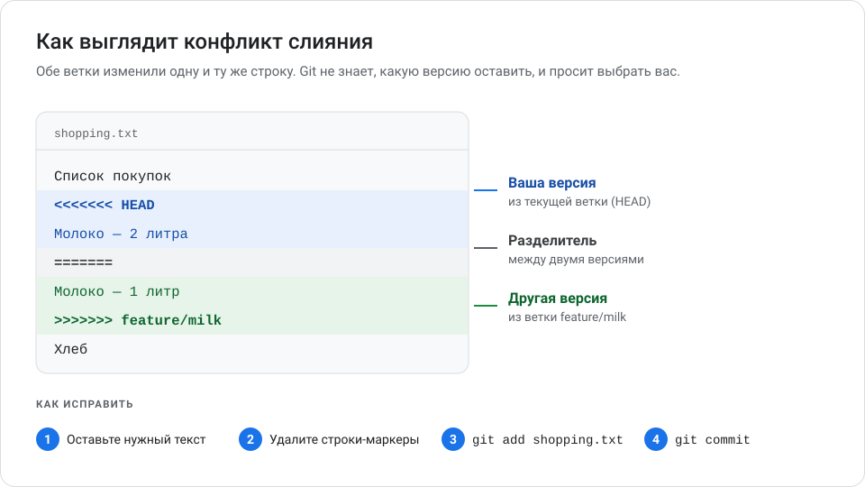
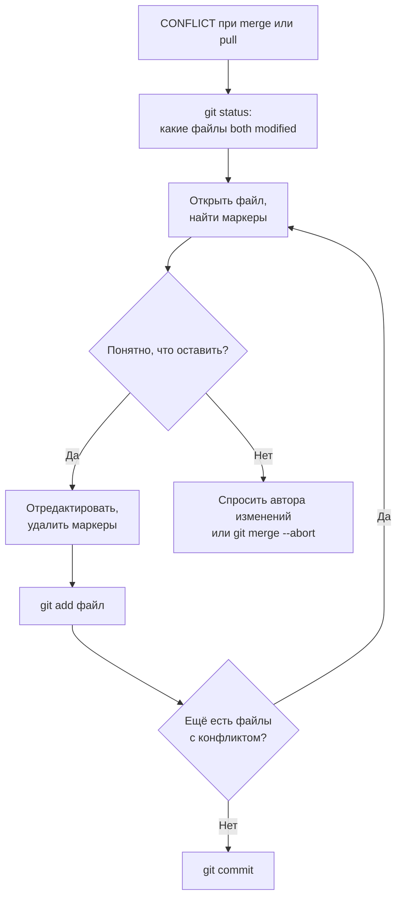
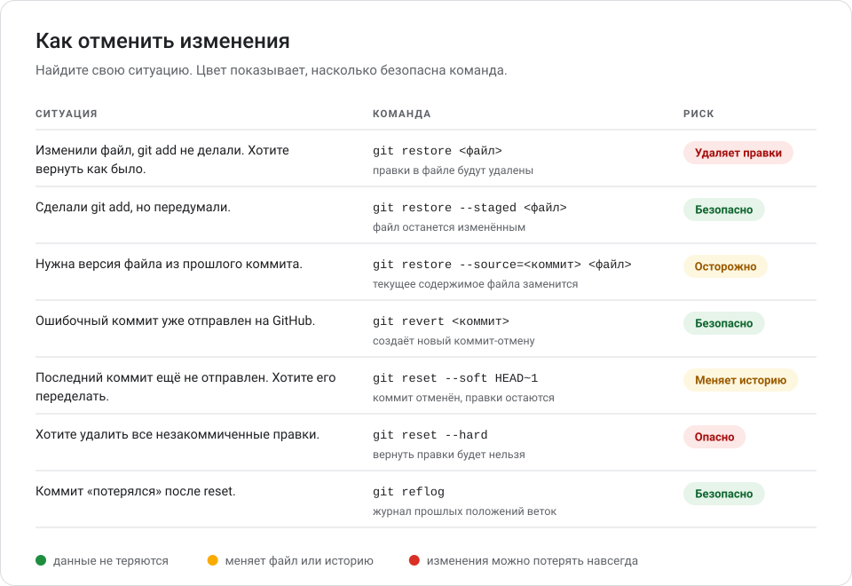
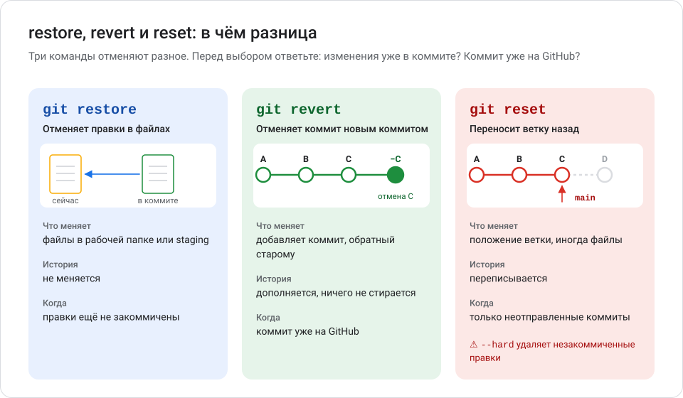
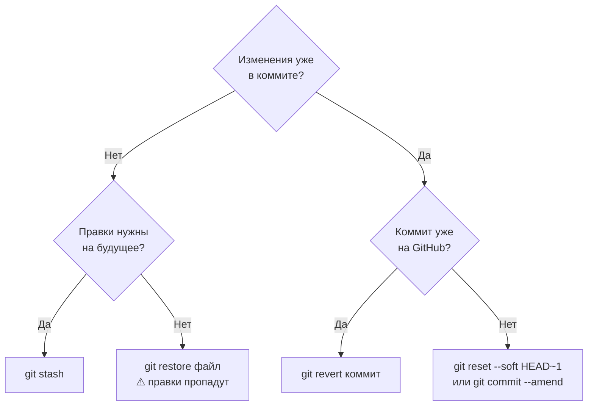
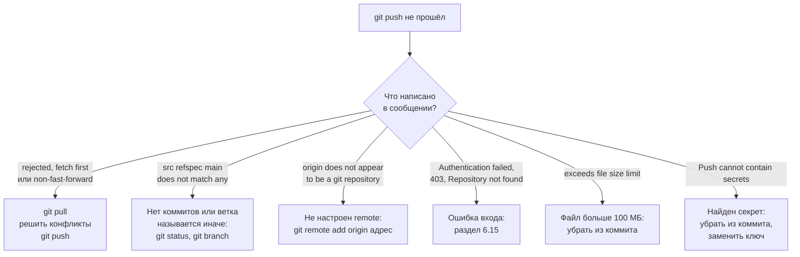
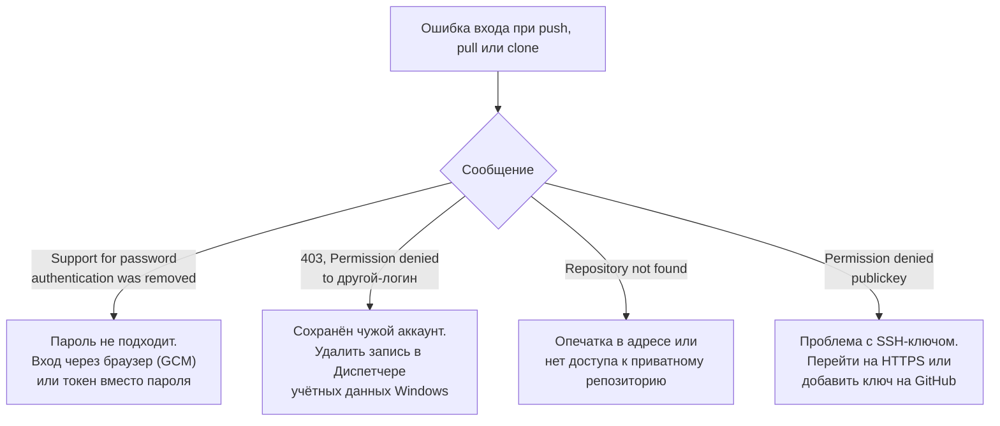

# Глава 6. Конфликты, восстановление и типичные ошибки

Ошибаются все. Хорошая новость: Git почти всегда позволяет вернуться назад — если знать, какую команду выбрать. В этой главе вы научитесь решать конфликты, отменять изменения, защищать секреты и разбираться в сообщениях об ошибках.

**Вы научитесь:**

- находить и исправлять конфликты слияния;
- отменять изменения до и после коммита;
- восстанавливать старые версии файлов;
- выбирать между `git restore`, `git revert` и `git reset`;
- не допускать утечки паролей и ключей;
- понимать сообщения терминала и исправлять частые ошибки.

**Время:** 2 часа. **Понадобится:** учебный репозиторий из глав 3–5.

> [!IMPORTANT]
> В этой главе есть команды, которые **удаляют изменения без возможности восстановления** или **переписывают историю**. Они отмечены предупреждениями. Перед такими командами всегда выполняйте `git status` и думайте, что именно пропадёт.

<!-- toc -->
**Содержание главы**

- [6.1. Что такое конфликт слияния](#61-что-такое-конфликт-слияния)
- [6.2. Как найти и исправить конфликт](#62-как-найти-и-исправить-конфликт)
- [6.3. Отменить незакоммиченные изменения](#63-отменить-незакоммиченные-изменения)
- [6.4. Убрать файл из staging](#64-убрать-файл-из-staging)
- [6.5. Исправить последний коммит](#65-исправить-последний-коммит)
- [6.6. Отменить коммит безопасно — git revert](#66-отменить-коммит-безопасно--git-revert)
- [6.7. Восстановить предыдущую версию файла](#67-восстановить-предыдущую-версию-файла)
- [6.8. git reset — перемотать историю назад](#68-git-reset--перемотать-историю-назад)
- [6.9. restore, revert и reset: в чём разница](#69-restore-revert-и-reset-в-чём-разница)
- [6.10. Спасательный круг: git reflog](#610-спасательный-круг-git-reflog)
- [6.11. Почему нельзя хранить секреты в репозитории](#611-почему-нельзя-хранить-секреты-в-репозитории)
- [6.12. .gitignore: что не должно попасть в Git](#612-gitignore-что-не-должно-попасть-в-git)
- [6.13. Публичные и приватные репозитории: правила безопасности](#613-публичные-и-приватные-репозитории-правила-безопасности)
- [6.14. Если push не проходит](#614-если-push-не-проходит)
- [6.15. Ошибки авторизации](#615-ошибки-авторизации)
- [6.16. Как читать сообщения терминала](#616-как-читать-сообщения-терминала)
- [6.17. Ошибка → причина → решение](#617-ошибка--причина--решение)
- [Проверьте себя](#проверьте-себя)
- [Что дальше](#что-дальше)
<!-- /toc -->

## 6.1. Что такое конфликт слияния

> **Конфликт слияния** (*merge conflict*) — ситуация, когда Git не может сам объединить изменения, потому что обе ветки по-разному изменили одно и то же место в файле.

Почему он возникает. Вы в ветке `main` написали «Молоко — 2 литра», а коллега в ветке `feature/milk` в той же строке — «Молоко — 1 литр». Обе правки разумны, и Git не знает, какая правильная. Он останавливается и просит решить человека.

Конфликт — не ошибка и не поломка. Это нормальная часть совместной работы.

Когда конфликт **не** возникает:

- изменены разные файлы;
- изменены разные места одного файла;
- изменения совпадают.

Конфликт может появиться при `git merge`, `git pull`, `git revert` и других командах, которые объединяют изменения.

## 6.2. Как найти и исправить конфликт

**Шаг 1. Git сообщает о конфликте.**

```text
Auto-merging shopping.txt
CONFLICT (content): Merge conflict in shopping.txt
Automatic merge failed; fix conflicts and then commit the result.
```

Перевод: «Конфликт содержимого в `shopping.txt`. Автоматическое слияние не удалось: исправьте конфликты и сделайте коммит».

**Шаг 2. Найдите файлы с конфликтом.**

```powershell
git status
```

```text
On branch main
You have unmerged paths.
  (fix conflicts and run "git commit")
  (use "git merge --abort" to abort the merge)

Unmerged paths:
  (use "git add <file>..." to mark resolution)
	both modified:   shopping.txt
```

`both modified` — файл изменён в обеих ветках.

**Шаг 3. Откройте файл.** Git вставил в него обе версии и маркеры:



| Маркер | Значение |
| --- | --- |
| `<<<<<<< HEAD` | Начало вашей версии (текущая ветка) |
| `=======` | Граница между версиями |
| `>>>>>>> feature/milk` | Конец версии из сливаемой ветки |

**Шаг 4. Решите, что оставить.** Можно оставить одну версию, другую или объединить их. Удалите все три строки-маркера. Результат, например:

```text
Список покупок
Молоко — 2 литра
Хлеб
```

**Шаг 5. Отметьте конфликт решённым и завершите слияние.**

```powershell
git add shopping.txt
git commit --no-edit
```

`--no-edit` — взять стандартное сообщение коммита слияния. Можно написать своё: `git commit -m "Объединить ветку feature/milk"`.

**Шаг 6. Проверьте.** `git status` должен показать `nothing to commit, working tree clean`, а `git log --oneline --graph` — коммит слияния.



### Как передумать

Если запутались, отмените слияние — всё вернётся к состоянию до `git merge`:

```powershell
git merge --abort
```

### Подсказки

- **Ищите маркеры поиском.** В Блокноте: <kbd>Ctrl</kbd>+<kbd>F</kbd> → `<<<<<<<`. Маркеров не должно остаться ни в одном файле.
- **Редакторы кода помогают.** Visual Studio Code подсвечивает конфликты и показывает кнопки **Accept Current Change**, **Accept Incoming Change**, **Accept Both Changes**.
- **Проверьте результат.** После решения конфликта запустите программу или тесты: Git проверяет только текст, а не работоспособность.

### Конфликт в Pull Request на GitHub

Если в PR написано **This branch has conflicts that must be resolved**:

- **Простой конфликт** (изменены одни и те же строки текста) можно решить на сайте: **Resolve conflicts** → отредактировать файл → **Mark as resolved** → **Commit merge**.
- **Сложный конфликт** решают на компьютере: влейте `main` в свою ветку и отправьте результат.

```powershell
git switch feature/contacts
git pull origin main --no-rebase
# решить конфликты, как описано выше
git add <файлы>
git commit --no-edit
git push
```

PR обновится сам.

## 6.3. Отменить незакоммиченные изменения

Карта всех способов отмены:



### Вернуть файл к последней сохранённой версии — git restore

```powershell
git restore hello.txt
```

Файл станет таким, каким был в последнем коммите (точнее — в staging area, если вы делали `git add`).

> [!WARNING]
> `git restore <файл>` **безвозвратно удаляет** незакоммиченные правки в файле. Git их нигде не сохранял, поэтому `reflog` не поможет. Если правки могут пригодиться — используйте `git stash` (ниже).

Отменить правки во **всех** файлах:

```powershell
git restore .
```

`git restore .` возвращает файлы к версии из staging area: удаляются правки, которые вы ещё не добавили через `git add`. Чтобы сбросить и подготовленные правки — вернуть всё к последнему коммиту, — используйте `git restore --staged --worktree .`.

> [!CAUTION]
> Обе команды **безвозвратно удаляют** правки во всех отслеживаемых файлах папки. Перед запуском выполните `git status` и `git diff`, чтобы увидеть, что пропадёт.

### Отложить изменения — git stash

> **Stash** («тайник», «заначка») — временное хранилище для незакоммиченных изменений. Изменения убираются из рабочей папки, но не теряются.

```powershell
git stash -u
```

```text
Saved working directory and index state WIP on main: 7a1b353 Вторая версия
```

`-u` — отложить и новые (неотслеживаемые) файлы тоже. Рабочая папка станет чистой.

Посмотреть отложенное и вернуть его:

```powershell
git stash list
git stash pop
```

```text
stash@{0}: WIP on main: 7a1b353 Вторая версия
```

`git stash pop` возвращает изменения и удаляет запись из тайника. `git stash drop` удаляет запись без возврата — осторожно.

Когда пригодится stash: нужно срочно переключиться на другую ветку, а текущая работа не готова к коммиту; или AI внёс изменения, которые не хочется применять, но и выбрасывать жалко.

### Удалить новые неотслеживаемые файлы — git clean

`git restore` не трогает новые файлы, которые Git ещё не отслеживает. Для них есть `git clean`.

Сначала **всегда** пробный запуск:

```powershell
git clean -n
```

```text
Would remove tmp.log
```

`-n` (*dry run*) — только показать, что будет удалено. Если список правильный:

```powershell
git clean -f
```

> [!CAUTION]
> `git clean -f` удаляет файлы с диска **мимо Корзины**. Добавление `-d` удаляет и папки, `-x` — даже файлы из `.gitignore` (например, `.env` с вашими настройками). Никогда не запускайте `git clean` без предварительного `git clean -n`.

## 6.4. Убрать файл из staging

Вы сделали `git add`, но передумали включать файл в коммит:

```powershell
git restore --staged secret.txt
```

Это **безопасно**: файл и правки в нём остаются, просто не войдут в коммит. После этого добавьте файл в `.gitignore`, если он не должен попадать в Git.

В новом репозитории, где ещё нет ни одного коммита, `git restore --staged` завершится ошибкой `fatal: could not resolve 'HEAD'`. В этом случае используйте `git rm --cached <файл>` — эту команду и подсказывает `git status`.

## 6.5. Исправить последний коммит

Забыли файл или опечатались в сообщении последнего коммита:

```powershell
git add forgotten.txt
git commit --amend -m "Исправленное сообщение"
```

`--amend` заменяет последний коммит новым: с добавленными файлами и новым сообщением. Чтобы оставить старое сообщение — `git commit --amend --no-edit`.

> [!WARNING]
> `--amend` создаёт новый коммит с новым хешем — то есть **переписывает историю**. Используйте только для коммита, который ещё **не отправлен** на GitHub. Если коммит уже отправлен, сделайте обычный новый коммит с исправлением.

## 6.6. Отменить коммит безопасно — git revert

> **git revert** создаёт новый коммит, который делает обратное указанному: удаляет добавленные строки и возвращает удалённые. Старый коммит остаётся в истории.

Это главный способ отменить коммит, который **уже на GitHub** или в общей ветке: никто не теряет историю.

**Шаг 1. Найдите хеш коммита.**

```powershell
git log --oneline
```

```text
7a1b353 (HEAD -> main) Вторая версия
f271226 Первая версия
```

**Шаг 2. Отмените коммит.**

```powershell
git revert --no-edit 7a1b353
```

```text
[main d36110f] Revert "Вторая версия"
 1 file changed, 1 deletion(-)
```

Без `--no-edit` Git откроет редактор с сообщением `Revert "Вторая версия"` — сохраните и закройте его.

**Шаг 3. Проверьте и отправьте.**

```powershell
git log --oneline
git push
```

```text
d36110f (HEAD -> main) Revert "Вторая версия"
7a1b353 Вторая версия
f271226 Первая версия
```

Отменить последний коммит можно короче: `git revert --no-edit HEAD`.

Если `revert` вызвал конфликт (более поздние коммиты меняли те же строки), решите его как в разделе 6.2 и завершите командой `git revert --continue`. Передумать — `git revert --abort`.

## 6.7. Восстановить предыдущую версию файла

**Шаг 1. Найдите коммит с нужной версией.** История только этого файла:

```powershell
git log --oneline -- hello.txt
```

**Шаг 2. Посмотрите, как файл выглядел тогда** (ничего не меняя):

```powershell
git show f271226:hello.txt
```

**Шаг 3. Восстановите файл из этого коммита.**

```powershell
git restore --source=f271226 hello.txt
```

Файл в рабочей папке станет таким, каким был в коммите `f271226`. Остальные файлы и история не меняются.

> [!WARNING]
> Текущее содержимое файла будет заменено. Если в нём есть незакоммиченные правки — они пропадут. Сначала закоммитьте или отложите их (`git stash`).

**Шаг 4. Сохраните восстановленную версию** как новый коммит:

```powershell
git add hello.txt
git commit -m "Вернуть hello.txt к версии f271226"
```

Посмотреть весь проект на момент старого коммита, ничего не меняя, можно так: `git switch --detach f271226`. Вернуться — `git switch main`.

> **Detached HEAD** («отсоединённый HEAD») — состояние, когда вы смотрите на конкретный коммит, а не на ветку. Коммиты в этом состоянии легко потерять. Если хотите что-то поменять, создайте ветку: `git switch -c имя-ветки`.

## 6.8. git reset — перемотать историю назад

> **git reset** передвигает текущую ветку на другой коммит. Коммиты «после» него перестают быть частью ветки.

У команды три режима. Они различаются тем, что происходит с изменениями из «отменённых» коммитов:

| Режим | Ветка | Staging area | Файлы в папке | Риск |
| --- | --- | --- | --- | --- |
| `--soft` | Переносится | Изменения остаются подготовленными | Не меняются | Меняет историю |
| `--mixed` (по умолчанию) | Переносится | Сбрасывается к выбранному коммиту | Не меняются | Меняет историю |
| `--hard` | Переносится | Сбрасывается к выбранному коммиту | **Перезаписываются** | **Удаляет правки** |

### Безопасный сценарий: переделать последний неотправленный коммит

```powershell
git reset --soft HEAD~1
```

`HEAD~1` — «на один коммит назад от текущего». Последний коммит отменён, а все его изменения остались подготовленными. Теперь можно поправить файлы и закоммитить заново.

### Опасный сценарий: выбросить всё до последнего коммита

```powershell
git reset --hard
```

> [!CAUTION]
> `git reset --hard` **безвозвратно удаляет** все незакоммиченные правки в отслеживаемых файлах. `git reset --hard HEAD~3` вдобавок убирает из ветки три последних коммита. Закоммиченное можно спасти через `reflog` (раздел 6.10), незакоммиченное — нельзя.

### Когда reset использовать нельзя

- **Коммиты уже на GitHub.** После `reset` ваша история разойдётся с GitHub, и обычный `git push` не пройдёт. Пришлось бы делать `git push --force`, который сотрёт эти коммиты у всех. Используйте `git revert`.
- **Общая ветка** (`main` в команде). Коллеги уже получили эти коммиты.
- **Вы не уверены, что делаете.** Начните с `git stash` или `git revert`.

### Страховка перед reset

Перед любой рискованной операцией создайте ветку-закладку — это бесплатно и мгновенно:

```powershell
git branch backup-before-reset
git reset --hard HEAD~2   # ⚠ убирает два коммита из ветки и удаляет незакоммиченные правки
```

Если что-то пошло не так: `git reset --hard backup-before-reset` вернёт всё как было. Когда закладка больше не нужна — `git branch -D backup-before-reset`.

### Про git push --force

> [!CAUTION]
> `git push --force` заменяет историю на GitHub вашей локальной. Всё, чего нет у вас, будет удалено с GitHub, а у коллег возникнут проблемы. Если без принудительной отправки своей ветки не обойтись, используйте более осторожный вариант `git push --force-with-lease`: он откажет, если на GitHub появились коммиты, которых вы не видели. Никогда не применяйте force к общей ветке без договорённости с командой. Очистка секрета из истории — особый случай со своей процедурой ([глава 11, раздел 11.8](11_bezopasnost_i_avtomatizatsiya.md#118-если-секрет-попал-в-историю)).

## 6.9. restore, revert и reset: в чём разница



| | `git restore` | `git revert` | `git reset` |
| --- | --- | --- | --- |
| Что отменяет | Правки в файлах | Целый коммит | Один или несколько коммитов |
| Как | Перезаписывает файл версией из staging или коммита | Создаёт новый коммит-отмену | Передвигает ветку назад |
| История | Не меняется | Дополняется | Переписывается |
| Безопасно для отправленных коммитов | Не относится к коммитам | **Да** | **Нет** |
| Может удалить правки навсегда | Да (незакоммиченные) | Нет | Да (в режиме `--hard`) |
| Типичный случай | «Испортил файл, верните как было» | «Коммит на GitHub оказался ошибочным» | «Последний коммит ещё у меня, хочу переделать» |

Правило выбора:



## 6.10. Спасательный круг: git reflog

> **Reflog** (*reference log*, журнал ссылок) — локальный журнал, куда Git записывает каждое перемещение `HEAD`: коммиты, переключения веток, `reset`, слияния.

Если после `git reset --hard` или удаления ветки «пропали» коммиты, скорее всего, они ещё существуют — на них просто ничего не указывает.

```powershell
git reflog
```

```text
f271226 (HEAD -> main) HEAD@{0}: reset: moving to HEAD~2
d36110f HEAD@{1}: revert: Revert "Вторая версия"
7a1b353 HEAD@{2}: commit: Вторая версия
f271226 (HEAD -> main) HEAD@{3}: commit (initial): Первая версия
```

Читать так: последнее действие — `reset` на два коммита назад; перед ним был коммит `d36110f`. Найдите строку с состоянием, которое нужно вернуть, и создайте на нём ветку:

```powershell
git branch restored d36110f
```

Или верните текущую ветку туда целиком: `git reset --hard d36110f` (осторожно: незакоммиченные правки пропадут).

Ограничения reflog:

- хранит только то, что **было закоммичено**. Незакоммиченные правки, удалённые `restore` или `reset --hard`, не восстановить;
- он **локальный**: только на вашем компьютере, на GitHub его нет, при новом `git clone` он пустой;
- записи устаревают: по умолчанию через 90 дней, а для недоступных коммитов — через 30 дней.

## 6.11. Почему нельзя хранить секреты в репозитории

> **Секрет** — любые данные, дающие доступ: пароли, API-ключи, токены, ключи SSH, строки подключения к базам данных, файлы `.env` с настройками.

> **API-ключ** — секретная строка, по которой сервис (оплата, почта, AI, карты) узнаёт вашу программу. Кто знает ключ, тот действует от вашего имени и за ваш счёт.

Почему секретам не место в Git:

- **История вечна.** Удалённый файл остаётся в старых коммитах. Его видит каждый, кто может открыть репозиторий.
- **Копии расходятся.** Клоны, форки, резервные копии и кэши сохраняют историю независимо от вас.
- **Публичные репозитории сканируют.** Автоматические программы, в том числе злоумышленников, ищут утёкшие ключи в публичных репозиториях.
- **Приватность временна.** Приватный репозиторий могут сделать публичным, к нему добавят новых людей, его могут скопировать.

Где хранить секреты вместо кода:

- **локально** — в файле `.env`, который внесён в `.gitignore`;
- **в GitHub Actions** — в разделе **Settings** → **Secrets and variables** → **Actions**;
- **в программе** — читать из переменных окружения, а не писать в код.

Подробно о работе с `.env` и о том, что делать при утечке, — в [главе 11](11_bezopasnost_i_avtomatizatsiya.md).

## 6.12. .gitignore: что не должно попасть в Git

> **`.gitignore`** — текстовый файл в корне репозитория со списком файлов и папок, которые Git должен игнорировать: не показывать в `git status` и не добавлять при `git add .`.

### Как создать

Если файла `.gitignore` ещё нет:

```powershell
New-Item .gitignore
notepad .gitignore
```

Если он уже есть (например, вы создали его в главе 4), просто откройте его: `notepad .gitignore`.

> [!TIP]
> Не создавайте `.gitignore` через «Создать → Текстовый документ» в Проводнике: Windows может назвать файл `.gitignore.txt`, и Git его не увидит. Команда `New-Item` создаёт файл с правильным именем.

### Синтаксис

| Строка | Что игнорируется |
| --- | --- |
| `.env` | Файл `.env` в любой папке |
| `*.log` | Все файлы с расширением `.log` |
| `build/` | Папка `build` целиком |
| `/config.local.json` | Только файл в корне репозитория |
| `!keep.log` | Исключение: этот файл **не** игнорировать |
| `# текст` | Комментарий |

### Пример для учебного проекта

```gitignore
# Секреты и локальные настройки
.env
.env.*
!.env.example
*.pem
*.key

# Служебные файлы Windows и macOS
Thumbs.db
desktop.ini
.DS_Store

# Редакторы
.vscode/
.idea/

# Логи и временные файлы
*.log
*.tmp

# Python
__pycache__/
.venv/

# Node.js
node_modules/
```

Готовые шаблоны для разных языков: [github.com/github/gitignore](https://github.com/github/gitignore) (например, `Python.gitignore`, `Node.gitignore`).

### Проверка

Почему файл игнорируется (или нет):

```powershell
git check-ignore -v .env
```

```text
.gitignore:2:.env	.env
```

Файл `.env` игнорируется из-за строки 2 файла `.gitignore`.

Показать игнорируемые файлы: `git status --ignored`.

### Если файл уже попал в Git

`.gitignore` действует только на файлы, которые Git **ещё не отслеживает**. Если файл уже закоммичен, добавление его в `.gitignore` ничего не изменит. Уберите файл из отслеживания, оставив его на диске:

```powershell
git rm --cached .env
git commit -m "Перестать отслеживать .env"
```

> [!WARNING]
> `git rm --cached` убирает файл из будущих коммитов, но **не из истории**. Если в файле был секрет, считайте его утёкшим: замените пароль или ключ ([глава 11](11_bezopasnost_i_avtomatizatsiya.md#118-если-секрет-попал-в-историю)).

## 6.13. Публичные и приватные репозитории: правила безопасности

- Перед первым коммитом проверяйте `git status` и `git diff --staged`, а перед первым `git push` в публичный репозиторий — `git log --stat`: какие файлы попадут на GitHub.
- Перед тем как сделать приватный репозиторий публичным, проверьте **всю историю**, а не только текущие файлы.
- Не публикуйте личные данные: паспорта, адреса, телефоны, переписку, базы клиентов.
- Не добавляйте в участники приватного репозитория (*collaborators*) тех, кому не нужен доступ. Убирайте доступ, когда человек больше не работает над проектом.
- Включите двухфакторную аутентификацию в аккаунте GitHub.
- Помните: приватный репозиторий защищает от посторонних глаз, но не от утечки через ваш компьютер, токены и людей с доступом.

## 6.14. Если push не проходит



| Сообщение | Причина | Решение |
| --- | --- | --- |
| `! [rejected] main -> main (fetch first)` | На GitHub есть коммиты, которых нет у вас | `git pull`, при конфликте — раздел 6.2, затем `git push` |
| `! [rejected] main -> main (non-fast-forward)` | Ваша ветка и GitHub разошлись | То же: `git pull`, затем `git push` |
| `error: src refspec main does not match any` | Нет коммитов или ветка не `main` | `git status`; сделайте коммит; `git branch -M main` |
| `fatal: No configured push destination` | Нет удалённого репозитория | `git remote add origin <адрес>` |
| `fatal: 'origin' does not appear to be a git repository` | Нет remote с именем `origin` | `git remote -v`; `git remote add origin <адрес>` |
| `fatal: The current branch feature has no upstream branch` | Новая ветка ещё не связана с GitHub | `git push -u origin <ветка>` |
| `remote: error: File big.zip is 120.00 MB; this exceeds GitHub's file size limit of 100.00 MB` | Файл больше 100 МБ | Уберите файл из коммита и добавьте в `.gitignore`; для больших файлов существует Git LFS |
| `remote: error: GH013: Repository rule violations found` и `Push cannot contain secrets` | Сработала защита от секретов (*push protection*) | Уберите секрет из коммитов, замените ключ ([глава 11](11_bezopasnost_i_avtomatizatsiya.md)) |

> [!TIP]
> Большой файл, попавший в последний **неотправленный** коммит, убирают так: `git rm --cached big.zip`, добавить `big.zip` в `.gitignore`, затем `git commit --amend --no-edit`. Если файл в более ранних коммитах — понадобится переписать историю (глава 11).

## 6.15. Ошибки авторизации



| Сообщение | Причина | Решение |
| --- | --- | --- |
| `remote: Support for password authentication was removed on August 13, 2021.` | Ввели пароль от аккаунта | Войдите через браузер (Git Credential Manager) или используйте токен вместо пароля ([глава 4](04_rabota_s_github.md#48-вход-в-github-из-терминала)) |
| `fatal: Authentication failed for 'https://github.com/...'` | Неверный или просроченный токен | Создайте новый токен; удалите старую запись входа (см. ниже) |
| `remote: Permission to ivan-petrov/my-site.git denied to other-user.` и `The requested URL returned error: 403` | Git вошёл под другим аккаунтом | Удалите сохранённую запись и войдите заново (см. ниже) |
| `remote: Repository not found.` | Опечатка в адресе, или репозиторий приватный, а у аккаунта нет доступа | Проверьте адрес (`git remote -v`); попросите владельца добавить вас в участники репозитория (*collaborators*) |
| `git@github.com: Permission denied (publickey).` | SSH-ключ не добавлен на GitHub или не загружен | Используйте HTTPS-адрес (`git remote set-url origin https://...`) или настройте SSH по документации GitHub |

### Как удалить сохранённый вход в Windows

1. <kbd>Win</kbd> → наберите **Диспетчер учётных данных** → <kbd>Enter</kbd>.
2. Выберите **Учётные данные Windows**.
3. Найдите запись `git:https://github.com` → **Удалить**.
4. Повторите `git push` — Git Credential Manager снова предложит войти.

## 6.16. Как читать сообщения терминала

Сообщения Git на английском, но устроены по одному образцу. Первое слово строки подсказывает, насколько всё серьёзно:

| Начало строки | Значение | Что делать |
| --- | --- | --- |
| `hint:` | Подсказка | Прочитать: часто там готовое решение |
| `warning:` | Предупреждение, команда выполнена | Обычно можно продолжать, но стоит понять причину |
| `error:` | Ошибка, часть действия не выполнена | Прочитать и исправить |
| `fatal:` | Критическая ошибка, команда не выполнена совсем | Исправить причину и повторить команду |
| `remote:` | Сообщение от сервера (GitHub) | Прочитать: там бывают ссылки и причина отказа |
| `CONFLICT` | Конфликт слияния | Раздел 6.2 |

Как разбираться:

1. **Читайте снизу вверх.** Последние строки обычно самые важные.
2. **Ищите `fatal:` и `error:`** — это причина. Строки `hint:` — подсказка, как исправить.
3. **Переводите ключевые слова:** `rejected` — отклонено, `not found` — не найдено, `denied` — запрещено, `already exists` — уже существует, `conflict` — конфликт, `untracked` — не отслеживается, `unmerged` — не слито, `upstream` — связанная ветка на сервере.
4. **Выполните `git status`.** Он почти всегда подсказывает следующий шаг.
5. **Ищите точный текст ошибки** в документации или поисковике. Можно спросить AI-ассистента, но не вставляйте в запрос пароли и токены.

## 6.17. Ошибка → причина → решение

| Ошибка или ситуация | Причина | Решение |
| --- | --- | --- |
| `fatal: not a git repository` | Вы не в папке репозитория | `cd` в папку проекта или `git init` |
| `Author identity unknown` | Не указаны имя и почта | `git config --global user.name ...`, `user.email ...` |
| `nothing added to commit but untracked files present` | Файлы не добавлены в staging | `git add <файл>` |
| `nothing to commit, working tree clean` | Нечего коммитить — всё сохранено | Ничего делать не нужно |
| `fatal: pathspec 'x' did not match any files` | Опечатка в имени файла | Проверьте имя, используйте <kbd>Tab</kbd> |
| `error: Your local changes ... would be overwritten` | Незакоммиченные правки мешают переключению или pull | Закоммитьте или `git stash` |
| `CONFLICT (content): Merge conflict in ...` | Обе ветки изменили одни строки | Раздел 6.2 |
| `fatal: refusing to merge unrelated histories` | Две независимые истории (обычно README на GitHub) | [Глава 4, раздел 4.12](04_rabota_s_github.md#412-если-на-github-уже-есть-readmemd) |
| `fatal: Need to specify how to reconcile divergent branches` | Не настроен способ `git pull` | `git config --global pull.rebase false`, повторить `git pull` |
| `error: remote origin already exists` | `origin` уже настроен | `git remote -v`; при ошибке в адресе — `git remote set-url origin <адрес>` |
| `error: the branch 'x' is not fully merged` | Удаляете неслитую ветку | Сначала `git merge`, или `git branch -D` — если работа не нужна |
| `fatal: destination path 'x' already exists` | Папка для `git clone` уже есть | Клонируйте в другую папку |
| `warning: ... LF will be replaced by CRLF` | Git приводит концы строк к формату Windows | Ничего делать не нужно |
| Терминал «завис», внизу `:` или `(END)` | Открыт постраничный просмотр | Нажмите <kbd>Q</kbd> |
| Открылся Vim | Не настроен редактор | <kbd>Esc</kbd>, `:wq`, <kbd>Enter</kbd>; затем `git config --global core.editor notepad` |
| `Aborting commit due to empty commit message` | Пустое сообщение коммита | `git commit -m "сообщение"` |
| `You are in 'detached HEAD' state` | Вы переключились на коммит, а не на ветку | `git switch main` или `git switch -c новая-ветка` |
| Русские имена файлов как `\320\277...` | Не настроен вывод путей | `git config --global core.quotepath false` |
| `fatal: unable to access ...: Could not resolve host: github.com` | Нет интернета или проблема с DNS/прокси | Проверьте подключение к интернету |
| Ошибки push и авторизации | — | Разделы 6.14 и 6.15 |

## Проверьте себя

Выполните в учебном репозитории `git-practice`:

1. Испортите `hello.txt` (удалите все строки) и верните его командой `git restore`.
2. Сделайте коммит «Тестовая правка», затем отмените его через `git revert`. Сколько коммитов добавилось?
3. Создайте ветку `conflict-test`, измените в ней первую строку `hello.txt` и закоммитьте. В `main` измените ту же строку иначе и закоммитьте. Влейте ветку и решите конфликт.
4. Создайте файл `.env` со строкой `API_KEY=test`. Добавьте его в `.gitignore`. Что покажет `git status`?

<details>
<summary>Ожидаемый результат</summary>

1. После `git restore hello.txt` файл снова содержит все строки, `git status` — `working tree clean`.
2. Два: «Тестовая правка» и `Revert "Тестовая правка"`. Исходный коммит остался в истории.
3. `git merge conflict-test` выводит `CONFLICT (content): Merge conflict in hello.txt`. После правки файла: `git add hello.txt`, `git commit --no-edit`. `git log --oneline --graph` показывает коммит слияния.
4. `.env` не появляется в списке, виден только изменённый `.gitignore`. `git check-ignore -v .env` подтверждает, что файл игнорируется.

</details>

## Что дальше

В [главе 7](07_git_s_claude_code.md) вы примените всё изученное к работе с AI-ассистентом Claude Code.
