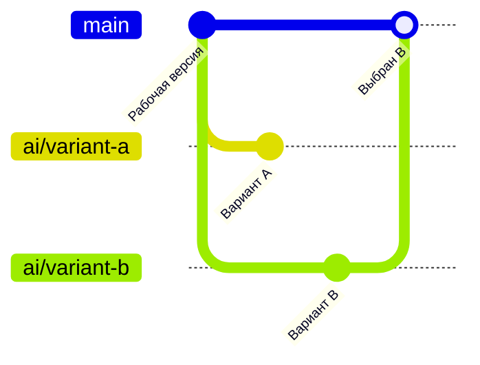
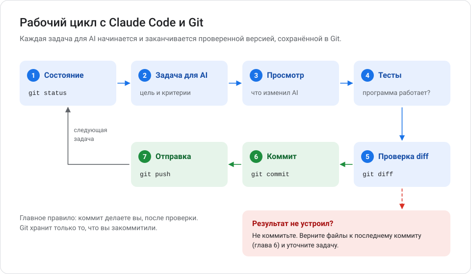
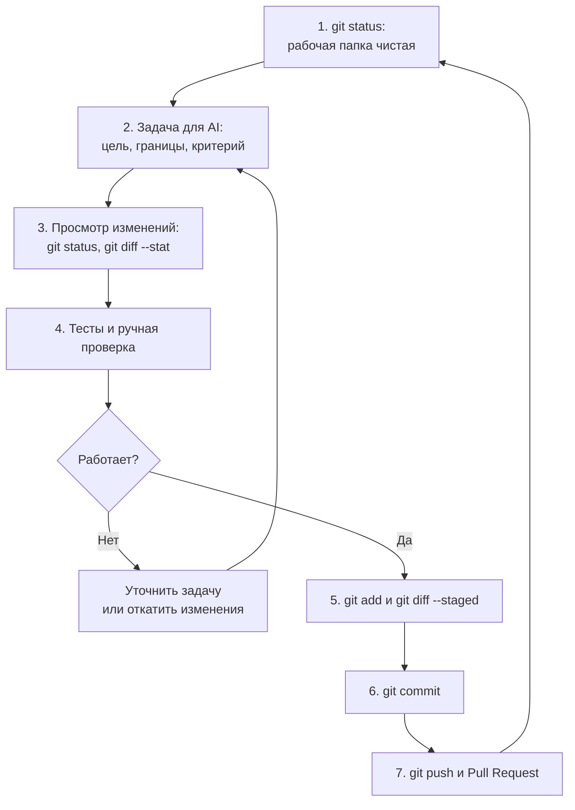

# Глава 7. Git и Claude Code

AI-ассистенты пишут код быстро — и так же быстро могут его сломать. Git превращает работу с AI в безопасный процесс: каждое изменение можно просмотреть, проверить, сохранить или отменить. В этой главе — рабочий цикл с Claude Code и правила оформления проектов, которые создаются с помощью AI.

**Вы научитесь:**

- готовить репозиторий перед работой с AI;
- создавать контрольные точки и ветки для экспериментов;
- просматривать и проверять изменения, сделанные AI;
- возвращаться к рабочей версии;
- оформлять AI-проекты: `CLAUDE.md`, документация, тесты, проверка зависимостей и лицензий.

**Время:** 1,5 часа. **Понадобится:** главы 3–6, подписка Claude с доступом к Claude Code.

<!-- toc -->
**Содержание главы**

- [7.1. Что такое Claude Code](#71-что-такое-claude-code)
- [7.2. Открыть существующий проект](#72-открыть-существующий-проект)
- [7.3. Проверить состояние Git перед работой с AI](#73-проверить-состояние-git-перед-работой-с-ai)
- [7.4. Создать контрольную точку](#74-создать-контрольную-точку)
- [7.5. Поставить задачу AI](#75-поставить-задачу-ai)
- [7.6. Просмотреть изменения, сделанные AI](#76-просмотреть-изменения-сделанные-ai)
- [7.7. Запустить тесты](#77-запустить-тесты)
- [7.8. Проверить diff перед коммитом](#78-проверить-diff-перед-коммитом)
- [7.9. Сохранить работающую версию](#79-сохранить-работающую-версию)
- [7.10. Вернуться к предыдущему состоянию](#710-вернуться-к-предыдущему-состоянию)
- [7.11. Ветки для экспериментов с AI](#711-ветки-для-экспериментов-с-ai)
- [7.12. Как не потерять код](#712-как-не-потерять-код)
- [7.13. Рекомендуемый рабочий цикл](#713-рекомендуемый-рабочий-цикл)
- [7.14. Профессиональное оформление проектов с AI](#714-профессиональное-оформление-проектов-с-ai)
- [7.15. Пример структуры проекта для разработки с AI](#715-пример-структуры-проекта-для-разработки-с-ai)
- [Проверьте себя](#проверьте-себя)
- [Что дальше](#что-дальше)
<!-- /toc -->

## 7.1. Что такое Claude Code

> **Claude Code** — AI-ассистент для программирования от Anthropic. Он читает файлы проекта, предлагает и вносит изменения, запускает команды и тесты. Работает в терминале, в приложении Claude для компьютера (вкладка **Code**) и в расширениях для редакторов VS Code и JetBrains.

Что важно знать до начала:

- **Нужна учётная запись.** Claude Code доступен в платных планах Claude (Pro, Max, Team, Enterprise) или через аккаунт Claude Console. В бесплатном плане его нет.
- **Claude Code меняет настоящие файлы** на вашем компьютере. Поэтому Git здесь не дополнение, а основа безопасности.
- **Действия требуют разрешения или проверки.** В Claude Code есть режимы разрешений: в ручном режиме (*default*) он спрашивает перед изменением файлов и запуском команд; в режиме *acceptEdits* правит файлы сам; в режиме планирования (*plan*) только исследует и предлагает план; в режиме *auto* действия проверяет встроенный классификатор. Текущий режим виден в интерфейсе, переключение в терминале — <kbd>Shift</kbd>+<kbd>Tab</kbd>.

### Установка на Windows

Рекомендуемый способ — официальный установщик. В PowerShell:

```powershell
irm https://claude.ai/install.ps1 | iex
```

- `irm` (*Invoke-RestMethod*) скачивает скрипт установки с сайта Anthropic;
- `| iex` (*Invoke-Expression*) выполняет его.

> [!IMPORTANT]
> Команда вида «скачать и выполнить» запускает код из интернета. Выполняйте её, только если адрес точно официальный и совпадает с документацией: [Claude Code — Set up](https://code.claude.com/docs/en/setup).

Другие способы: `winget install --id Anthropic.ClaudeCode -e --source winget` или `npm install -g @anthropic-ai/claude-code` (нужен Node.js 22+). Проверка — в новом окне терминала:

```powershell
claude --version
```

Git для Windows рекомендуется: если он установлен, Claude Code использует Git Bash для выполнения команд.

## 7.2. Открыть существующий проект

```powershell
cd ~\projects\my-site
claude
```

Claude Code начнёт сессию в текущей папке и будет работать с её файлами. В приложении Claude: вкладка **Code** → выберите папку проекта.

> [!TIP]
> Запускайте Claude Code в **корневой папке репозитория** — там, где лежит папка `.git`. Не запускайте его в домашней папке или на диске `C:\` целиком.

## 7.3. Проверить состояние Git перед работой с AI

Перед каждой задачей убедитесь, что точка старта сохранена.

```powershell
git status
git log --oneline -3
git branch
```

Что должно быть:

| Проверка | Ожидание | Если не так |
| --- | --- | --- |
| `git status` | `nothing to commit, working tree clean` | Закоммитьте текущую работу или отложите её (`git stash -u`) |
| `git log` | Последний коммит — рабочая версия | Сначала доведите проект до рабочего состояния |
| `git branch` | Вы в нужной ветке | `git switch <ветка>` |

Почему чистая рабочая папка так важна: после задачи `git diff` покажет **только** изменения AI. Если перед этим были ваши незакоммиченные правки, они смешаются с правками AI, и откатить одно без другого будет трудно.

## 7.4. Создать контрольную точку

> **Контрольная точка** — сохранённое состояние, к которому можно вернуться. В Git это коммит, ветка или тег (постоянная метка на коммите, подробнее — в [главе 9](09_standarty_i_oformlenie_proektov.md#95-версионирование-semver-теги-и-релизы)).

Перед крупной задачей (новая функция, рефакторинг, обновление библиотек):

**1. Закоммитьте рабочую версию.**

```powershell
git add .
git commit -m "Рабочая версия перед добавлением формы обратной связи"
```

**2. Создайте ветку для задачи.**

```powershell
git switch -c ai/feedback-form
```

Префикс `ai/` — соглашение, а не правило: так видно, какие ветки — эксперименты с AI.

**3. (Необязательно) Отправьте ветку на GitHub** — так контрольная точка сохранится и вне компьютера:

```powershell
git push -u origin ai/feedback-form
```

> [!NOTE]
> У Claude Code есть собственные контрольные точки (*checkpoints*): двойное нажатие <kbd>Esc</kbd> или команда `/rewind` возвращают файлы к состоянию до определённого запроса. Но они отслеживают только правки, сделанные инструментами редактирования Claude. Изменения, сделанные командами в терминале (удаление, перемещение файлов) или вами вручную, туда не попадают, а сами точки хранятся ограниченное время. В документации прямо сказано, что это не замена системе контроля версий. Источник: [Checkpointing](https://code.claude.com/docs/en/checkpointing).

## 7.5. Поставить задачу AI

Хорошая задача снижает число ошибок и лишних изменений.

| Плохо | Хорошо |
| --- | --- |
| «Сделай форму» | «Добавь на страницу `contacts.html` форму обратной связи: имя, почта, сообщение. Не меняй другие страницы.» |
| «Исправь баг» | «При пустом поле „почта“ форма отправляется. Нужна проверка на клиенте. Добавь тест.» |
| «Улучши код» | «Вынеси повторяющийся код из `app.py` в функцию. Поведение не меняй. Тесты должны проходить.» |

Что включать в задачу:

- **цель** — что должно получиться;
- **границы** — какие файлы можно и нельзя трогать;
- **критерий готовности** — как проверить результат (тесты, ручная проверка);
- **ограничения** — без новых библиотек, без изменения структуры данных и т. п.

Для больших задач попросите сначала план: переключитесь в режим планирования (<kbd>Shift</kbd>+<kbd>Tab</kbd> до режима plan) или напишите «сначала покажи план, ничего не меняй».

## 7.6. Просмотреть изменения, сделанные AI

После того как Claude Code закончил:

```powershell
git status
```

Какие файлы изменены, добавлены, удалены. Неожиданные файлы — повод насторожиться.

```powershell
git diff --stat
```

Сколько строк изменено в каждом файле. Если в маленькой задаче изменены десятки файлов — что-то пошло не так.

```powershell
git diff
```

Построчные изменения. Читайте их целиком.

Где ещё смотреть изменения:

- команда `/diff` внутри Claude Code;
- расширение VS Code показывает изменения рядом с исходным текстом;
- в приложении Claude индикатор вида `+12 -1` открывает панель изменений.

Новые файлы `git diff` не показывает, пока они не добавлены в staging. Просмотрите их отдельно или выполните `git add -N <файл>` (*intent to add*), чтобы они появились в `git diff`.

**Чек-лист просмотра:**

- [ ] изменены только те файлы, о которых шла речь;
- [ ] нет удалённого кода, который был нужен;
- [ ] нет паролей, ключей и личных данных;
- [ ] нет новых библиотек, о которых вы не просили;
- [ ] понятна каждая изменённая строка — если нет, попросите Claude объяснить.

## 7.7. Запустить тесты

> **Тест** — небольшая программа, которая проверяет, что код работает как задумано. Например: «функция перевода 0 °C в Фаренгейты возвращает 32».

Запустите тесты проекта. Команда зависит от языка, например:

```powershell
python -m unittest discover -s tests   # Python
npm test                               # JavaScript / Node.js
```

Если тестов нет — проверьте работу вручную (откройте страницу, запустите программу) и попросите Claude добавить тесты.

Документация Claude Code советует давать ассистенту способ проверить свою работу: тесты, сборку, скриншот. С тестами AI сам находит и исправляет часть ошибок. Источник: [Best practices](https://code.claude.com/docs/en/best-practices).

## 7.8. Проверить diff перед коммитом

Подготовьте изменения и посмотрите финальную версию того, что войдёт в коммит:

```powershell
git add contacts.html tests/test_form.py
git diff --staged
```

Добавляйте файлы **по именам**, а не `git add .`, если в папке есть что-то, что вы не проверили.

## 7.9. Сохранить работающую версию

```powershell
git commit -m "Добавить форму обратной связи на страницу контактов"
git push
```

Claude Code умеет сам делать коммиты и открывать Pull Request (с установленным GitHub CLI `gh`), если попросить. По умолчанию он добавляет в коммит строку `Co-Authored-By` с указанием модели. Даже в этом случае **решение о коммите принимаете вы** — после просмотра diff и тестов.

Для командной работы отправьте ветку и откройте Pull Request ([глава 5](05_vetki_i_pull_requests.md)): второй человек и автоматические проверки посмотрят изменения до слияния в `main`.

## 7.10. Вернуться к предыдущему состоянию

| Ситуация | Что сделать |
| --- | --- |
| AI ещё работает и делает не то | Остановите его клавишей <kbd>Esc</kbd> |
| Нужно откатить последний шаг Claude | <kbd>Esc</kbd> <kbd>Esc</kbd> или `/rewind` (только правки инструментов Claude) |
| Изменения не закоммичены, хочу всё вернуть, но сохранить на всякий случай | `git stash -u` |
| Изменения не закоммичены, выбросить их совсем | `git restore --staged --worktree .`, затем `git clean -n` и `git clean -f` для новых файлов ⚠ |
| Неудачные изменения уже в коммите, коммит не отправлен | `git reset --soft HEAD~1` или `git revert` |
| Неудачный коммит уже на GitHub | `git revert <коммит>` |
| Весь эксперимент в ветке не удался | `git switch main`, затем `git branch -D ai/feedback-form` ⚠ |

Отметка ⚠ — команды, которые удаляют изменения безвозвратно ([глава 6](06_oshibki_i_vosstanovlenie.md)).

## 7.11. Ветки для экспериментов с AI

Ветка — самый простой способ дать AI свободу без риска:



- Попробуйте два подхода в двух ветках и оставьте лучший.
- Неудачную ветку просто удалите — `main` не пострадает.

Для параллельной работы нескольких сессий Claude Code есть **рабочие деревья** (*git worktrees*): отдельные папки с разными ветками одного репозитория. Claude Code создаёт их командой:

```powershell
claude --worktree feedback-form
```

Папки создаются внутри `.claude/worktrees/`. Добавьте эту папку в `.gitignore`. Источник: [Worktrees](https://code.claude.com/docs/en/worktrees).

## 7.12. Как не потерять код

**Правила:**

1. Начинайте каждую задачу с чистого `git status`.
2. Коммитьте каждую проверенную рабочую версию.
3. Экспериментируйте в отдельных ветках.
4. Регулярно отправляйте коммиты на GitHub.
5. Читайте diff перед каждым коммитом.
6. Не разрешайте AI выполнять команды, смысл которых вам непонятен: `git reset --hard`, `git push --force`, `git clean -fdx`, удаление папок.
7. Храните секреты вне репозитория и закройте их от чтения AI (раздел 7.14).

**Ограничения — о них важно помнить:**

- **Git защищает только закоммиченное.** Незакоммиченные правки, удалённые `git restore` или `reset --hard`, не восстановить.
- **Локальный репозиторий — не резервная копия.** Без `git push` история пропадёт вместе с диском.
- **Файлы из `.gitignore` не сохраняются в Git.** Тот же `.env` нужно хранить отдельно (например, в менеджере паролей).
- **GitHub — не единственная резервная копия.** Аккаунт можно потерять, репозиторий — удалить. Для важных проектов держите независимую копию.
- **Контрольные точки Claude Code временные** и не охватывают изменения, сделанные командами терминала.
- **Git не проверяет правильность кода.** Он сохранит и сломанную версию. Проверка — тесты, ревью и ваше внимание.

## 7.13. Рекомендуемый рабочий цикл





## 7.14. Профессиональное оформление проектов с AI

Проект, написанный с помощью AI, должен соответствовать тем же требованиям, что и любой другой: понятная структура, документация, тесты, лицензия, проверка зависимостей. AI ускоряет работу, но ответственность за результат остаётся на человеке.

### Начинайте с оформленного репозитория

До первой задачи для AI создайте:

1. `README.md` — что за проект и как его запустить ([глава 9](09_standarty_i_oformlenie_proektov.md)).
2. `.gitignore` — чтобы AI не закоммитил лишнего.
3. `LICENSE` — если проект будет публичным ([глава 10](10_litsenzii_i_avtorskie_prava.md)).
4. `CLAUDE.md` — инструкции для AI (ниже).
5. Папки `src/` и `tests/` и команду запуска тестов.

Так AI с первого запроса видит правила проекта и следует им.

### CLAUDE.md — инструкции для AI

> **CLAUDE.md** — файл с инструкциями, который Claude Code читает в начале каждой сессии. Туда пишут то, что AI не может понять из кода сам: команды сборки и тестов, правила оформления, договорённости команды.

Где хранить:

| Файл | Для чего | В Git |
| --- | --- | --- |
| `./CLAUDE.md` или `./.claude/CLAUDE.md` | Правила проекта для всей команды | **Да**, закоммитьте |
| `~/.claude/CLAUDE.md` | Ваши личные правила для всех проектов | Нет, это вне проекта |
| `./CLAUDE.local.md` | Ваши личные правила для этого проекта | **Нет** — добавьте в `.gitignore` сами |

Создать заготовку: команда `/init` в Claude Code проанализирует проект и предложит `CLAUDE.md`. Отредактируйте её вручную. Открыть файлы памяти — `/memory`.

Пример `CLAUDE.md` для учебного проекта на Python:

```markdown
# Инструкции для Claude Code

## Проект
Консольный конвертер температур. Код — в src/tempconv/, тесты — в tests/.

## Команды
- Тесты: python -m unittest discover -s tests -v
- Проверка стиля: ruff check .

## Правила
- Только стандартная библиотека Python. Новые зависимости — только после согласования.
- Каждое изменение поведения сопровождается тестом.
- После изменения поведения обнови README.md и раздел [Unreleased] в CHANGELOG.md.
- Не читай и не изменяй файлы .env и папку secrets/.
- Не делай коммиты и push без явной просьбы.
```

Советы из документации: держите файл коротким (до ~200 строк), проверяйте каждую строку вопросом «если её убрать, AI начнёт ошибаться?», не пишите то, что видно из кода. `CLAUDE.md` — это контекст, а не принуждение: для правил, которые должны выполняться всегда, используют настройки и хуки (*hooks* — команды, которые Claude Code запускает автоматически при определённых событиях, например форматирование после каждой правки файла). Источник: [Memory](https://code.claude.com/docs/en/memory).

Для других AI-инструментов есть похожие файлы (например, `AGENTS.md` или файлы правил конкретного редактора). Проверьте документацию своего инструмента.

### Закройте секреты от чтения

В файле `.claude/settings.json` (общий для проекта, его коммитят) можно запретить Claude Code читать секретные файлы:

```json
{
  "permissions": {
    "deny": [
      "Read(./.env)",
      "Read(./.env.*)",
      "Read(./secrets/**)"
    ]
  }
}
```

Личные настройки хранят в `.claude/settings.local.json`; Claude Code сам исключает его из Git, если создаёт этот файл. Такие запреты действуют на инструменты чтения файлов Claude Code; это дополнительная мера, а не замена `.gitignore` и аккуратности. Источник: [Settings](https://code.claude.com/docs/en/settings).

### Документируйте архитектуру

> **Архитектура** — как устроена программа: из каких частей она состоит и как они связаны.

- `docs/architecture.md` — короткое описание частей программы и схема (можно в Mermaid).
- `docs/adr/` — **записи архитектурных решений** (*Architecture Decision Records*, ADR): по одному файлу на важное решение. Формат: контекст → решение → последствия.

Пример ADR:

```markdown
# 0001. Хранить настройки в переменных окружения

Статус: принято
Дата: 2026-10-11

## Контекст
Программе нужен ключ API погодного сервиса. Ключ нельзя хранить в коде.

## Решение
Читать ключ из переменной окружения WEATHER_API_KEY. В репозитории — только .env.example.

## Последствия
Перед запуском нужно создать .env. Это описано в README.
```

Документация нужна и людям, и AI: в следующих сессиях Claude прочитает её и не будет «изобретать» архитектуру заново. Попросите: «Прочитай docs/architecture.md и следуй ему».

### Просите тесты и обновление документации

Добавляйте к задачам:

- «Добавь тесты на новое поведение и на граничные случаи (пустой ввод, отрицательные числа)».
- «Запусти тесты и покажи результат».
- «Обнови README.md, если изменились установка или использование».
- «Добавь запись в раздел [Unreleased] файла CHANGELOG.md».

Проверяйте сами тесты: AI может написать тест, который проверяет не то или проходит всегда.

### Проверяйте зависимости и лицензии

> **Зависимость** — чужая библиотека, которую использует ваш проект.

AI охотно добавляет библиотеки. Перед тем как принять новую зависимость:

1. **Нужна ли она?** Может, задачу решает стандартная библиотека.
2. **Существует ли она?** AI иногда придумывает несуществующие пакеты. Злоумышленники регистрируют пакеты с такими «придуманными» именами. Найдите пакет на официальном сайте реестра (pypi.org, npmjs.com) и в его репозитории.
3. **Поддерживается ли?** Дата последнего релиза, открытые проблемы, число пользователей.
4. **Какая лицензия?** Совместима ли она с вашей ([глава 10](10_litsenzii_i_avtorskie_prava.md)).
5. **Есть ли известные уязвимости?** `pip-audit` для Python, `npm audit` для Node.js, Dependabot на GitHub ([глава 11](11_bezopasnost_i_avtomatizatsiya.md)).

### Проверяйте происхождение кода

AI обучен на большом объёме кода и теоретически может воспроизвести фрагмент существующей программы. Правовой статус результатов работы AI зависит от страны и продолжает меняться ([глава 10](10_litsenzii_i_avtorskie_prava.md#108-код-созданный-с-помощью-ai)).

Практические правила:

- насторожитесь, если AI выдал большой готовый фрагмент с чужими комментариями, именами авторов или уведомлением о лицензии;
- если код явно взят из конкретного проекта — соблюдайте его лицензию или замените код;
- фиксируйте происхождение заимствованного кода в `THIRD_PARTY_NOTICES.md` ([глава 10](10_litsenzii_i_avtorskie_prava.md));
- соблюдайте правила работодателя и заказчика об использовании AI.

### Делайте осмысленные коммиты

- **Одна задача — один коммит** (или несколько логичных). Не сохраняйте результат двухчасовой сессии одним коммитом «изменения от AI».
- **Сообщение описывает результат,** а не процесс: «Добавить проверку почты в форме», а не «попросил Claude».
- По желанию используйте соглашение **Conventional Commits**: `feat: добавить форму обратной связи` ([глава 9](09_standarty_i_oformlenie_proektov.md#96-сообщения-коммитов-conventional-commits)).

### Проверяйте изменения перед слиянием

- Откройте Pull Request и прочитайте вкладку **Files changed** так, будто код написал незнакомый человек.
- Дождитесь автоматических проверок CI ([глава 11](11_bezopasnost_i_avtomatizatsiya.md)).
- Можно попросить Claude Code сделать ревью: команда `/code-review` ищет ошибки в изменениях ветки, `/security-review` — проблемы безопасности. Это помощь, а не замена вашей проверке.

### Почему AI-код нельзя считать автоматически правильным

- **Ошибки в логике.** Код выглядит убедительно, но считает неправильно в редких случаях.
- **Выдуманные функции и библиотеки.** Вызовы того, чего не существует, или устаревших версий.
- **Уязвимости.** Например, отсутствие проверки ввода или секреты в коде.
- **Лицензионные риски.** Фрагменты чужого кода без соблюдения лицензии.
- **Лишние изменения.** «Заодно улучшенные» файлы, о которых не просили.

Относитесь к коду от AI как к коду от нового коллеги: полезно, но обязательно проверять.

## 7.15. Пример структуры проекта для разработки с AI

```text
my-project/
├── README.md               # что это, как установить и запустить
├── LICENSE                 # лицензия
├── CHANGELOG.md            # журнал изменений
├── CLAUDE.md               # инструкции для AI: команды, правила
├── .gitignore              # .env, CLAUDE.local.md, .claude/worktrees/, кэши
├── .env.example            # образец настроек без секретов
├── .claude/
│   └── settings.json       # общие настройки Claude Code: запрет чтения .env
├── docs/
│   ├── architecture.md     # как устроена программа
│   └── adr/
│       └── 0001-config-from-env.md
├── src/                    # исходный код
├── tests/                  # тесты — главный способ проверить работу AI
└── .github/
    ├── workflows/ci.yml    # автоматические тесты на каждый PR
    └── pull_request_template.md
```

Работающий пример такого репозитория — в папке [examples/tempconv](examples/tempconv/).

## Проверьте себя

1. Почему перед задачей для AI рабочая папка должна быть чистой?
2. AI изменил 15 файлов, хотя вы просили поправить один. Ваши действия?
3. Чем контрольные точки Claude Code отличаются от коммитов Git?
4. Что написать в `CLAUDE.md`, а чего писать не нужно?
5. AI предложил установить пакет, о котором вы не слышали. Что проверить?

<details>
<summary>Ответы</summary>

1. Тогда `git diff` покажет только изменения AI, и их можно откатить, не задев вашу работу.
2. Не коммитить. Посмотреть `git diff --stat` и `git diff`, понять причину. Если изменения лишние — откатить: `git stash -u` (изменения сохранятся в тайнике) или `git restore --staged --worktree .` (⚠ удалит правки безвозвратно), — и поставить задачу точнее, с границами.
3. Контрольные точки отслеживают только правки инструментов Claude, хранятся ограниченное время и существуют только локально. Коммиты охватывают все изменения, хранятся постоянно и отправляются на GitHub.
4. Писать: команды сборки и тестов, правила, которые AI не выведет из кода. Не писать: то, что видно из кода, длинные описания, секреты.
5. Существует ли пакет в официальном реестре, нужен ли он, поддерживается ли, какая у него лицензия, есть ли известные уязвимости.

</details>

## Что дальше

В [главе 8](08_praktika_i_zadaniya.md) — упражнения и итоговые проекты, которые закрепят всё изученное.
