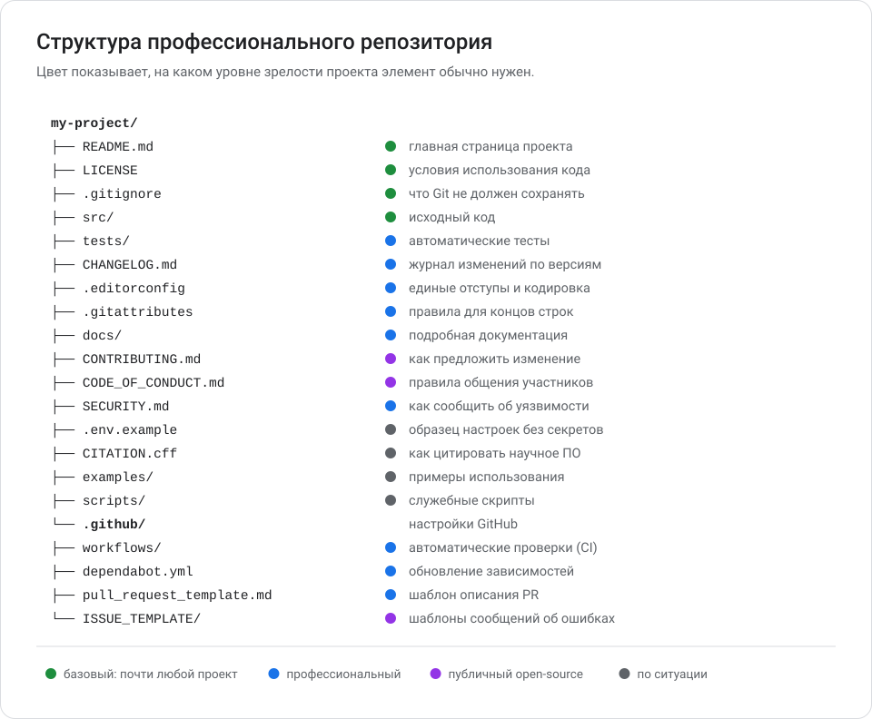
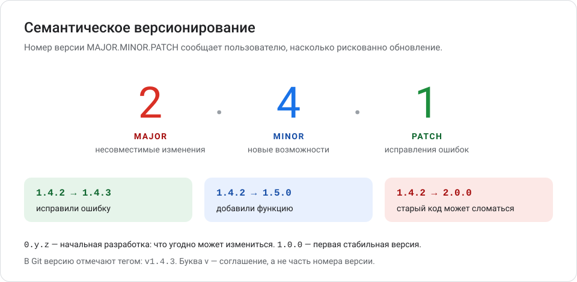
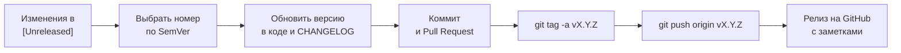
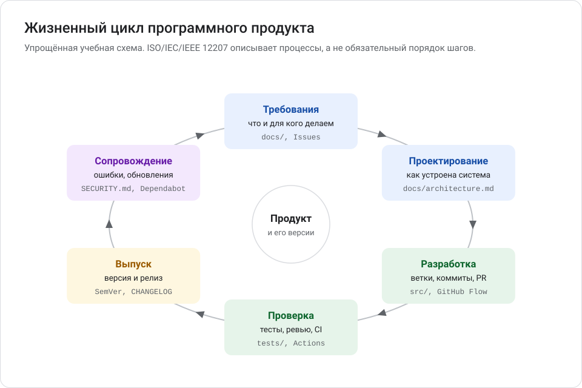
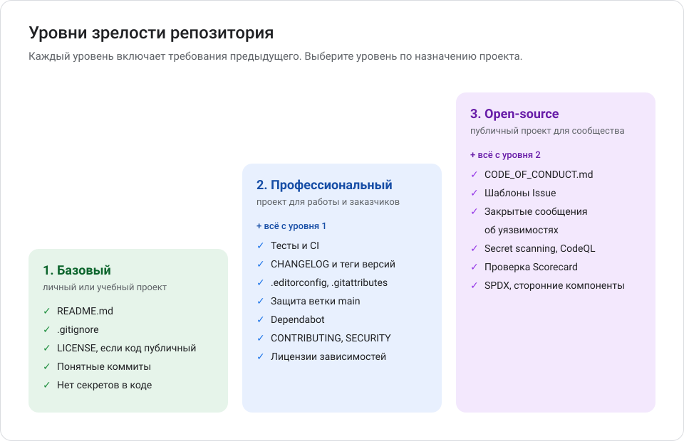

# Глава 9. Стандарты и оформление проектов

Глава открывает часть II методички «Как создавать, оформлять и публиковать программные проекты по международным практикам». Эта часть — о том, как превратить «папку с кодом» в проект, которым удобно пользоваться, который легко развивать и не страшно публиковать. В этой главе — структура репозитория, README, документы сопровождения, версионирование и обзор международных стандартов и инженерных практик.

**Вы научитесь:**

- отличать международные стандарты от практик сообщества, рекомендаций платформ и требований закона;
- выбирать структуру репозитория и нужные файлы;
- писать README, CONTRIBUTING, CODE_OF_CONDUCT, SECURITY и CHANGELOG;
- выпускать версии по Semantic Versioning с тегами и релизами;
- понимать, когда и как применять ISO/IEC-стандарты, SPDX, REUSE, OpenSSF Scorecard, SLSA и OWASP.

**Время:** 2–3 часа. **Понадобится:** главы 1–6 части I. Лицензиям посвящена [глава 10](10_litsenzii_i_avtorskie_prava.md), безопасности и автоматизации — [глава 11](11_bezopasnost_i_avtomatizatsiya.md).

<!-- toc -->
**Содержание главы**

- [9.1. Стандарты, практики и требования: как их различать](#91-стандарты-практики-и-требования-как-их-различать)
- [9.2. Структура профессионального репозитория](#92-структура-профессионального-репозитория)
- [9.3. README.md — главная страница проекта](#93-readmemd--главная-страница-проекта)
- [9.4. Документы сопровождения](#94-документы-сопровождения)
- [9.5. Версионирование: SemVer, теги и релизы](#95-версионирование-semver-теги-и-релизы)
- [9.6. Сообщения коммитов: Conventional Commits](#96-сообщения-коммитов-conventional-commits)
- [9.7. Международные стандарты и инженерные практики](#97-международные-стандарты-и-инженерные-практики)
- [9.8. Жизненный цикл программного продукта](#98-жизненный-цикл-программного-продукта)
- [9.9. Уровни зрелости проекта](#99-уровни-зрелости-проекта)
- [Проверьте себя](#проверьте-себя)
- [Что дальше](#что-дальше)
<!-- /toc -->

## 9.1. Стандарты, практики и требования: как их различать

Слово «стандарт» часто используют для всего подряд. Разберёмся, что есть что.

| Вид | Кто устанавливает | Обязателен ли | Примеры |
| --- | --- | --- | --- |
| **Международный стандарт** | ISO, IEC, IEEE — через национальные органы стандартизации | Добровольный. Обязательным становится через закон, договор или требование заказчика | ISO/IEC/IEEE 12207, ISO/IEC 25010, ISO/IEC/IEEE 29148, ISO/IEC 5962 (SPDX 2.2.1) |
| **Открытая спецификация или практика сообщества** | Сообщества и фонды: OpenSSF, OWASP, Linux Foundation, FSFE | Добровольная | SemVer, Keep a Changelog, Conventional Commits, SPDX 3, REUSE, SLSA, OpenSSF Scorecard, OWASP ASVS и SAMM |
| **Рекомендация платформы** | Компания — владелец сервиса | Добровольная, но от неё зависит работа функций платформы | GitHub Flow, файлы сообщества GitHub, Dependabot |
| **Юридическое требование** | Законы конкретной страны, договоры | Обязательно в своей юрисдикции | Авторское право, условия лицензий, договор с работодателем, регламенты вроде EU Cyber Resilience Act |

Три важных уточнения:

1. **Применять ≠ соответствовать ≠ быть сертифицированным.** Если вы взяли из стандарта несколько идей, это не значит, что проект ему соответствует. Соответствие требует выполнить все обязательные требования стандарта. Сертификация — это проверка независимым органом; для многих стандартов из этой главы её нет вовсе.
2. **Тексты ISO в основном платные.** На [iso.org](https://www.iso.org/) бесплатно доступны название, описание и статус документа. Во многих странах есть национальные версии стандартов, их редакции могут отставать от международных.
3. **Практики сообщества меняются.** Проверяйте версию спецификации и дату обновления на официальном сайте.

## 9.2. Структура профессионального репозитория



Пример универсальной структуры:

```text
my-project/
├── README.md
├── LICENSE
├── CONTRIBUTING.md
├── CODE_OF_CONDUCT.md
├── SECURITY.md
├── CHANGELOG.md
├── .gitignore
├── .editorconfig
├── .gitattributes
├── .env.example
├── CITATION.cff
├── docs/
├── src/
├── tests/
├── examples/
├── scripts/
└── .github/
    ├── ISSUE_TEMPLATE/
    ├── workflows/
    ├── pull_request_template.md
    └── dependabot.yml
```

> [!IMPORTANT]
> Не создавайте все файлы сразу «для галочки». Пустой `CODE_OF_CONDUCT.md` без человека, который следит за его соблюдением, или `SECURITY.md` с несуществующим адресом хуже, чем их отсутствие. Добавляйте файл, когда понимаете, зачем он нужен и кто за него отвечает.

### Назначение каждого элемента

| Элемент | Назначение | Когда нужен |
| --- | --- | --- |
| `README.md` | Главная страница: что это, как установить и использовать | Всегда |
| `LICENSE` | Условия использования кода ([глава 10](10_litsenzii_i_avtorskie_prava.md)) | Если кодом будут пользоваться другие; без лицензии копирование, изменение и распространение кода по умолчанию запрещены |
| `CONTRIBUTING.md` | Как предложить изменение | Командный или открытый проект |
| `CODE_OF_CONDUCT.md` | Правила общения участников | Открытый проект с сообществом |
| `SECURITY.md` | Как закрыто сообщить об уязвимости | Публичный проект, которым пользуются; профессиональные проекты |
| `CHANGELOG.md` | Изменения по версиям — для пользователей | Когда есть версии и пользователи |
| `.gitignore` | Что Git не должен сохранять | Всегда |
| `.editorconfig` | Единые отступы, кодировка и концы строк во всех редакторах | Больше одного участника или редактора |
| `.gitattributes` | Как Git обрабатывает концы строк и двоичные файлы | Участники на разных ОС; двоичные файлы; Git LFS |
| `.env.example` | Образец настроек без секретов | Программа читает настройки или ключи из окружения |
| `CITATION.cff` | Как цитировать проект в научных работах | Научное и исследовательское ПО |
| `docs/` | Подробная документация: архитектура, руководства, решения | Когда README становится слишком длинным |
| `src/` | Исходный код | Почти всегда; в некоторых экосистемах принята другая раскладка — следуйте ей |
| `tests/` | Автоматические тесты | Профессиональный проект |
| `examples/` | Примеры использования | Библиотеки и инструменты |
| `scripts/` | Служебные скрипты: сборка, установка, миграции | По ситуации |
| `.github/ISSUE_TEMPLATE/` | Шаблоны сообщений об ошибках и идей | Открытый проект |
| `.github/workflows/` | Автоматические проверки GitHub Actions | Профессиональный проект |
| `.github/pull_request_template.md` | Шаблон описания Pull Request | Командная работа |
| `.github/dependabot.yml` | Автоматические предложения обновить зависимости | Есть зависимости или GitHub Actions |

GitHub ищет файлы сообщества (`CONTRIBUTING.md`, `CODE_OF_CONDUCT.md`, `SECURITY.md`, `SUPPORT.md`, шаблоны) в папке `.github/`, затем в корне, затем в `docs/`. `LICENSE` должен лежать в каждом репозитории. Источник: [Creating a default community health file](https://docs.github.com/en/communities/setting-up-your-project-for-healthy-contributions/creating-a-default-community-health-file).

### Обязательные и рекомендуемые файлы по уровням

Обозначения: ● — обязательно на этом уровне, ○ — рекомендуется, — — обычно не нужно.

| Файл | Базовый (личный проект) | Профессиональный | Публичный open-source |
| --- | --- | --- | --- |
| `README.md` | ● | ● | ● |
| `.gitignore` | ● | ● | ● |
| `LICENSE` | ● если код публичный | ● | ● |
| `CHANGELOG.md` | — | ● | ● |
| `tests/` и CI | ○ | ● | ● |
| `.editorconfig`, `.gitattributes` | ○ | ● | ● |
| `CONTRIBUTING.md` | — | ● в команде | ● |
| `SECURITY.md` | — | ● | ● |
| `.github/dependabot.yml` | ○ | ● | ● |
| `pull_request_template.md` | — | ● в команде | ● |
| `ISSUE_TEMPLATE/` | — | ○ | ● |
| `CODE_OF_CONDUCT.md` | — | — | ● |
| `docs/` | — | ○ | ○ |
| `.env.example` | ● если есть настройки | ● если есть настройки | ● если есть настройки |
| `CITATION.cff` | по ситуации | по ситуации | по ситуации |
| `NOTICE`, `THIRD_PARTY_NOTICES.md` | по ситуации ([глава 10](10_litsenzii_i_avtorskie_prava.md)) | по ситуации | по ситуации |

Это рекомендации методички, а не требования стандарта. Подробный чек-лист — [templates/PROJECT_RELEASE_CHECKLIST.md](templates/PROJECT_RELEASE_CHECKLIST.md).

### .editorconfig и .gitattributes

> **EditorConfig** — соглашение о файле `.editorconfig`, в котором записаны правила форматирования: отступы, кодировка, концы строк. Редакторы применяют их автоматически. Многие редакторы понимают его сами; VS Code, Notepad++ и Sublime Text — через расширение. Источник: [editorconfig.org](https://editorconfig.org/).

```ini
root = true

[*]
charset = utf-8
end_of_line = lf
insert_final_newline = true
trim_trailing_whitespace = true
indent_style = space
indent_size = 4

[*.md]
trim_trailing_whitespace = false
```

> **`.gitattributes`** — файл с правилами для Git: какие файлы текстовые, какие двоичные, какие концы строк хранить. Строка `* text=auto` просит Git самому определять текстовые файлы и хранить их с концами строк LF. Это убирает «изменения» из-за разницы Windows и Linux.

```gitattributes
* text=auto
*.ps1 text eol=crlf
*.png binary
```

Полные примеры — в [examples/tempconv](examples/tempconv/).

## 9.3. README.md — главная страница проекта

README читают первым. За минуту человек должен понять, что это за проект, подходит ли он ему и как его запустить.

### Из чего состоит хороший README

| Раздел | Что написать | Обязателен |
| --- | --- | --- |
| Название и краткое описание | Одно предложение: что делает программа | Да |
| Проблема | Какую задачу решает и для кого | Да |
| Возможности | 3–7 пунктов | Да |
| Скриншоты или демонстрация | Как выглядит результат | Если есть интерфейс или наглядный вывод |
| Архитектура и схема работы | Из чего состоит, как связаны части | Для нетривиальных проектов; подробности — в `docs/` |
| Требования к окружению | ОС, версия языка, внешние сервисы | Да |
| Установка | Пошаговые команды, которые можно скопировать | Да |
| Быстрый старт | Минимальный пример «запустить и увидеть результат» | Да |
| Примеры использования | Типичные сценарии | Да |
| Настройка через переменные окружения | Таблица: переменная, значение по умолчанию, описание | Если есть настройки |
| Тестирование | Как запустить тесты | Для проектов с тестами |
| Документация | Ссылки на `docs/`, сайт, API | Если есть |
| Статус и ограничения | Стабильность, версия, чего программа не умеет | Да |
| Как сообщить об ошибке и предложить улучшение | Ссылки на Issues, CONTRIBUTING, SECURITY | Для публичных проектов |
| Лицензия | Название и ссылка на `LICENSE` | Да, если есть лицензия |

Полный пример — [README учебного проекта tempconv](examples/tempconv/README.md). Шаблон с пояснениями — [templates/README.template.md](templates/README.template.md).

### Когда уместны дополнительные элементы

| Элемент | Уместно | Неуместно |
| --- | --- | --- |
| **Бейджи** (значки статуса CI, версии, лицензии) | 2–4 бейджа с полезной информацией, которая обновляется сама | Десяток значков ради украшения; бейджи сломанных сервисов |
| **Содержание** | README длиннее двух-трёх экранов | Короткий README |
| **GIF-анимация** | Интерфейс или процесс, который трудно описать словами | Когда хватает текста или скриншота; тяжёлые файлы на десятки мегабайт |
| **Скриншоты** | Программа с интерфейсом; результат работы | Скриншоты кода — код лучше вставлять текстом |
| **Архитектурная диаграмма** | Несколько компонентов или сервисов | Одна функция в одном файле |
| **Ссылка на демоверсию** | Веб-приложение, которое можно открыть в браузере | Демо, которое давно не работает |

> [!TIP]
> Диаграммы в README удобно рисовать в Mermaid прямо в Markdown — GitHub отображает их автоматически. Изображения храните в репозитории (например, в `docs/images/`) и подписывайте альтернативным текстом: ``.

### Правила хорошего README

- Пишите для человека, который видит проект впервые.
- Команды должны работать, если их скопировать. Проверьте установку на «чистом» компьютере или в CI.
- Не обещайте того, чего нет. Раздел «Ограничения» вызывает доверие.
- Обновляйте README вместе с кодом — это можно включить в чек-лист Pull Request.

## 9.4. Документы сопровождения

Шаблоны всех документов — в папке [templates/](templates/). В каждом есть пояснения и заполнители в квадратных скобках, например `[ИМЯ ПРАВООБЛАДАТЕЛЯ]`. Не оставляйте заполнители в опубликованных файлах.

### CONTRIBUTING.md — как участвовать

Описывает путь от идеи до принятого изменения:

- как предложить изменение (сначала Issue или сразу Pull Request);
- как подготовить окружение разработчика;
- как запустить тесты и проверки;
- правила оформления кода и сообщений коммитов;
- как создать Pull Request и сколько ждать ревью;
- на каких условиях принимается вклад (обычно — на условиях лицензии проекта).

**Когда применять:** в любом проекте, где изменения вносит больше одного человека. GitHub показывает ссылку на этот файл при создании Issue и Pull Request. Шаблон: [templates/CONTRIBUTING.template.md](templates/CONTRIBUTING.template.md).

### CODE_OF_CONDUCT.md — правила общения

Кодекс поведения описывает, какое поведение в сообществе приемлемо, какое нет, куда сообщать о нарушениях и что за них бывает.

- **Готовый текст.** Самый распространённый — [Contributor Covenant](https://www.contributor-covenant.org/). Актуальная версия — 3.0 (2025). На GitHub шаблон можно вставить так: **Add file** → **Create new file** → имя `CODE_OF_CONDUCT.md` → **Choose a code of conduct template**. Сверьте версию шаблона с сайтом Contributor Covenant.
- **Обязательно укажите реальный контакт** для жалоб и человека, который их рассматривает.
- **Когда применять:** открытый проект с внешними участниками. В личном проекте без сообщества он не нужен.

Шаблон с пояснениями: [templates/CODE_OF_CONDUCT.template.md](templates/CODE_OF_CONDUCT.template.md).

### SECURITY.md — как сообщить об уязвимости

> **Уязвимость** — ошибка, которая позволяет нарушить безопасность: получить чужие данные, выполнить свой код, обойти проверку доступа.

> **Ответственное (координированное) раскрытие** — порядок, при котором исследователь сначала закрыто сообщает об уязвимости разработчикам, а публикует детали только после выхода исправления или по согласованию.

Что написать:

- **поддерживаемые версии** — для каких версий выпускаются исправления;
- **закрытый канал** для сообщений: функция GitHub **Private vulnerability reporting** или почта;
- **что указать** в сообщении: версия, шаги воспроизведения, последствия;
- **сроки** ответа и порядок публикации.

Почему детали нельзя публиковать сразу: пока исправления нет, публичное описание — готовая инструкция для атаки на всех пользователей.

**Когда применять:** любой публичный проект, которым кто-то пользуется, и все профессиональные проекты. Шаблон: [templates/SECURITY.template.md](templates/SECURITY.template.md). Как включить закрытые сообщения на GitHub — [глава 11](11_bezopasnost_i_avtomatizatsiya.md#1111-закрытые-сообщения-об-уязвимостях).

### CHANGELOG.md — журнал изменений

> **Журнал изменений** (*changelog*) — файл, где для каждой версии записано, что изменилось: понятным пользователю языком.

Чем он отличается от `git log`: история коммитов — для разработчиков, в ней «исправил опечатку» и «слил ветку». Журнал изменений — выжимка для пользователей: что нового и что может сломаться при обновлении.

Принципы [Keep a Changelog 1.1.0](https://keepachangelog.com/ru/1.1.0/):

- журнал — для людей, а не машин;
- запись для каждой версии, новые версии — сверху;
- дата выпуска в формате ГГГГ-ММ-ДД (ISO 8601);
- изменения сгруппированы по типам;
- вверху раздел `[Unreleased]` — изменения, которые войдут в следующую версию;
- отозванные версии помечаются `[YANKED]`.

| Тип | Что туда писать |
| --- | --- |
| `Added` | Новые возможности |
| `Changed` | Изменения существующей функциональности |
| `Deprecated` | Возможности, которые скоро удалят |
| `Removed` | Удалённые возможности |
| `Fixed` | Исправленные ошибки |
| `Security` | Исправления уязвимостей |

Как отличать типы изменений:

- **исправление** (*fix*) — программа начинает работать так, как было обещано → `Fixed`, версия PATCH;
- **новая возможность** — появилось то, чего не было, старое работает как раньше → `Added`, версия MINOR;
- **несовместимое изменение** (*breaking change*) — то, что работало у пользователей, перестанет работать без их правок → `Changed` или `Removed` с явной пометкой, версия MAJOR.

Шаблон: [templates/CHANGELOG.template.md](templates/CHANGELOG.template.md). Пример: [CHANGELOG учебного проекта](examples/tempconv/CHANGELOG.md).

### Другие полезные файлы

| Файл | Назначение |
| --- | --- |
| `SUPPORT.md` | Где получить помощь: форум, чат, платная поддержка |
| `.github/CODEOWNERS` | Кто автоматически назначается ревьюером для частей кода |
| `.github/FUNDING.yml` | Кнопка **Sponsor** со ссылками на способы поддержать проект |
| `AUTHORS`, `CONTRIBUTORS`, `NOTICE`, `THIRD_PARTY_NOTICES.md` | Авторство и сторонние компоненты — [глава 10](10_litsenzii_i_avtorskie_prava.md) |
| `CITATION.cff` | Как цитировать проект — [глава 10](10_litsenzii_i_avtorskie_prava.md#citationcff--как-цитировать-научное-по) |

## 9.5. Версионирование: SemVer, теги и релизы

### Семантическое версионирование

> **Semantic Versioning** (SemVer, «семантическое версионирование») — соглашение о номерах версий вида `MAJOR.MINOR.PATCH`, в котором каждое число сообщает, насколько изменилась программа. Спецификация: [semver.org](https://semver.org/lang/ru/), версия 2.0.0.



| Что изменилось | Какое число увеличить | Пример |
| --- | --- | --- |
| Исправлена ошибка, поведение для пользователей не меняется | PATCH | `1.4.2` → `1.4.3` |
| Добавлена возможность, старое работает как прежде | MINOR (PATCH обнуляется) | `1.4.2` → `1.5.0` |
| Изменение может сломать код или сценарии пользователей | MAJOR (MINOR и PATCH обнуляются) | `1.4.2` → `2.0.0` |

Важные правила спецификации:

- **`0.y.z` — начальная разработка.** Всё может меняться в любой момент, публичный интерфейс нестабилен. Версия 0.x уместна, пока вы ищете форму проекта.
- **`1.0.0` определяет публичный интерфейс.** Если программой уже пользуются в работе, ей, скорее всего, пора быть 1.0.0.
- **Выпущенную версию не меняют.** Любое исправление — новая версия.
- **Предварительные версии** пишутся через дефис: `2.0.0-alpha.1`, `2.0.0-rc.1`. Они «младше» итоговой `2.0.0`.
- **Метаданные сборки** — через плюс: `1.0.0+20261011`. При сравнении версий они не учитываются.
- **Буква `v`** в `v1.2.3` — распространённое соглашение для тегов, а не часть версии. Семантическая версия здесь — `1.2.3`.

> **Публичный интерфейс** (*public API*) — то, на что опираются пользователи программы: команды и их параметры, функции библиотеки, формат файлов. SemVer имеет смысл, только если вы определили, что входит в публичный интерфейс.

### Теги Git

```powershell
git tag -a v1.0.0 -m "Версия 1.0.0"   # создать аннотированный тег на текущем коммите
git push origin v1.0.0                 # отправить тег на GitHub
git tag                                # список тегов
git show v1.0.0                        # информация о теге и коммите
```

Документация Git рекомендует аннотированные теги (`-a`) для релизов: они хранят автора, дату и сообщение. Лёгкие теги (без `-a`) — для личных временных меток. `git push` по умолчанию теги не отправляет — их нужно отправлять явно.

### Релиз на GitHub

> **Релиз** (*release*) — страница на GitHub, связанная с тегом: номер версии, описание изменений (*release notes*) и файлы для скачивания.

1. **Releases** (справа на странице репозитория) → **Draft a new release**.
2. **Choose a tag** → выберите существующий тег или создайте новый (**Create new tag**) на нужной ветке.
3. Заголовок — номер версии, например `v1.0.0`.
4. Описание: скопируйте раздел версии из `CHANGELOG.md` или нажмите **Generate release notes** — GitHub соберёт список слитых Pull Request.
5. Если это предварительная версия (например, `v2.0.0-rc.1`), отметьте соответствующий пункт (*pre-release*).
6. **Publish release**.

Категории автоматических заметок настраиваются в файле `.github/release.yml`. Источник: [Managing releases](https://docs.github.com/en/repositories/releasing-projects-on-github/managing-releases-in-a-repository).

### Порядок выпуска версии



## 9.6. Сообщения коммитов: Conventional Commits

> **Conventional Commits** — соглашение о формате сообщений коммитов, удобном и людям, и программам. Спецификация 1.0.0: [conventionalcommits.org](https://www.conventionalcommits.org/ru/v1.0.0/).

Формат:

```text
<тип>[область]: <описание>

[тело — подробности, необязательно]

[сноски, например BREAKING CHANGE: ...]
```

Примеры:

```text
feat: добавить шкалу Ранкина
fix(cli): принимать шкалу с пробелами
docs: описать переменную TEMPCONV_PRECISION
feat!: удалить устаревший параметр --round
```

| Элемент | Значение | Связь с SemVer |
| --- | --- | --- |
| `feat` | Новая возможность | MINOR |
| `fix` | Исправление ошибки | PATCH |
| `!` после типа или сноска `BREAKING CHANGE:` | Несовместимое изменение | MAJOR |
| `(cli)` | Область изменения — необязательно | — |

Спецификация обязывает только `feat`, `fix` и обозначение несовместимых изменений. Типы `build`, `chore`, `ci`, `docs`, `style`, `refactor`, `perf`, `test`, `revert` — распространённое соглашение (например, в инструменте commitlint), а не требование спецификации.

**Нужно ли новичку:** не обязательно. Но формат приучает писать понятные сообщения и позволяет автоматически собирать CHANGELOG и вычислять номер версии.

## 9.7. Международные стандарты и инженерные практики

### Сводная таблица

| Документ | Вид | Для чего | Новичку |
| --- | --- | --- | --- |
| ISO/IEC/IEEE 12207 | Международный стандарт | Процессы жизненного цикла ПО | Знать о существовании |
| ISO/IEC 25010 | Международный стандарт | Модель качества продукта | Полезно как список вопросов о качестве |
| ISO/IEC/IEEE 29148 | Международный стандарт | Инженерия требований | Полезно: как писать требования |
| SPDX | Спецификация (2.2.1 — стандарт ISO/IEC 5962) | Идентификаторы лицензий, сведения о составе ПО | Да: идентификаторы лицензий |
| REUSE | Практика FSFE | Лицензия и авторство в каждом файле | По желанию, для open-source |
| Semantic Versioning | Спецификация сообщества | Номера версий | Да |
| Conventional Commits | Спецификация сообщества | Сообщения коммитов | По желанию |
| Keep a Changelog | Практика сообщества | Журнал изменений | Да |
| GitHub Flow | Рекомендация платформы | Работа через ветки и PR | Да |
| OpenSSF Scorecard | Инструмент сообщества | Автоматическая оценка практик безопасности | По желанию, для open-source |
| SLSA | Спецификация сообщества | Целостность и происхождение сборок | Знать о существовании |
| OWASP SAMM | Модель зрелости | Оценка практик безопасности в организации | Знать о существовании |
| OWASP ASVS | Стандарт сообщества | Проверяемые требования к безопасности приложений | Полезно для веб-приложений |

> [!IMPORTANT]
> Использование отдельных идей из этих документов не означает соответствия им и не даёт права заявлять о сертификации. ISO не выдаёт сертификаты сама; OWASP не сертифицирует продукты, специалистов и проверяющих.

### ISO/IEC/IEEE 12207 — процессы жизненного цикла ПО

| | |
| --- | --- |
| **Что это** | Международный стандарт «Системная и программная инженерия — Процессы жизненного цикла программного обеспечения». Текущая редакция — **ISO/IEC/IEEE 12207:2026** (выпущена в апреле 2026 года и заменила редакцию 2017 года) |
| **Задача** | Общий словарь и набор процессов для приобретения, поставки, разработки, эксплуатации, сопровождения и вывода ПО из эксплуатации. Подходит и для гибких, и для формальных подходов; не навязывает конкретную модель жизненного цикла |
| **Нужно ли новичку** | Нет. Достаточно понимать, что у ПО есть жизненный цикл: требования, проектирование, разработка, проверка, выпуск, сопровождение, вывод из эксплуатации |
| **Как внедрить в небольшом проекте** | Использовать как список вопросов: где описаны требования? как принимаются решения? как управляем версиями и конфигурацией? как сопровождаем после выпуска? В редакции 2017 года процессы делились на группы: соглашения, организационное обеспечение проекта, техническое управление и технические процессы; детали актуальной редакции уточняйте по тексту стандарта |
| **Помощники** | GitHub Issues и Projects (планирование), Pull Request (контроль изменений), теги и релизы (управление конфигурацией), `docs/adr/` (решения) |
| **Официальный источник** | [iso.org/standard/90219.html](https://www.iso.org/standard/90219.html) |

Это стандарт процессов, а не система менеджмента: организация может заявлять о соответствии, но схемы сертификации, подобной ISO 9001, для него нет.

### ISO/IEC 25010 — модель качества продукта

| | |
| --- | --- |
| **Что это** | Стандарт серии SQuaRE «Модель качества продукта». Текущая редакция — **ISO/IEC 25010:2023** |
| **Задача** | Определяет, из чего складывается качество ПО: девять характеристик, каждая делится на подхарактеристики. Помогает формулировать требования к качеству и проверять их |
| **Нужно ли новичку** | Полезно как чек-лист «о чём ещё подумать», кроме того, что программа просто работает |
| **Как внедрить в небольшом проекте** | Для каждой характеристики задать себе вопрос и записать ответ в README или `docs/`: например, «сопровождаемость — есть ли тесты и понятная структура?», «защищённость — где хранятся секреты?» |
| **Помощники** | Тесты и CI (надёжность, функциональная пригодность), линтеры (сопровождаемость), CodeQL и Dependabot (защищённость) |
| **Официальный источник** | [iso.org/standard/78176.html](https://www.iso.org/standard/78176.html) |

Девять характеристик редакции 2023 года:

| Характеристика | Вопрос для небольшого проекта |
| --- | --- |
| Функциональная пригодность (*functional suitability*) | Делает ли программа то, что нужно, и правильно ли? |
| Эффективность производительности (*performance efficiency*) | Достаточно ли быстро работает и экономно ли расходует ресурсы? |
| Совместимость (*compatibility*) | Уживается ли с другими программами и форматами? |
| Способность к взаимодействию (*interaction capability*, ранее *usability*) | Удобно ли пользоваться, понятны ли сообщения? |
| Надёжность (*reliability*) | Работает ли без сбоев, переживает ли ошибки ввода? |
| Защищённость (*security*) | Защищены ли данные и доступ? |
| Сопровождаемость (*maintainability*) | Легко ли понять, изменить и проверить код? |
| Гибкость (*flexibility*, ранее *portability*) | Можно ли запустить в другой среде и адаптировать? |
| Безопасность (*safety*) | Не создаёт ли программа угрозы людям и имуществу? |

Качество при использовании (*quality in use*) в редакции 2023 года вынесено в отдельный стандарт ISO/IEC 25019:2023.

### ISO/IEC/IEEE 29148 — инженерия требований

| | |
| --- | --- |
| **Что это** | Стандарт «Процессы жизненного цикла — Инженерия требований». Действующая редакция — **ISO/IEC/IEEE 29148:2018**; новая редакция находится в разработке |
| **Задача** | Процессы работы с требованиями и состав документов с требованиями; характеристики хорошо сформулированного требования |
| **Нужно ли новичку** | Полезно в упрощённом виде: умение чётко записать, что должна делать программа, экономит время и вам, и AI-ассистенту |
| **Как внедрить в небольшом проекте** | Записывать требования в Issues или `docs/requirements.md`. Проверять каждое требование по характеристикам ниже. Связывать требования с тестами |
| **Помощники** | Шаблоны Issue, критерии готовности в Pull Request, тесты как проверка требований |
| **Официальный источник** | [iso.org/standard/72089.html](https://www.iso.org/standard/72089.html) |

Характеристики отдельного требования, которые обычно приводят по стандарту: **необходимое, уместное, однозначное, полное, единичное** (одно требование — одна мысль), **выполнимое, проверяемое, корректное, соответствующее** принятым правилам. Текст стандарта платный; перечень дан по общедоступным описаниям.

Пример. Плохо: «Программа должна быстро конвертировать температуру». Хорошо: «Команда `tempconv 100 C F` выводит `100 °C = 212.00 °F` и завершается с кодом 0». Второе требование однозначно и проверяемо тестом.

### SPDX — идентификаторы лицензий и состав ПО

| | |
| --- | --- |
| **Что это** | Открытый стандарт обмена сведениями о составе ПО, лицензиях и авторских правах. Версия 2.2.1 утверждена как международный стандарт **ISO/IEC 5962:2021**; актуальная версия спецификации — **SPDX 3.0.1**. Список лицензий SPDX даёт каждой лицензии короткий идентификатор: `MIT`, `Apache-2.0`, `GPL-3.0-or-later` |
| **Задача** | Однозначно указывать лицензии в файлах и метаданных; описывать состав ПО (SBOM — *Software Bill of Materials*, «спецификация компонентов») |
| **Нужно ли новичку** | Да, в части идентификаторов: они нужны в `pyproject.toml`, `package.json` и заголовках файлов |
| **Как внедрить в небольшом проекте** | Указать идентификатор лицензии в манифесте пакета; при желании добавить в начало файлов строку `SPDX-License-Identifier: MIT` |
| **Помощники** | GitHub распознаёт лицензию и умеет экспортировать SBOM (вкладка **Insights** → **Dependency graph** → **Export SBOM**) |
| **Официальный источник** | [spdx.dev](https://spdx.dev/), [список лицензий](https://spdx.org/licenses/), [ISO/IEC 5962:2021](https://www.iso.org/standard/81870.html) |

Подробнее о выражениях SPDX — в [главе 10](10_litsenzii_i_avtorskie_prava.md#109-spdx-и-reuse-машиночитаемые-сведения-о-лицензиях).

### REUSE — лицензия в каждом файле

| | |
| --- | --- |
| **Что это** | Практика Free Software Foundation Europe. Спецификация **REUSE 3.3** |
| **Задача** | Чтобы для **каждого** файла было однозначно известно, кто правообладатель и какая лицензия |
| **Нужно ли новичку** | Нет. Полезно для open-source-проектов с внешними участниками и заимствованными файлами |
| **Как внедрить в небольшом проекте** | Три шага: положить тексты лицензий в папку `LICENSES/`; добавить в файлы заголовки `SPDX-FileCopyrightText` и `SPDX-License-Identifier` (или описать их в `REUSE.toml`); проверить командой `reuse lint` |
| **Помощники** | Инструмент `reuse` (команды `reuse download`, `reuse annotate`, `reuse lint`), его можно запускать в CI |
| **Официальный источник** | [reuse.software](https://reuse.software/) |

### Semantic Versioning

| | |
| --- | --- |
| **Что это** | Спецификация номеров версий **SemVer 2.0.0** |
| **Задача** | Номер версии сообщает о совместимости изменений (раздел 9.5) |
| **Нужно ли новичку** | Да, как только у проекта появляются версии |
| **Как внедрить в небольшом проекте** | Начать с `0.1.0`; определить публичный интерфейс; выпустить `1.0.0`, когда им начнут пользоваться; повышать номер по правилам; ставить теги `vX.Y.Z` |
| **Помощники** | Теги и релизы GitHub, CHANGELOG, Conventional Commits |
| **Официальный источник** | [semver.org](https://semver.org/lang/ru/) |

### Conventional Commits

| | |
| --- | --- |
| **Что это** | Спецификация сообщений коммитов **1.0.0** (раздел 9.6) |
| **Задача** | Единый формат сообщений; автоматический CHANGELOG и вычисление версии |
| **Нужно ли новичку** | По желанию |
| **Как внедрить в небольшом проекте** | Описать формат в `CONTRIBUTING.md` и следовать ему; при необходимости проверять в CI |
| **Помощники** | commitlint, release-please, semantic-release |
| **Официальный источник** | [conventionalcommits.org](https://www.conventionalcommits.org/ru/v1.0.0/) |

### Keep a Changelog

| | |
| --- | --- |
| **Что это** | Рекомендации по журналу изменений **1.1.0** (раздел 9.4) |
| **Задача** | Понятный пользователю список изменений по версиям |
| **Нужно ли новичку** | Да, когда у проекта есть пользователи |
| **Как внедрить в небольшом проекте** | Создать `CHANGELOG.md` с разделом `[Unreleased]`, добавлять запись в каждом Pull Request, переносить в раздел версии при релизе |
| **Помощники** | Пункт в шаблоне Pull Request; release notes на GitHub |
| **Официальный источник** | [keepachangelog.com](https://keepachangelog.com/ru/1.1.0/) |

### GitHub Flow

| | |
| --- | --- |
| **Что это** | Лёгкий рабочий процесс на основе веток, описанный в документации GitHub |
| **Задача** | Порядок внесения изменений: ветка → коммиты → Pull Request → ревью → слияние → удаление ветки |
| **Нужно ли новичку** | Да ([глава 5](05_vetki_i_pull_requests.md)) |
| **Как внедрить в небольшом проекте** | Не коммитить напрямую в `main`; каждая задача — ветка и PR; защитить `main` правилами |
| **Помощники** | Защита веток и rulesets, шаблон PR, CI |
| **Официальный источник** | [GitHub flow](https://docs.github.com/en/get-started/using-github/github-flow) |

### OpenSSF Scorecard

| | |
| --- | --- |
| **Что это** | Инструмент Open Source Security Foundation, который автоматически проверяет практики безопасности open-source-проекта и ставит оценку от 0 до 10 по каждой проверке |
| **Задача** | Быстро увидеть слабые места: нет защиты веток, не закреплены версии действий, нет политики безопасности, не обновляются зависимости |
| **Нужно ли новичку** | По желанию; полезно как список идей для улучшения |
| **Как внедрить в небольшом проекте** | Посмотреть оценку публичного репозитория на [scorecard.dev](https://scorecard.dev/) или подключить GitHub Action `ossf/scorecard-action`; исправлять пункты по одному |
| **Помощники** | Проверки: Binary-Artifacts, Branch-Protection, CI-Tests, CII-Best-Practices, Code-Review, Contributors, Dangerous-Workflow, Dependency-Update-Tool, Fuzzing, License, Maintained, Packaging, Pinned-Dependencies, SAST, Security-Policy, Signed-Releases, Token-Permissions, Vulnerabilities (Webhooks и SBOM — экспериментальные) |
| **Официальный источник** | [scorecard.dev](https://scorecard.dev/), [github.com/ossf/scorecard](https://github.com/ossf/scorecard) |

Проверки Scorecard — эвристики: бывают ложные срабатывания и пропуски. Высокая итоговая оценка не доказывает, что проект безопасен.

### SLSA — целостность сборок

| | |
| --- | --- |
| **Что это** | Спецификация OpenSSF «Supply-chain Levels for Software Artifacts». Текущая версия — **SLSA v1.2** |
| **Задача** | Защитить цепочку «исходный код → сборка → готовый пакет» от подмены. Главная идея — **происхождение** (*provenance*): проверяемые сведения о том, кто, из чего и как собрал файл |
| **Нужно ли новичку** | Нет; важно для проектов, которые выпускают пакеты и бинарные файлы для других |
| **Как внедрить в небольшом проекте** | Собирать релизы только в CI, а не на своём компьютере; добавлять к ним аттестации происхождения. Уровни трека сборки: L0 — нет гарантий, L1 — происхождение есть, L2 — подписанное происхождение с размещённой платформы сборки, L3 — защищённая платформа сборки. В v1.2 добавлен трек исходного кода (*Source track*) |
| **Помощники** | GitHub Artifact Attestations (действие `actions/attest`) дают уровень Build L2; проверка — `gh attestation verify`. Для публичных репозиториев доступно во всех планах |
| **Официальный источник** | [slsa.dev](https://slsa.dev/) |

### OWASP SAMM — зрелость практик безопасности

| | |
| --- | --- |
| **Что это** | Модель зрелости OWASP Software Assurance Maturity Model (версия 2) |
| **Задача** | Оценить и спланировать развитие практик безопасной разработки в команде или организации. 5 бизнес-функций (управление, проектирование, реализация, проверка, эксплуатация) × 3 практики = 15 практик, у каждой три уровня зрелости |
| **Нужно ли новичку** | Нет. Это инструмент для команд и организаций |
| **Как внедрить в небольшом проекте** | Пройти самооценку по таблице SAMM Toolbox, выбрать 2–3 практики для улучшения (например, управление дефектами и безопасная сборка) |
| **Помощники** | SAMM Toolbox (таблица самооценки) |
| **Официальный источник** | [owaspsamm.org](https://owaspsamm.org/) |

### OWASP ASVS — требования к безопасности приложений

| | |
| --- | --- |
| **Что это** | OWASP Application Security Verification Standard — открытый стандарт проверяемых требований к безопасности приложений. Текущая версия — **ASVS 5.0.0** (май 2025), 17 разделов |
| **Задача** | Список конкретных требований для разработки и проверки: аутентификация, сессии, контроль доступа, криптография, обработка ошибок и др. |
| **Нужно ли новичку** | Полезно для веб-приложений и API; для консольной утилиты без сети — в основном нет |
| **Как внедрить в небольшом проекте** | Выбрать уровень: L1 — минимальный набор требований, L2 — рекомендуемый для большинства приложений, L3 — для наиболее критичных. Отобрать применимые разделы и использовать как чек-лист; ссылаться на требования по идентификатору вида `v5.0.0-1.2.5` |
| **Помощники** | Списки требований в форматах CSV и JSON; OWASP Top 10 (2025) — обзор самых частых рисков |
| **Официальный источник** | [owasp.org/www-project-application-security-verification-standard](https://owasp.org/www-project-application-security-verification-standard/) |

### Связанные документы

| Документ | Что это |
| --- | --- |
| [ISO/IEC 5230:2020 (OpenChain)](https://www.iso.org/standard/81039.html) | Международный стандарт требований к программе соблюдения лицензий open source в организации |
| [ISO/IEC 18974:2023](https://www.iso.org/standard/86450.html) | Международный стандарт требований к обеспечению безопасности open-source-компонентов в организации |
| [OpenSSF Best Practices Badge](https://www.bestpractices.dev/) | Самооценка open-source-проекта с бейджем: уровни passing, silver, gold и уровни Baseline |
| [OpenSSF OSPS Baseline](https://baseline.openssf.org/) | Минимальные меры безопасности для open-source-проектов, три уровня |
| [OWASP Top 10:2025](https://owasp.org/Top10/) | Обзор самых распространённых рисков безопасности веб-приложений |
| [NIST SSDF (SP 800-218)](https://csrc.nist.gov/pubs/sp/800/218/final) | Рекомендации правительства США по безопасной разработке (версия 1.1; версия 1.2 — в проекте) |

## 9.8. Жизненный цикл программного продукта



| Этап | Что происходит | Что в репозитории |
| --- | --- | --- |
| Требования | Понять, что и для кого делаем | Issues, `docs/requirements.md` |
| Проектирование | Решить, как устроена система | `docs/architecture.md`, `docs/adr/` |
| Разработка | Писать код небольшими проверяемыми шагами | Ветки, коммиты, Pull Request |
| Проверка | Тесты, ревью, автоматические проверки | `tests/`, `.github/workflows/` |
| Выпуск | Версия, заметки, артефакты | Теги, Releases, `CHANGELOG.md` |
| Сопровождение | Исправления, обновления зависимостей, ответы пользователям | Issues, Dependabot, `SECURITY.md` |
| Вывод из эксплуатации | Проект больше не развивается | Пометка в README, архивирование репозитория (**Settings** → **Archive this repository**) |

Это упрощённая учебная схема. ISO/IEC/IEEE 12207 описывает процессы, которые могут выполняться параллельно и повторяться, а не обязательную последовательность шагов.

## 9.9. Уровни зрелости проекта



- **Базовый** — личный или учебный проект: README, `.gitignore`, лицензия для публичного кода, понятные коммиты, никаких секретов.
- **Профессиональный** — проект для работы и заказчиков: тесты и CI, CHANGELOG и версии, единое форматирование, защита `main`, обновление зависимостей, правила участия, политика безопасности (`SECURITY.md`), проверка лицензий зависимостей.
- **Публичный open-source** — проект для сообщества: кодекс поведения, шаблоны Issue, закрытые сообщения об уязвимостях, secret scanning и CodeQL, проверка Scorecard, учёт сторонних компонентов (SPDX, `THIRD_PARTY_NOTICES.md`).

Полный чек-лист по трём уровням — [templates/PROJECT_RELEASE_CHECKLIST.md](templates/PROJECT_RELEASE_CHECKLIST.md).

## Проверьте себя

1. Чем международный стандарт отличается от практики сообщества? Приведите по примеру.
2. Ваш проект использует две отметки из ISO/IEC 25010. Можно ли написать в README «соответствует ISO/IEC 25010»?
3. Вы исправили ошибку в версии `2.3.1`. Какой будет новая версия? А если добавили новую команду?
4. В какой раздел CHANGELOG записать «удалён параметр `--round`»? Какую часть версии увеличить?
5. Какие файлы нужны личному учебному проекту, а какие — публичной библиотеке?

<details>
<summary>Ответы</summary>

1. Международный стандарт принимают организации по стандартизации (ISO/IEC/IEEE 12207), практику сообщества — открытое сообщество (Semantic Versioning). Оба вида добровольны, пока их не требует закон или договор.
2. Нет. Соответствие требует выполнить все обязательные требования стандарта. Корректно: «при оценке качества мы опираемся на характеристики ISO/IEC 25010».
3. `2.3.2`. При новой совместимой возможности — `2.4.0`.
4. В `Removed`. Это несовместимое изменение — увеличить MAJOR.
5. Учебному проекту: README, `.gitignore`, лицензия, если код публичный. Публичной библиотеке дополнительно: CHANGELOG, тесты и CI, CONTRIBUTING, CODE_OF_CONDUCT, SECURITY, шаблоны Issue и PR, учёт лицензий зависимостей.

</details>

## Что дальше

В [главе 10](10_litsenzii_i_avtorskie_prava.md) — лицензии, авторские права и учёт стороннего кода.
