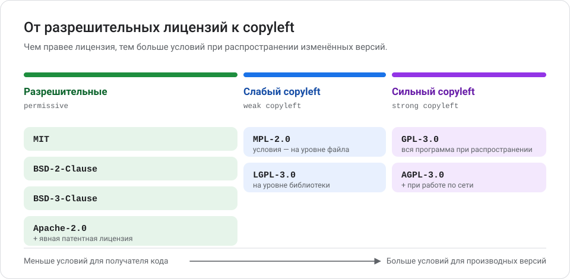
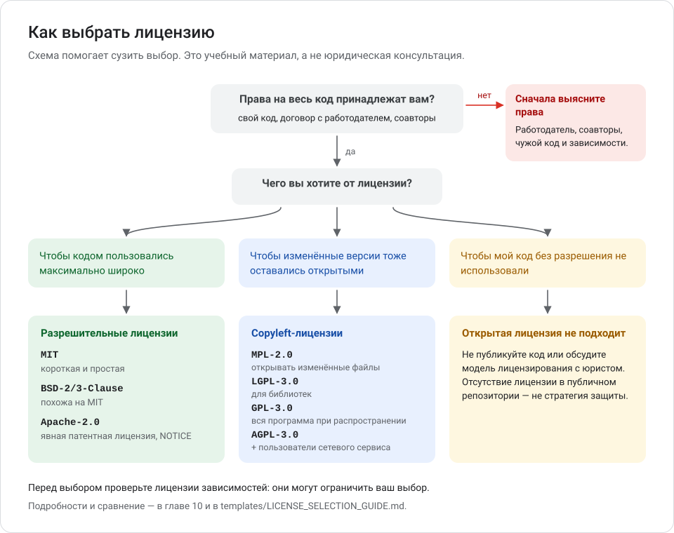
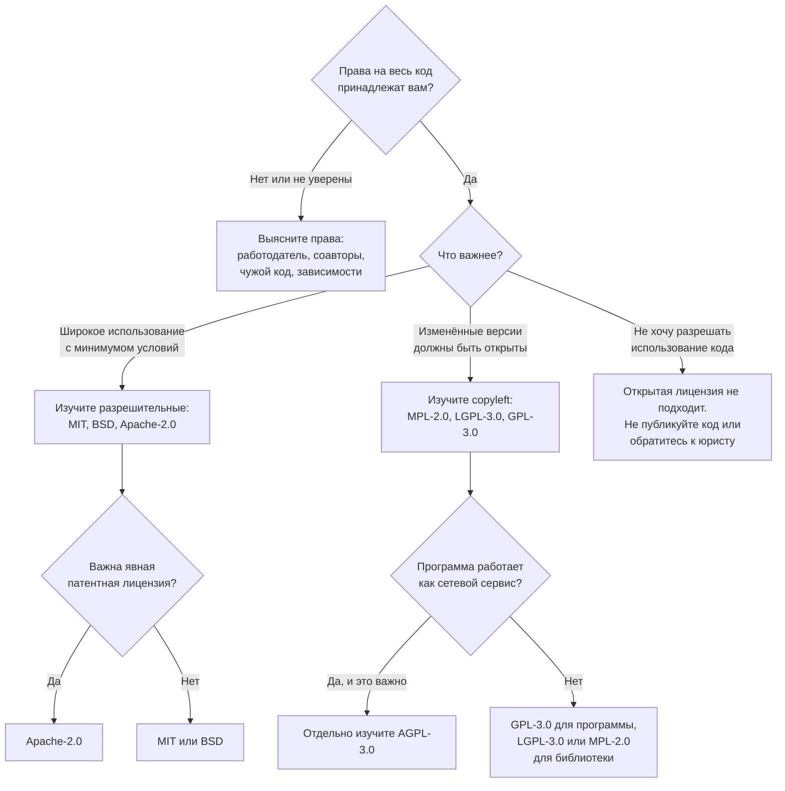

# Глава 10. Лицензии и авторские права

Код, опубликованный на GitHub, не становится «общим». Кто и как может его использовать, определяют авторское право и лицензия. В этой главе — что такое лицензия, чем отличаются популярные лицензии, как выбрать и правильно оформить лицензию и как учитывать чужой код, шрифты и изображения.

**Вы научитесь:**

- понимать, кто правообладатель и что разрешает лицензия;
- сравнивать MIT, Apache-2.0, BSD, GPL, LGPL, AGPL, MPL и Unlicense;
- понимать, когда возникают обязательства по лицензии;
- выбирать лицензию по целям проекта;
- оформлять `LICENSE`, `NOTICE`, `THIRD_PARTY_NOTICES.md`, `CITATION.cff` и сведения SPDX.

**Время:** 2 часа.

> [!IMPORTANT]
> **Эта глава — учебный материал, а не юридическая консультация.** Правила зависят от страны, договора с работодателем или заказчиком, лицензий сторонних компонентов и конкретного способа использования программы. Для коммерческих продуктов и спорных случаев обращайтесь к юристу, который специализируется на интеллектуальной собственности. Сведения проверены по официальным источникам на 11 октября 2026 года.

<!-- toc -->
**Содержание главы**

- [10.1. Основы: авторское право и лицензия](#101-основы-авторское-право-и-лицензия)
- [10.2. Виды лицензий](#102-виды-лицензий)
- [10.3. Сравнение лицензий](#103-сравнение-лицензий)
- [10.4. Когда возникают обязательства](#104-когда-возникают-обязательства)
- [10.5. Как выбрать лицензию](#105-как-выбрать-лицензию)
- [10.6. Как добавить лицензию в проект](#106-как-добавить-лицензию-в-проект)
- [10.7. Авторство, NOTICE и сторонние компоненты](#107-авторство-notice-и-сторонние-компоненты)
- [10.8. Код, созданный с помощью AI](#108-код-созданный-с-помощью-ai)
- [10.9. SPDX и REUSE: машиночитаемые сведения о лицензиях](#109-spdx-и-reuse-машиночитаемые-сведения-о-лицензиях)
- [10.10. Что зависит от страны и договоров](#1010-что-зависит-от-страны-и-договоров)
- [10.11. Практические примеры](#1011-практические-примеры)
- [Проверьте себя](#проверьте-себя)
- [Что дальше](#что-дальше)
<!-- /toc -->

## 10.1. Основы: авторское право и лицензия

### Авторское право возникает автоматически

> **Авторское право** — права автора на созданное им произведение. Программа для компьютера охраняется как литературное произведение.

Права возникают **в момент создания** кода — регистрировать ничего не нужно. Так устроено в большинстве стран. Например, в Гражданском кодексе РФ программы для ЭВМ охраняются как литературные произведения (ст. 1259, ст. 1261), а для возникновения прав не требуется регистрация или иные формальности (ст. 1259, п. 4).

Пример. Вы написали скрипт и выложили его в публичный репозиторий без лицензии. Права на скрипт принадлежат вам. Другие люди могут его прочитать, но по закону не могут свободно копировать, изменять и распространять.

### Кто правообладатель

> **Правообладатель** — тот, кому принадлежат исключительные права на произведение: право разрешать или запрещать его использование.

Правообладателем может быть не автор:

- **Код, написанный по работе.** Во многих странах права на служебное произведение принадлежат работодателю, если договор не говорит иное. Например, в РФ — ст. 1295 ГК РФ; в США — правило *work made for hire*.
- **Код по договору с заказчиком.** Права могут перейти заказчику по договору.
- **Код соавторов.** Если в проекте есть чужие правки, правообладателей несколько.

> [!WARNING]
> Прежде чем публиковать код, написанный на работе или по заказу, проверьте трудовой договор и договор с заказчиком. Опубликовать чужой (работодателя) код под открытой лицензией без разрешения — нарушение.

Кроме исключительных прав есть **личные неимущественные права**: право авторства и право на имя. Во многих странах от них нельзя отказаться. Например, в РФ отказ от этих прав ничтожен (ст. 1228, п. 2 и ст. 1265 ГК РФ).

### Что такое лицензия

> **Лицензия на ПО** — разрешение правообладателя использовать программу на определённых условиях: что можно делать, что нужно соблюдать и чего лицензия не гарантирует.

| | Авторское право | Лицензия |
| --- | --- | --- |
| Что это | Права, которые принадлежат правообладателю | Разрешение, которое правообладатель даёт другим |
| Как возникает | Автоматически, при создании | Правообладатель выбирает и публикует условия |
| Кто решает | Закон | Правообладатель в рамках закона |
| Пример | «Код мой» | «Можно использовать, если сохраните моё имя» |

Лицензия не передаёт права на код — правообладатель остаётся прежним. Она лишь разрешает другим то, что без неё было бы запрещено.

### Почему публичный репозиторий не означает разрешения

На GitHub, сделав репозиторий публичным, вы по Условиям использования GitHub разрешаете другим пользователям **просматривать и делать форк** репозитория в рамках сервиса GitHub (раздел D.5 «License Grant to Other Users»). Больше ничего: ни копировать код в свои проекты, ни распространять, ни изменять вне GitHub без лицензии нельзя.

Документация GitHub: без лицензии действуют обычные законы об авторском праве — никто не может воспроизводить, распространять и создавать производные работы. Источники: [Licensing a repository](https://docs.github.com/en/repositories/managing-your-repositorys-settings-and-features/customizing-your-repository/licensing-a-repository), [GitHub Terms of Service](https://docs.github.com/en/site-policy/github-terms/github-terms-of-service#5-license-grant-to-other-users), [No License — choosealicense.com](https://choosealicense.com/no-permission/).

### Что лицензия даёт и что требует

**Права пользователя** (зависят от лицензии): использовать, в том числе коммерчески; изменять; распространять копии и изменённые версии; использовать в закрытых продуктах; иногда — использовать патенты участников.

**Обязанности при использовании чужого кода** (зависят от лицензии):

- сохранять уведомление об авторских правах и текст лицензии;
- отмечать внесённые изменения;
- предоставлять исходный код производной работы на тех же условиях (copyleft);
- не использовать имена авторов и товарные знаки для рекламы;
- соблюдать условия при работе программы по сети (AGPL).

Почти все открытые лицензии **отказываются от гарантий и ответственности**: программа предоставляется «как есть».

### Почему нельзя просто скопировать лицензию из чужого проекта

- В чужом `LICENSE` — **чужое имя правообладателя**. Скопировав его, вы заявите, что код принадлежит другому человеку.
- Вы можете взять лицензию с условиями, которых не понимаете, например **copyleft**, и неожиданно обязать себя и пользователей открывать код.
- Лицензия проекта должна быть **совместима с лицензиями зависимостей** — иначе распространять проект на выбранных условиях нельзя.
- Некоторые лицензии требуют особого оформления: заголовков в файлах, файла `NOTICE`, указания версии («только 3.0» или «3.0 и новее»).

## 10.2. Виды лицензий



| Вид | Суть | Примеры |
| --- | --- | --- |
| **Разрешительные** (*permissive*) | Можно почти всё, включая закрытые коммерческие продукты; нужно сохранить уведомление об авторстве | MIT, BSD-2-Clause, BSD-3-Clause, Apache-2.0 |
| **Слабый copyleft** | Изменения самого компонента (файла или библиотеки) остаются открытыми; остальной продукт может быть закрытым | MPL-2.0 (на уровне файла), LGPL-3.0 (на уровне библиотеки) |
| **Сильный copyleft** | Распространяемая производная программа целиком должна быть под той же лицензией с исходным кодом | GPL-3.0 |
| **Сетевой copyleft** | Как сильный copyleft, плюс обязанность предложить исходный код изменённой версии пользователям, работающим с ней по сети | AGPL-3.0 |
| **Отказ от прав в пользу общественного достояния** | Автор пытается отказаться от всех прав; на случай, если это невозможно, даётся максимально широкая лицензия | Unlicense, CC0-1.0 |
| **Без лицензии** | Действует авторское право по умолчанию: всё запрещено, кроме прямо разрешённого законом | — |

> **Copyleft** («копилефт») — условие лицензии: если вы распространяете изменённую версию, вы должны распространять её на тех же условиях, вместе с исходным кодом.

## 10.3. Сравнение лицензий

Таблицы — упрощение. Точные условия — только в текстах лицензий (ссылки в разделе 10.6 и в [sources.md](sources.md)). Идентификаторы — из списка лицензий SPDX.

### Права и базовые условия

| Лицензия (SPDX) | 1. Коммерческое использование | 2. Изменение кода | 3. Распространение изменённой версии | 4. Сохранять уведомление и лицензию |
| --- | --- | --- | --- | --- |
| **MIT** (`MIT`) | Да | Да | Да; свои изменения можно распространять на любых условиях | Да |
| **Apache License 2.0** (`Apache-2.0`) | Да | Да | Да; на свои изменения можно дать другие условия, соблюдая Apache-2.0 для исходного кода; изменённые файлы нужно пометить | Да, плюс атрибуции из файла `NOTICE`, если он есть |
| **BSD 2-Clause** (`BSD-2-Clause`) | Да | Да | Да; свои изменения можно распространять на любых условиях | Да |
| **BSD 3-Clause** (`BSD-3-Clause`) | Да | Да | Да; свои изменения можно распространять на любых условиях | Да; нельзя использовать имена авторов для продвижения без разрешения |
| **GNU GPL v3** (`GPL-3.0-only`, `GPL-3.0-or-later`) | Да | Да | Да, только под GPL-3.0 и с исходным кодом; изменения нужно отметить | Да |
| **GNU LGPL v3** (`LGPL-3.0-only`, `LGPL-3.0-or-later`) | Да | Да | Изменённая библиотека — под LGPL с исходным кодом; программа, которая её использует, — на ваших условиях при соблюдении LGPL | Да |
| **GNU AGPL v3** (`AGPL-3.0-only`, `AGPL-3.0-or-later`) | Да | Да | Да, только под AGPL-3.0 и с исходным кодом | Да |
| **Mozilla Public License 2.0** (`MPL-2.0`) | Да | Да | Изменённые файлы MPL — под MPL с исходным кодом; остальной продукт — на ваших условиях | Да |
| **The Unlicense** (`Unlicense`) | Да | Да | Да, без условий | Нет |
| **Нет лицензии** | Нет, без разрешения правообладателя | Нет | Нет | — |

### Исходный код, сеть, патенты и применение

| Лицензия | 5. Исходный код при распространении производной работы | 6. Особые требования при работе по сети | 7. Патенты | 8. Где может быть уместна |
| --- | --- | --- | --- | --- |
| **MIT** | Не требуется | Нет | Явной патентной лицензии нет | Небольшие библиотеки и утилиты, учебные проекты, максимально широкое использование |
| **Apache-2.0** | Не требуется | Нет | Явная патентная лицензия от участников; прекращается для того, кто подаёт патентный иск о нарушении | Крупные проекты, корпоративная среда, когда важны патенты |
| **BSD-2-Clause** | Не требуется | Нет | Явной патентной лицензии нет | Как MIT |
| **BSD-3-Clause** | Не требуется | Нет | Явной патентной лицензии нет | Как MIT, плюс защита имени автора от использования в рекламе |
| **GPL-3.0** | Да: полный исходный код всей производной программы под GPL | Нет: работа программы на сервере без передачи копий не считается распространением | Явная патентная лицензия от участников; запрет патентных исков о нарушении программой | Приложения, все распространяемые версии которых должны оставаться свободными |
| **LGPL-3.0** | Исходный код библиотеки и её изменений; для программы с библиотекой — возможность заменить или пересобрать библиотеку | Нет | Как GPL-3.0 | Библиотеки, которые можно использовать в закрытых программах, но улучшения самой библиотеки должны быть открыты |
| **AGPL-3.0** | Да, как GPL-3.0 | **Да:** если вы изменили программу, пользователям, работающим с ней по сети, нужно предложить исходный код изменённой версии | Как GPL-3.0 | Серверные и веб-приложения, где важно, чтобы изменения сервиса были открыты |
| **MPL-2.0** | Исходный код файлов под MPL (включая изменённые) | Нет: работа только на сервере не считается распространением | Явная патентная лицензия от участников; прекращается при патентном иске | Компромисс: открытые файлы компонента внутри закрытого продукта |
| **Unlicense** | Не требуется | Нет | Патенты не упоминаются | Когда автор хочет передать код без условий; см. оговорку ниже |
| **Нет лицензии** | — | — | — | Закрытые и приватные проекты; это не стратегия защиты публичного кода |

### Оговорка о The Unlicense

The Unlicense пытается передать код в **общественное достояние** (*public domain*). Но не во всех странах автор может отказаться от авторских прав: например, в Германии авторское право не передаётся (§ 29 UrhG), а в РФ отказ от личных неимущественных прав ничтожен. Поэтому в тексте Unlicense есть и широкое разрешение на использование — GNU описывает его как запасную разрешительную лицензию на случай, если отказ от прав не сработает. OSI одобрила Unlicense в 2020 году; FSF считает её свободной и совместимой с GPL. Если нужна предсказуемость в разных странах, многие выбирают MIT.

Похожая лицензия-отказ CC0-1.0 не одобрена OSI, и OSI не рекомендует её для ПО: она прямо не предоставляет патентных прав.

## 10.4. Когда возникают обязательства

Обязательства лицензии почти всегда зависят от того, **что вы делаете с программой**.

| Что вы делаете | MIT, BSD, Apache-2.0 | MPL-2.0 | LGPL-3.0 | GPL-3.0 | AGPL-3.0 |
| --- | --- | --- | --- | --- | --- |
| Используете и меняете только у себя | Обязательств нет | Обязательств нет | Обязательств нет | Обязательств нет | Обязательств нет |
| Запускаете на своём сервере, пользователи работают по сети | Обязательств нет | Обязательств нет | Обязательств нет | Обязательств нет | Если программа изменена — предложить исходный код пользователям сети |
| Передаёте копии другим (продаёте, публикуете, отдаёте заказчику) | Сохранить уведомления (Apache — ещё `NOTICE` и пометки изменений) | Открыть исходный код файлов под MPL | Открыть код библиотеки; дать возможность заменить библиотеку | Вся производная программа — под GPL с исходным кодом | Как GPL-3.0 |

Пояснения:

- **«Распространение»** в GPL-3.0 называется *conveying* — любая передача копий другим лицам. Взаимодействие с пользователем по сети без передачи копии распространением не считается. Использование и изменение у себя — не распространение.
- **JavaScript, который сайт отправляет в браузер,** по позиции FSF (GPL FAQ) передаётся пользователю — то есть распространяется.
- **LGPL** допускает подключение библиотеки к закрытой программе, но пользователь должен иметь возможность заменить библиотеку своей изменённой версией: например, через динамическое подключение (*shared library*). При статическом связывании требований больше.
- **MPL-2.0** работает на уровне файлов: новые файлы, в которые не скопирован код под MPL, могут быть под другой лицензией.
- **Внутри одной организации** правила передачи копий между юрлицами и подрядчиками сложны — это вопрос для юриста.

### Совместимость лицензий

> **Совместимость лицензий** — возможность объединить код под разными лицензиями в одну программу и распространять её, соблюдая все лицензии сразу.

Факты из списка лицензий GNU:

- MIT (в терминах GNU — Expat), BSD-2-Clause и BSD-3-Clause совместимы с GPL.
- Apache-2.0 совместима с GPL-3.0, но **не совместима с GPL-2.0** (из-за условий о патентах).
- MPL-2.0 совместима с GPL, если автор не пометил код как «Incompatible With Secondary Licenses».
- GPL-2.0 (только 2.0, без «или новее») и GPL-3.0 между собой **не совместимы**.
- Unlicense совместима с GPL.

Правило на практике: **как правило, код под разрешительной лицензией можно включать в проект под copyleft-лицензией (с учётом исключений выше, например Apache-2.0 и GPL-2.0), но не наоборот** — нельзя взять код под GPL и распространять его в составе проекта под MIT.

Источник: [Various Licenses and Comments about Them — GNU](https://www.gnu.org/licenses/license-list.html).

### Патенты

> **Патент** — исключительное право на изобретение, например на способ обработки данных. Авторское право защищает текст кода, а патент — идею способа.

Явная патентная лицензия (Apache-2.0, GPL-3.0, LGPL-3.0, AGPL-3.0, MPL-2.0) означает: участники проекта разрешают использовать свои патенты, которые нарушаются их вкладом. В лицензиях есть защита от патентных исков: в Apache-2.0 тот, кто подаёт патентный иск о нарушении, теряет полученную по лицензии патентную лицензию; в MPL-2.0 у него прекращаются права, предоставленные участниками; GPL-3.0 запрещает такие иски как условие лицензии. Точные условия — в тексте каждой лицензии. В MIT и BSD явной патентной лицензии нет и явного отказа тоже нет — вопрос о подразумеваемом разрешении решается по праву конкретной страны.

## 10.5. Как выбрать лицензию

Лицензию выбирает **правообладатель**, исходя из своих целей. Методичка не выбирает лицензию за вас. Ответьте на вопросы:

1. **Кому принадлежат права** на весь код? Нет ли кода работодателя, заказчика, соавторов, чужих фрагментов?
2. **Чего вы хотите?** Максимального распространения? Чтобы улучшения возвращались в открытый доступ? Зарабатывать на закрытом продукте?
3. **Какие лицензии у зависимостей?** Они могут ограничить выбор.
4. **Какие лицензии приняты в вашей экосистеме?** Например, в экосистемах JavaScript и Python популярны MIT и Apache-2.0, в Linux — GPL.
5. **Нужна ли явная защита от патентных претензий?**





### Четыре типичные цели

**Хочу разрешить широкое повторное использование с минимальными условиями.** Изучите разрешительные лицензии. MIT — самая короткая и популярная. Apache-2.0 длиннее, но содержит явную патентную лицензию и правила о `NOTICE`; её часто выбирают для крупных и корпоративных проектов.

**Хочу, чтобы производные версии распространялись на условиях copyleft.** Изучите GPL-3.0 для программ. Для библиотек, которые могут использовать закрытые программы, — LGPL-3.0 или MPL-2.0. Решите, указывать «только эта версия» (`-only`) или «эта версия и новее» (`-or-later`).

**Хочу учесть работу программы как сетевого сервиса.** Под GPL изменённую программу можно запустить на сервере и не открывать код. Если это для вас важно, отдельно изучите AGPL-3.0. Учтите: многие компании избегают AGPL-зависимостей.

**Не хочу разрешать произвольное использование исходного кода.** Открытые лицензии этого не дают. Отсутствие лицензии в публичном репозитории — **не готовая стратегия защиты**: код видят все, его можно скопировать вопреки закону, а доказывать нарушение придётся вам. Варианты: держать репозиторий приватным; разработать коммерческое лицензионное соглашение с юристом; рассмотреть модели, где часть продукта открыта, а часть нет. Это решение требует юридической консультации.

Удобный помощник для первого знакомства: [choosealicense.com](https://choosealicense.com/). Подробный опросник — в шаблоне [templates/LICENSE_SELECTION_GUIDE.md](templates/LICENSE_SELECTION_GUIDE.md).

## 10.6. Как добавить лицензию в проект

**Шаг 1. Выберите лицензию** (раздел 10.5).

**Шаг 2. Возьмите официальный текст.** Не переписывайте и не переводите лицензию: юридическую силу имеет официальный текст.

| Лицензия | Официальный текст |
| --- | --- |
| MIT | [opensource.org/license/mit](https://opensource.org/license/mit) |
| Apache-2.0 | [apache.org/licenses/LICENSE-2.0](https://www.apache.org/licenses/LICENSE-2.0) |
| BSD-2-Clause, BSD-3-Clause | [opensource.org/license/bsd-2-clause](https://opensource.org/license/bsd-2-clause), [opensource.org/license/bsd-3-clause](https://opensource.org/license/bsd-3-clause) |
| GPL-3.0, LGPL-3.0, AGPL-3.0 | [gnu.org/licenses](https://www.gnu.org/licenses/) |
| MPL-2.0 | [mozilla.org/MPL/2.0](https://www.mozilla.org/en-US/MPL/2.0/) |
| Unlicense | [unlicense.org](https://unlicense.org/) |
| Все лицензии с идентификаторами | [spdx.org/licenses](https://spdx.org/licenses/) |

**Шаг 3. Создайте файл `LICENSE`** в корне репозитория.

Через GitHub: **Add file** → **Create new file** → имя `LICENSE` → **Choose a license template** → выберите лицензию → **Review and submit** → **Commit changes**. Источник: [Adding a license to a repository](https://docs.github.com/en/communities/setting-up-your-project-for-healthy-contributions/adding-a-license-to-a-repository).

Вручную: скопируйте официальный текст в файл `LICENSE` (без расширения или `LICENSE.md`, `LICENSE.txt`).

**Шаг 4. Укажите год и правообладателя**, если лицензия этого требует. Например, MIT:

```text
Copyright (c) 2026 Иван Петров
```

- **Год** — год первой публикации; можно указать диапазон `2024–2026`.
- **Правообладатель** — вы, ваша компания или формулировка «авторы проекта» со ссылкой на файл `AUTHORS`.
- В Apache-2.0 текст лицензии не меняют, а строку `Copyright [yyyy] [name of copyright owner]` добавляют в заголовки файлов или в `NOTICE` (см. приложение к лицензии).
- GPL-семейство рекомендует уведомление в начале каждого файла исходного кода (образец — в конце текста лицензии, раздел «How to Apply These Terms to Your New Programs»).

**Шаг 5. Отразите лицензию в README:**

```markdown
## Лицензия

Распространяется по лицензии MIT — см. файл [LICENSE](LICENSE).
```

**Шаг 6. Укажите идентификатор SPDX в манифесте пакета**, если он есть: `license = "MIT"` в `pyproject.toml`, `"license": "MIT"` в `package.json`.

**Шаг 7. Учтите сторонние материалы** (раздел 10.7).

> [!IMPORTANT]
> Файл `LICENSE` сам по себе **не подтверждает**, что вы обладаете правами на все файлы проекта. Лицензия действует только на то, чем вы вправе распоряжаться. Чужой код, шрифты, изображения и данные остаются под своими лицензиями.

## 10.7. Авторство, NOTICE и сторонние компоненты

### LICENSE и уведомления об авторских правах

- **`LICENSE`** — текст лицензии проекта.
- **Уведомление об авторских правах** (*copyright notice*) — строка вида `Copyright (c) 2026 Иван Петров`. Её размещают в `LICENSE`, а при желании или по требованию лицензии — в заголовках файлов. Чужие уведомления **нельзя удалять**: этого требуют почти все лицензии.

### NOTICE — когда он нужен

> **`NOTICE`** — файл с обязательными атрибуциями, предусмотренный лицензией Apache-2.0 (раздел 4(d)).

- Если вы **распространяете** производную работу от компонента под Apache-2.0, в котором есть файл `NOTICE`, вы обязаны сохранить его атрибуции: в своём `NOTICE`, в документации или в интерфейсе программы.
- Если ваш собственный проект под Apache-2.0, `NOTICE` не обязателен. Apache Software Foundation советует не добавлять в него ничего, что не требуется юридически.
- Содержимое `NOTICE` информационное и не меняет условий лицензии.

Пример (с заполнителями):

```text
[НАЗВАНИЕ ПРОЕКТА]
Copyright [ГОД] [ИМЯ ПРАВООБЛАДАТЕЛЯ]

This product includes software developed by [ПРОЕКТ] ([ССЫЛКА]),
licensed under the Apache License, Version 2.0.
```

### AUTHORS и CONTRIBUTORS

Необязательные файлы со списком авторов и участников. Полезны, если в уведомлении указано «Copyright [год] авторы проекта» или если хочется поблагодарить участников. Историю авторства и так хранит Git. **Не добавляйте в эти файлы людей без их согласия и не придумывайте авторов.**

### CITATION.cff — как цитировать научное ПО

> **CITATION.cff** — файл в формате Citation File Format (версия 1.2.0), который сообщает, как ссылаться на программу в научных работах. GitHub показывает для него ссылку **Cite this repository** с форматами APA и BibTeX.

Обязательные поля: `cff-version`, `message`, `title`, `authors`. Пример с заполнителями:

```yaml
cff-version: 1.2.0
message: "Если вы используете эту программу, процитируйте её, как указано ниже."
title: "[НАЗВАНИЕ ПРОЕКТА]"
authors:
  - family-names: "[ФАМИЛИЯ]"
    given-names: "[ИМЯ]"
version: "[ВЕРСИЯ, например 1.0.0]"
date-released: "[ГГГГ-ММ-ДД]"
license: MIT
repository-code: "https://github.com/[ВЛАДЕЛЕЦ]/[РЕПОЗИТОРИЙ]"
```

**Когда нужен:** научное и исследовательское ПО, которое цитируют в публикациях. Сгенерировать файл помогает [cffinit](https://citation-file-format.github.io/cff-initializer-javascript/). Источник: [About CITATION files](https://docs.github.com/en/repositories/managing-your-repositorys-settings-and-features/customizing-your-repository/about-citation-files).

### THIRD_PARTY_NOTICES.md — учёт сторонних компонентов

Единого стандарта названия нет: встречаются `THIRD_PARTY_NOTICES.md`, `ThirdPartyNotices.txt`, `NOTICE`. Смысл один — перечислить сторонние компоненты, которые **входят в распространяемый продукт**, с их лицензиями и уведомлениями.

| Компонент | Версия | Лицензия | Источник | Где используется |
| --- | --- | --- | --- | --- |
| [библиотека] | [версия] | MIT | [ссылка] | Встроена в `vendor/` |
| [шрифт] | [версия] | OFL-1.1 | [ссылка] | `assets/fonts/` |
| [иконки] | — | CC-BY-4.0 | [ссылка] | `assets/icons/` |

Шаблон есть в [templates/LICENSE_SELECTION_GUIDE.md](templates/LICENSE_SELECTION_GUIDE.md).

Что учитывать:

- **Библиотеки**, скопированные в репозиторий или включённые в сборку. Многие разрешительные лицензии (MIT, BSD) требуют приложить их текст и уведомление к **каждой копии** продукта — в том числе к закрытой программе.
- **Шрифты.** Часто под SIL Open Font License (OFL-1.1) или коммерческими лицензиями с ограничениями.
- **Изображения, иконки, звуки, видео.** Часто под лицензиями Creative Commons: CC BY требует указать автора, CC BY-NC запрещает коммерческое использование, CC BY-ND — изменения.
- **Данные и тексты** — свои условия использования.
- **Фрагменты кода из интернета** (форумы, статьи, ответы AI) — см. ниже.

### Происхождение кода

Записывайте, откуда пришёл заимствованный код:

- в коммите: `Добавить функцию разбора дат (адаптировано из [проект], [лицензия], [ссылка])`;
- в комментарии рядом с кодом и в `THIRD_PARTY_NOTICES.md`;
- для крупных заимствований — сохраните исходное уведомление об авторских правах.

Если происхождение фрагмента неизвестно и его нельзя проверить — лучше переписать его самостоятельно.

### DCO и CLA — права на вклад участников

Когда в проект присылают код другие люди, важно, на каких условиях.

- **DCO** (*Developer Certificate of Origin*) — короткое заявление участника, что он имеет право отправить код на условиях лицензии проекта. Подтверждается строкой `Signed-off-by` в каждом коммите: `git commit -s`. Текст: [developercertificate.org](https://developercertificate.org/).
- **CLA** (*Contributor License Agreement*) — отдельное соглашение, по которому участник предоставляет проекту права на свой вклад. Требует юридического оформления.
- **По умолчанию на GitHub** вклад в репозиторий предоставляется на условиях лицензии этого репозитория (принцип *inbound = outbound* в Условиях использования GitHub), если нет отдельного соглашения.

## 10.8. Код, созданный с помощью AI

- **Правовой статус различается по странам и меняется.** Например, Бюро авторского права США считает, что охраняется только то, что создано человеком: одни лишь запросы (промпты), как правило, не делают пользователя автором результата; материал, где человек определил творческие элементы, может охраняться. Источники: [Copyright Registration Guidance (2023)](https://www.copyright.gov/ai/ai_policy_guidance.pdf), [Copyright and Artificial Intelligence, Part 2: Copyrightability (2025)](https://www.copyright.gov/ai/Copyright-and-Artificial-Intelligence-Part-2-Copyrightability-Report.pdf).
- **Риск совпадения с чужим кодом.** AI может воспроизвести фрагмент существующего кода вместе с его лицензионными обязательствами.
- **Условия AI-сервиса и работодателя.** Прочитайте условия использования инструмента и внутренние правила компании.
- **Ответственность остаётся на человеке.** Публикуя код, вы отвечаете за соблюдение лицензий, даже если код написал AI.

Практические меры перечислены в [главе 7](07_git_s_claude_code.md#проверяйте-происхождение-кода).

## 10.9. SPDX и REUSE: машиночитаемые сведения о лицензиях

### Идентификаторы и выражения SPDX

> **Идентификатор SPDX** — короткое стандартное имя лицензии из [списка лицензий SPDX](https://spdx.org/licenses/): `MIT`, `Apache-2.0`, `GPL-3.0-or-later`.

Для лицензий GNU используйте полные идентификаторы с `-only` («только эта версия») или `-or-later` («эта версия и новее»). Старые формы `GPL-3.0` и `GPL-3.0+` устарели.

Заголовок в начале файла исходного кода:

```python
# SPDX-License-Identifier: MIT
```

```javascript
// SPDX-License-Identifier: Apache-2.0
```

**Выражения лицензий:**

| Выражение | Значение |
| --- | --- |
| `MIT OR Apache-2.0` | Пользователь выбирает одну из лицензий |
| `MIT AND CC-BY-4.0` | Действуют обе лицензии (например, код и изображения) |
| `GPL-2.0-or-later WITH Classpath-exception-2.0` | Лицензия с исключением |
| `LicenseRef-Company-EULA` | Лицензия, которой нет в списке SPDX |

Источник: [SPDX License Expressions](https://spdx.github.io/spdx-spec/v3.0.1/annexes/spdx-license-expressions/).

### REUSE

[REUSE](https://reuse.software/) — практика, при которой для каждого файла указаны правообладатель и лицензия:

```python
# SPDX-FileCopyrightText: 2026 [ИМЯ ПРАВООБЛАДАТЕЛЯ]
# SPDX-License-Identifier: MIT
```

Три шага REUSE:

1. **Выбрать и положить тексты лицензий** в папку `LICENSES/` с именами по SPDX: `LICENSES/MIT.txt`.
2. **Добавить сведения в каждый файл** — заголовком в комментарии, файлом `*.license` рядом с двоичным файлом или записью в `REUSE.toml`.
3. **Проверить** командой `reuse lint`.

Инструмент `reuse` устанавливается из PyPI (`pip install reuse`). Полезные команды: `reuse download --all` (скачать тексты лицензий), `reuse annotate --copyright="[ИМЯ]" --license=MIT <файлы>` (добавить заголовки), `reuse lint` (проверить).

### Проверка лицензий зависимостей

> **Зависимость** — чужая библиотека, которую использует проект. Прямые зависимости вы подключили сами, транзитивные — пришли вместе с ними.

1. **Составьте список** зависимостей: файл зависимостей (`requirements.txt`, `pyproject.toml`, `package.json`), граф зависимостей GitHub (**Insights** → **Dependency graph**) или выгрузка SBOM.
2. **Определите лицензию** каждой зависимости: в её репозитории, в реестре пакетов (pypi.org, npmjs.com), в SBOM.
3. **Проверьте совместимость** с лицензией и моделью распространения вашего проекта. Особое внимание — GPL и AGPL в закрытых продуктах и проектах под разрешительной лицензией.
4. **Автоматизируйте**: действие `actions/dependency-review-action` умеет не пропускать Pull Request с зависимостями под лицензиями, которых нет в списке разрешённых (параметр `allow-licenses`, [глава 11](11_bezopasnost_i_avtomatizatsiya.md)); для больших проектов существуют сканеры вроде ScanCode Toolkit и OSS Review Toolkit.
5. **Повторяйте** при каждом добавлении или обновлении зависимостей.

Сведения о лицензиях в реестрах и автоматических инструментах бывают неполными или ошибочными. Для важных решений проверяйте текст лицензии в самом пакете.

## 10.10. Что зависит от страны и договоров

| Вопрос | От чего зависит | Пример |
| --- | --- | --- |
| Кто правообладатель кода, написанного на работе | Закон страны и трудовой договор | РФ: служебное произведение (ст. 1295 ГК РФ) |
| Можно ли отказаться от авторских прав | Закон страны | В РФ отказ от личных неимущественных прав ничтожен; в Германии авторское право не передаётся |
| Как оформляется открытая лицензия | Закон страны | В РФ есть понятие открытой лицензии (ст. 1286.1 ГК РФ): если срок не указан, для программ она действует весь срок исключительного права, если территория не указана — на территории всего мира |
| Охраняется ли результат работы AI | Закон и практика страны | США: требуется человеческое авторство |
| Обязанности производителя ПО | Отраслевое регулирование | ЕС: Регламент (ЕС) 2024/2847 (Cyber Resilience Act) — для продуктов, поставляемых на рынок ЕС в рамках коммерческой деятельности; обязанности сообщать об активно эксплуатируемых уязвимостях действуют с 11 сентября 2026 года, основные требования — с 11 декабря 2027 года; некоммерческое open-source ПО в целом вне сферы действия |
| Права на код по заказу | Договор с заказчиком | Права могут перейти заказчику |
| Использование чужих компонентов | Лицензии этих компонентов | GPL-библиотека в закрытом продукте |

Источники по РФ: [Гражданский кодекс РФ, часть четвёртая](https://www.consultant.ru/document/cons_doc_LAW_64629/). По ЕС: [Регламент (ЕС) 2024/2847](https://eur-lex.europa.eu/legal-content/EN/TXT/?uri=CELEX:32024R2847).

## 10.11. Практические примеры

### Учебный проект в портфолио

**Ситуация:** публичный репозиторий с учебной программой, весь код ваш, хотите, чтобы его могли свободно использовать.

**Решение:** MIT. Файл `LICENSE` с вашим именем и годом, раздел «Лицензия» в README. Если в проекте есть чужие изображения или шрифты — проверьте их лицензии и перечислите в `THIRD_PARTY_NOTICES.md`. Если репозиторий приватный и никому не передаётся, лицензия не обязательна.

### Коммерческий продукт с закрытым кодом

**Ситуация:** компания продаёт программу, исходный код не публикуется.

**Решение:**

- открытая лицензия на собственный код не нужна; условия для клиентов описывает лицензионное соглашение, которое готовит юрист;
- в репозитории можно указать уведомление вида `Copyright (c) [ГОД] [НАЗВАНИЕ КОМПАНИИ]. All rights reserved.` и сделать репозиторий приватным;
- **проверьте лицензии всех зависимостей**: GPL и AGPL могут потребовать открыть код продукта;
- соберите `THIRD_PARTY_NOTICES` для поставки: даже разрешительные лицензии (MIT, BSD, Apache-2.0) требуют приложить их тексты и уведомления к продукту;
- закрепите права на код сотрудников и подрядчиков в договорах.

### Open-source-библиотека

**Ситуация:** библиотека для других разработчиков, хотите широкого распространения, в том числе в компаниях.

**Решение:** часто выбирают Apache-2.0 (явная патентная лицензия) или MIT (простота). Если важно, чтобы улучшения самой библиотеки оставались открытыми, но использовать её могли и закрытые программы, — изучите MPL-2.0 или LGPL-3.0. Дополнительно:

- SPDX-идентификатор в манифесте пакета и, по желанию, в заголовках файлов (REUSE);
- `CONTRIBUTING.md` с условиями приёма вклада (например, DCO);
- проверка лицензий зависимостей в CI;
- `NOTICE`, если выбрана Apache-2.0 и есть обязательные атрибуции.

## Проверьте себя

1. Вы выложили код в публичный репозиторий без лицензии. Может ли другой человек использовать его в своём коммерческом продукте?
2. Почему нельзя скопировать файл `LICENSE` из чужого проекта и закоммитить к себе?
3. Компания запускает изменённую программу под GPL-3.0 на своём сервере, пользователи работают с ней через браузер. Должна ли она открыть исходный код? А если программа под AGPL-3.0?
4. Можно ли включить код под GPL-3.0 в проект под MIT и распространять результат под MIT?
5. Чем Apache-2.0 отличается от MIT с точки зрения патентов?
6. Вы написали программу на работе. Можно ли выложить её под MIT?

<details>
<summary>Ответы</summary>

1. Нет. Без лицензии действует авторское право по умолчанию. GitHub разрешает другим только просматривать репозиторий и делать форк на GitHub.
2. В нём чужое имя правообладателя, а условия лицензии могут не соответствовать вашим целям и лицензиям зависимостей.
3. По GPL-3.0 — нет: работа на сервере без передачи копий не считается распространением (если JavaScript с GPL-кодом не отправляется в браузер). По AGPL-3.0 — да: изменённая версия должна предлагать пользователям сети исходный код.
4. Нет. Объединённая программа при распространении должна соответствовать GPL-3.0.
5. Apache-2.0 содержит явную патентную лицензию от участников и прекращает её для того, кто подаёт патентный иск. В MIT явных положений о патентах нет.
6. Только с разрешения правообладателя. Права на служебный код часто принадлежат работодателю — проверьте трудовой договор и спросите работодателя.

</details>

## Что дальше

В [главе 11](11_bezopasnost_i_avtomatizatsiya.md) — безопасность репозитория и автоматические проверки на GitHub.
