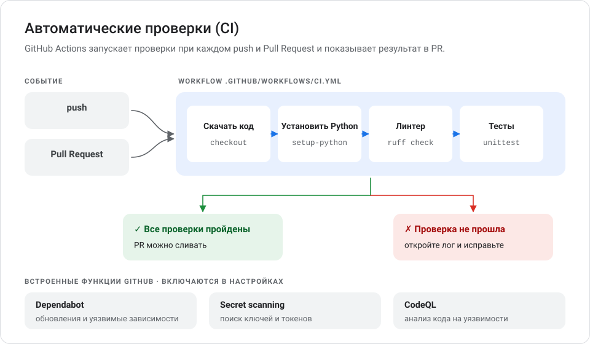
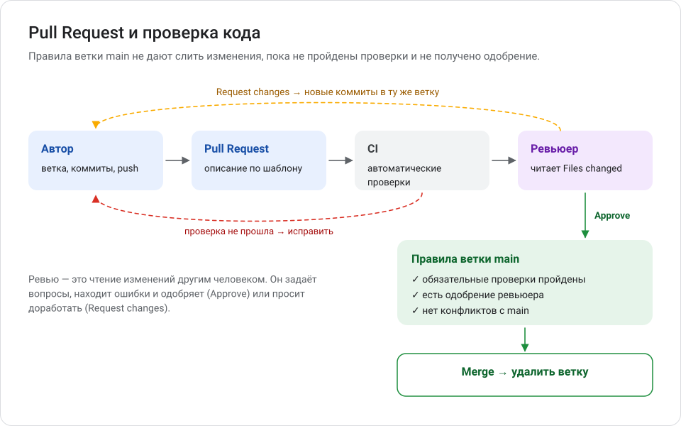
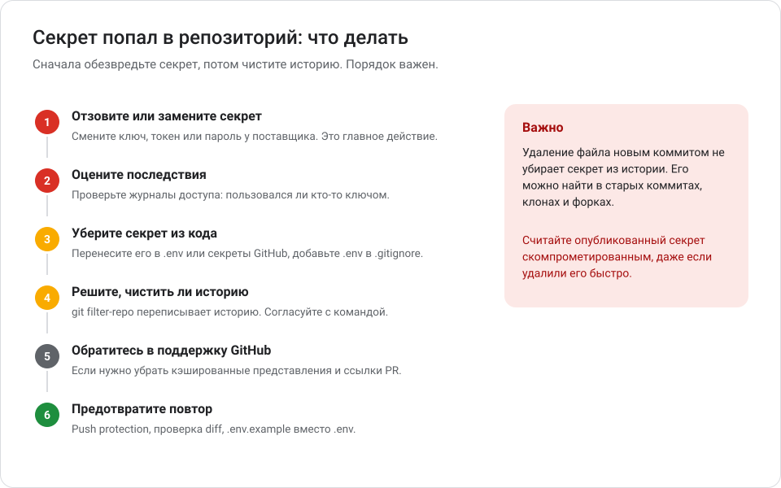

# Глава 11. Безопасность и автоматизация

Автоматические проверки ловят ошибки до того, как они попадут в `main`, а настройки безопасности защищают репозиторий, ключи и пользователей. В этой главе — GitHub Actions и CI, защита веток, работа с секретами, Dependabot, secret scanning, CodeQL и порядок действий при утечке.

**Вы научитесь:**

- понимать, что такое CI и как устроен workflow GitHub Actions;
- добавлять в проект автоматические проверки стиля и тестов;
- защищать основную ветку правилами;
- хранить токены и ключи вне репозитория;
- включать Dependabot, secret scanning, CodeQL и закрытые сообщения об уязвимостях;
- действовать правильно, если секрет попал в Git.

**Время:** 2–3 часа. **Понадобится:** репозиторий на GitHub с кодом и тестами — например, учебный проект [examples/tempconv](examples/tempconv/).

> [!NOTE]
> Доступность функций GitHub и их стоимость зависят от тарифа, видимости репозитория (публичный или приватный) и настроек организации. Ниже указано состояние на октябрь 2026 года. Перед настройкой сверяйтесь с документацией GitHub — ссылки даны в каждом разделе.

<!-- toc -->
**Содержание главы**

- [11.1. CI и GitHub Actions](#111-ci-и-github-actions)
- [11.2. Пример workflow для проекта на Python](#112-пример-workflow-для-проекта-на-python)
- [11.3. Линтеры, форматтеры и тесты](#113-линтеры-форматтеры-и-тесты)
- [11.4. Защита основной ветки](#114-защита-основной-ветки)
- [11.5. Проверка изменений в Pull Request](#115-проверка-изменений-в-pull-request)
- [11.6. Токены, ключи и файлы .env](#116-токены-ключи-и-файлы-env)
- [11.7. Secret scanning и push protection](#117-secret-scanning-и-push-protection)
- [11.8. Если секрет попал в историю](#118-если-секрет-попал-в-историю)
- [11.9. Зависимости: Dependabot, dependency review и лицензии](#119-зависимости-dependabot-dependency-review-и-лицензии)
- [11.10. CodeQL: поиск уязвимостей в коде](#1110-codeql-поиск-уязвимостей-в-коде)
- [11.11. Закрытые сообщения об уязвимостях](#1111-закрытые-сообщения-об-уязвимостях)
- [11.12. Минимальные права доступа](#1112-минимальные-права-доступа)
- [11.13. Безопасность GitHub Actions и CI/CD](#1113-безопасность-github-actions-и-cicd)
- [11.14. Чек-лист безопасности репозитория](#1114-чек-лист-безопасности-репозитория)
- [Проверьте себя](#проверьте-себя)
- [Что дальше](#что-дальше)
<!-- /toc -->

## 11.1. CI и GitHub Actions

> **CI** (*continuous integration*, непрерывная интеграция) — практика, при которой каждое изменение автоматически проверяется: собирается, тестируется, проверяется линтером. Ошибка обнаруживается через минуты после push, а не через неделю.

> **GitHub Actions** — встроенная в GitHub система автоматизации. Она запускает ваши команды на виртуальных машинах GitHub по событиям в репозитории.



| Понятие | Что это | Пример |
| --- | --- | --- |
| **Workflow** | Сценарий автоматизации — файл YAML в папке `.github/workflows/` | `.github/workflows/ci.yml` |
| **Событие** (*event*) | Что запускает workflow | `push`, `pull_request`, расписание (`schedule`), ручной запуск (`workflow_dispatch`) |
| **Задание** (*job*) | Набор шагов на одной машине | `test` |
| **Шаг** (*step*) | Одна команда или готовое действие | `ruff check .` |
| **Раннер** (*runner*) | Виртуальная машина, где выполняется задание | `ubuntu-latest` |
| **Действие** (*action*) | Готовый переиспользуемый шаг | `actions/checkout` — скачать код |

> **YAML** — текстовый формат настроек, где вложенность задаётся отступами из пробелов. Табуляция в YAML запрещена, а неверный отступ ломает файл.

**Стоимость.** Для публичных репозиториев стандартные раннеры GitHub бесплатны. Для приватных в тариф входит ограниченное число минут в месяц (в бесплатном тарифе для личных аккаунтов — 2 000 минут), сверх него — оплата. Источник: [GitHub Actions billing](https://docs.github.com/en/billing/concepts/product-billing/github-actions).

## 11.2. Пример workflow для проекта на Python

Файл `.github/workflows/ci.yml` из учебного проекта [tempconv](examples/tempconv/.github/workflows/ci.yml):

```yaml
name: CI

on:
  push:
    branches: [main]
  pull_request:

permissions:
  contents: read

jobs:
  test:
    name: Python ${{ matrix.python-version }}
    runs-on: ubuntu-latest
    strategy:
      fail-fast: false
      matrix:
        python-version: ["3.11", "3.12", "3.13", "3.14"]

    steps:
      - name: Скачать код
        uses: actions/checkout@3d3c42e5aac5ba805825da76410c181273ba90b1 # v7.0.1
        with:
          persist-credentials: false

      - name: Установить Python
        uses: actions/setup-python@5fda3b95a4ea91299a34e894583c3862153e4b97 # v7.0.0
        with:
          python-version: ${{ matrix.python-version }}

      - name: Установить проект и инструменты
        run: |
          python -m pip install --upgrade pip
          python -m pip install -e . -r requirements-dev.txt

      - name: Проверить стиль кода
        run: ruff check .

      - name: Запустить тесты
        run: python -m unittest discover -s tests -v
```

Разбор по частям:

| Фрагмент | Значение |
| --- | --- |
| `name: CI` | Название workflow во вкладке **Actions** |
| `on: push: branches: [main]` | Запускать при push в `main` |
| `on: pull_request:` | Запускать для каждого Pull Request |
| `permissions: contents: read` | Токену workflow разрешено только читать код — принцип минимальных прав (раздел 11.12) |
| `runs-on: ubuntu-latest` | Выполнять на виртуальной машине с Linux |
| `matrix: python-version` | Повторить задание для четырёх версий Python |
| `fail-fast: false` | Не останавливать другие версии, если одна упала |
| `uses: actions/checkout@3d3c...` | Готовое действие, закреплённое **полным хешем коммита**; версия — в комментарии |
| `persist-credentials: false` | Не оставлять токен в настройках Git на раннере после скачивания кода |
| `run:` | Команда, как в терминале |

**Как добавить в свой проект:**

1. Создайте папки `.github/workflows/` и файл `ci.yml`.
2. Замените команды установки, линтера и тестов на команды вашего проекта.
3. Закоммитьте через ветку и откройте Pull Request.
4. Откройте вкладку **Checks** в PR или вкладку **Actions** репозитория — workflow запустится автоматически.

**Значок статуса в README:**

```markdown
[](https://github.com/<владелец>/<репозиторий>/actions/workflows/ci.yml)
```

**Если проверка упала:**

1. Откройте упавший запуск во вкладке **Actions** или по ссылке **Details** в PR.
2. Разверните шаг с красным крестиком и прочитайте последние строки лога.
3. Воспроизведите ошибку у себя той же командой (`ruff check .`, тесты).
4. Исправьте, закоммитьте и отправьте в ту же ветку — проверка запустится заново.

### Вариант для проекта на Node.js

Те же принципы, другие команды:

```yaml
    steps:
      - uses: actions/checkout@3d3c42e5aac5ba805825da76410c181273ba90b1 # v7.0.1
        with:
          persist-credentials: false
      - uses: actions/setup-node@949feb2413d6458794dcd2491c4babbbce0c15c1 # v7.1.0
        with:
          node-version: 24
          cache: npm
      - run: npm ci
      - run: npm run lint --if-present
      - run: npm test
```

`npm ci` устанавливает зависимости строго по `package-lock.json`. Workflow полезен, только если в проекте есть тесты и линтер: пустой workflow «для галочки» ничего не проверяет.

## 11.3. Линтеры, форматтеры и тесты

| Инструмент | Что делает | Примеры |
| --- | --- | --- |
| **Линтер** | Ищет ошибки и подозрительные места в коде без запуска: неиспользуемые переменные, опечатки в именах, опасные конструкции | Ruff (Python), ESLint (JavaScript) |
| **Форматтер** | Автоматически приводит код к единому оформлению | `ruff format` (Python), Prettier (JavaScript) |
| **Тесты** | Запускают код и сверяют результат с ожидаемым | `unittest`, pytest (Python), `npm test` |

Правила:

- запускайте те же проверки локально перед push — так быстрее;
- версии инструментов закрепляйте (`ruff==0.17.0` в `requirements-dev.txt`), чтобы проверки не менялись сами;
- новый код — с тестами; упавший тест — повод разобраться, а не удалить тест.

## 11.4. Защита основной ветки

Правила ветки не дают изменить `main` в обход Pull Request и проверок.

**Как настроить (rulesets):**

1. Репозиторий → **Settings** → в меню слева раздел **Rules** → **Rulesets** → **New ruleset** → **New branch ruleset**.
2. **Ruleset name** — например, `protect-main`. Статус применения (*enforcement status*) по умолчанию **Disabled** — переключите на **Active**.
3. **Target branches** → **Add a target** → **Include default branch**.
4. Отметьте правила:

| Правило | Что даёт |
| --- | --- |
| **Restrict deletions** | Ветку нельзя удалить |
| **Block force pushes** | Нельзя переписать историю `git push --force` |
| **Require a pull request before merging** | Изменения — только через PR; можно потребовать одобрение (в команде — хотя бы одно) |
| **Require status checks to pass before merging** | Слияние только после успешных проверок CI — добавьте задания из вашего workflow |

5. **Create**.

Классический вариант — **Settings** → **Branches** → **Add classic branch protection rule** — работает похоже.

**Доступность:** правила и защита веток доступны в публичных репозиториях на бесплатном тарифе; для приватных нужен тариф Pro, Team или Enterprise. Источник: [About rulesets](https://docs.github.com/en/repositories/configuring-branches-and-merges-in-your-repository/managing-rulesets/about-rulesets).

> [!TIP]
> Если вы работаете один, требование одобрения заблокирует вас: одобрить свой PR нельзя. Оставьте число обязательных одобрений равным 0, но сохраните обязательный PR и проверки.

## 11.5. Проверка изменений в Pull Request



Чек-лист безопасности для ревьюера:

- [ ] нет паролей, токенов, ключей, личных данных — в том числе в тестах и примерах;
- [ ] новые зависимости обоснованы, существуют в официальном реестре, их лицензии подходят;
- [ ] изменения в `.github/workflows/` проверены особенно внимательно: workflow выполняется с доступом к секретам репозитория;
- [ ] пользовательский ввод проверяется; ошибки не раскрывают внутренние данные;
- [ ] нет отключённых проверок, закомментированных тестов, «временных» обходов;
- [ ] все автоматические проверки зелёные.

Чтобы изменения в критичных файлах всегда смотрел определённый человек, используйте файл `.github/CODEOWNERS`:

```text
# Изменения в workflow и настройках зависимостей — только с одобрения владельца
/.github/ @<логин>
```

## 11.6. Токены, ключи и файлы .env

> **Переменная окружения** — именованное значение, которое операционная система передаёт программе при запуске. Программа читает настройки и секреты из окружения, поэтому их не нужно писать в код.

### Схема .env и .env.example

| Файл | Что в нём | В Git |
| --- | --- | --- |
| `.env` | Настоящие значения, в том числе секреты | **Нет** — в `.gitignore` |
| `.env.example` | Имена переменных и безопасные образцы значений, пояснения | **Да** |

Пример `.env.example`:

```dotenv
# Ключ API погодного сервиса. Получить: [ССЫЛКА НА СЕРВИС]
WEATHER_API_KEY=замените-на-свой-ключ

# Число знаков после запятой (0–6)
TEMPCONV_PRECISION=2
```

Правила в `.gitignore`:

```gitignore
.env
.env.*
!.env.example
```

Чтение переменной в Python:

```python
import os

api_key = os.environ.get("WEATHER_API_KEY")
if not api_key:
    raise SystemExit("Задайте переменную WEATHER_API_KEY (см. .env.example)")
```

Задать переменную в PowerShell для текущего окна: `$env:WEATHER_API_KEY = "..."`. Загружать файл `.env` автоматически умеют библиотеки (например, python-dotenv для Python); без них программа видит только переменные окружения.

### Секреты в GitHub Actions

Ключи для workflow храните в **Settings** → **Secrets and variables** → **Actions** → **New repository secret**. В workflow они доступны как `${{ secrets.ИМЯ }}`, а в логах GitHub заменяет их звёздочками.

```yaml
      - name: Вызов API
        env:
          WEATHER_API_KEY: ${{ secrets.WEATHER_API_KEY }}
        run: python scripts/check_api.py
```

Секреты не передаются в workflow, запущенные из Pull Request форков (кроме ограниченного `GITHUB_TOKEN`).

### Правила обращения с токенами

- Создавайте **fine-grained** токены: только нужные репозитории, только нужные права, ограниченный срок.
- Храните токены в менеджере паролей, а не в заметках и файлах проекта.
- Не вставляйте токены в чаты, тикеты и запросы к AI-ассистентам.
- Удаляйте токены, которыми больше не пользуетесь: **Settings** → **Developer settings** → **Personal access tokens**.
- При подозрении на утечку — сразу отзывайте токен (раздел 11.8).

## 11.7. Secret scanning и push protection

> **Secret scanning** — автоматический поиск секретов (ключей, токенов) в репозитории. **Push protection** — проверка в момент `git push`: если в коммите найден секрет, GitHub не примет push.

| Где | Что доступно |
| --- | --- |
| Публичные репозитории | Secret scanning работает автоматически и бесплатно; push protection на уровне репозитория можно включить в настройках |
| Ваш аккаунт | Push protection для вас лично включена по умолчанию для публичных репозиториев: **Settings** (аккаунта) → **Code security** → **Push protection for yourself** |
| Приватные репозитории организаций | Нужен платный продукт GitHub Secret Protection (тарифы Team и Enterprise Cloud) |

Источник: [About secret scanning](https://docs.github.com/en/code-security/concepts/secret-security/secret-scanning).

### Если push заблокирован

Сообщение содержит тип секрета, коммит и путь к файлу:

```text
remote: error: GH013: Repository rule violations found for refs/heads/main.
remote: - GITHUB PUSH PROTECTION
remote:   Push cannot contain secrets
...
```

Что делать:

1. **Если секрет настоящий** — уберите его из кода (перенесите в `.env`). Если он в последнем коммите: исправьте файл, затем `git commit --amend --all --no-edit` и повторите push. Если в более ранних — см. раздел 11.8.
2. **Считайте секрет скомпрометированным,** если он уже был где-то опубликован, и замените его у поставщика.
3. **Обход блокировки** (с указанием причины) допустим только для ложного срабатывания или тестовых данных. Он создаёт предупреждение (*alert*) в репозитории.

## 11.8. Если секрет попал в историю



> [!CAUTION]
> Удаление секрета новым коммитом **не удаляет его из истории**. Старые коммиты, клоны, форки, кэши и резервные копии продолжают его хранить. Если репозиторий публичный — считайте секрет украденным.

**Шаг 1. Отзовите или замените секрет — немедленно.** Смените пароль, удалите ключ API или токен у поставщика и выпустите новый. Это главное действие: старый секрет становится бесполезным, где бы он ни лежал. Часто этого достаточно.

**Шаг 2. Оцените последствия.** Посмотрите журналы доступа поставщика: использовался ли ключ, кем и когда. Проверьте счета, данные, сервисы, к которым был доступ. При утечке персональных данных могут действовать требования закона об уведомлении.

**Шаг 3. Уберите секрет из текущего кода.** Перенесите его в `.env` или секреты GitHub, добавьте `.env` в `.gitignore`, закоммитьте.

**Шаг 4. Решите, нужно ли очищать историю.** Очистка нужна, если секрет нельзя заменить или в истории — чувствительные данные (например, персональные). Очистка переписывает историю — это сложная и рискованная операция:

- меняются хеши всех затронутых коммитов, подписи коммитов теряются;
- участники с доступом к репозиторию должны заново склонировать его — старые клоны нельзя сливать с новой историей;
- форки и чужие клоны вы очистить не сможете;
- правила, запрещающие force push, придётся временно отключить.

Рекомендованный GitHub инструмент — [git filter-repo](https://github.com/newren/git-filter-repo) (отдельная программа, версия 2.47 или новее). Установить его можно через Python: `python -m pip install git-filter-repo`. Устаревшую `git filter-branch` документация Git использовать не рекомендует.

> [!WARNING]
> Команды ниже **необратимо переписывают историю** на GitHub. Выполняйте их только после шагов 1–3, договорившись с участниками проекта и сохранив резервную копию репозитория. Пошаговую актуальную инструкцию читайте в документации: [Removing sensitive data from a repository](https://docs.github.com/en/authentication/keeping-your-account-and-data-secure/removing-sensitive-data-from-a-repository).

Общая схема:

```powershell
# свежий клон в отдельную папку
git clone https://github.com/<владелец>/<репозиторий>.git cleanup
cd cleanup

# удалить файл из всей истории
git filter-repo --sensitive-data-removal --invert-paths --path config/secrets.json

# отправить переписанную историю (все ветки и теги)
git push --force --mirror origin
```

Чтобы заменить строку внутри файлов, используется параметр `--replace-text` с файлом шаблонов замены.

**Шаг 5. Обратитесь в поддержку GitHub,** если нужно удалить кэшированные представления и ссылки в Pull Request. Поддержка помогает в случаях, когда замены секрета недостаточно.

**Шаг 6. Предотвратите повтор.** Включите push protection, проверяйте `git diff --staged` перед коммитом, держите `.env` в `.gitignore`, используйте `.env.example`.

## 11.9. Зависимости: Dependabot, dependency review и лицензии

> **Уязвимость в зависимости** — известная ошибка безопасности в чужой библиотеке, которую использует ваш проект. Такие уязвимости публикуются в базах данных, например GitHub Advisory Database.

### Dependabot

| Функция | Что делает | Где включить |
| --- | --- | --- |
| **Dependabot alerts** | Предупреждает, если в зависимостях найдена известная уязвимость | **Settings** → раздел безопасности (**Advanced Security**) → **Dependabot alerts** |
| **Dependabot security updates** | Сам открывает PR с обновлением уязвимой зависимости | Там же |
| **Dependabot version updates** | Регулярно предлагает обновления всех зависимостей | Файл `.github/dependabot.yml` |

Функции Dependabot доступны для всех репозиториев на GitHub. Источник: [Dependabot alerts](https://docs.github.com/en/code-security/concepts/supply-chain-security/dependabot-alerts).

Пример `.github/dependabot.yml`:

```yaml
version: 2
updates:
  - package-ecosystem: "pip"          # зависимости Python
    directory: "/"                    # где лежит файл зависимостей
    schedule:
      interval: "weekly"              # раз в неделю
  - package-ecosystem: "github-actions"  # версии действий в workflow
    directory: "/"
    schedule:
      interval: "weekly"
```

Для JavaScript используйте `package-ecosystem: "npm"`. Обновления от Dependabot — обычные Pull Request: дождитесь проверок CI, просмотрите изменения и только потом сливайте.

Локальная проверка уязвимостей: `pip-audit` для Python, `npm audit` для Node.js.

### Dependency review — проверка зависимостей в Pull Request

Действие `actions/dependency-review-action` сравнивает зависимости до и после PR и не даёт слить изменение, которое добавляет уязвимую зависимость или зависимость под запрещённой лицензией. Доступно для всех публичных репозиториев и для приватных с GitHub Code Security.

```yaml
name: Dependency review
on: pull_request

permissions:
  contents: read

jobs:
  dependency-review:
    runs-on: ubuntu-latest
    steps:
      - uses: actions/checkout@3d3c42e5aac5ba805825da76410c181273ba90b1 # v7.0.1
        with:
          persist-credentials: false
      - uses: actions/dependency-review-action@a1d282b36b6f3519aa1f3fc636f609c47dddb294 # v5.0.0
        with:
          fail-on-severity: moderate
          allow-licenses: MIT, Apache-2.0, BSD-2-Clause, BSD-3-Clause, ISC, PSF-2.0
```

`allow-licenses` — список разрешённых лицензий: PR с зависимостью под другой лицензией не пройдёт проверку. Список зависит от лицензии и модели распространения вашего проекта. Параметр `deny-licenses` (запрещённые лицензии) в версии 5 объявлен устаревшим — используйте `allow-licenses` ([глава 10](10_litsenzii_i_avtorskie_prava.md#109-spdx-и-reuse-машиночитаемые-сведения-о-лицензиях)). Источник: [About dependency review](https://docs.github.com/en/code-security/concepts/supply-chain-security/dependency-review).

### Состав зависимостей (SBOM)

Список всех зависимостей проекта можно выгрузить в формате SPDX: **Insights** → **Dependency graph** → **Export SBOM**. Это пригодится для проверки лицензий и для заказчиков, которые требуют перечень компонентов.

## 11.10. CodeQL: поиск уязвимостей в коде

> **CodeQL** — анализатор GitHub, который ищет в исходном коде типичные уязвимости и ошибки: внедрение SQL-кода, небезопасную обработку ввода, утечки данных. Это вид **статического анализа** (*SAST*) — проверки кода без его запуска.

**Как включить (default setup):** **Settings** → раздел безопасности (**Advanced Security**) → **Code scanning** → **CodeQL analysis** → **Set up** → **Default**. GitHub сам выберет языки и расписание. Результаты появятся в разделе безопасности репозитория (**Code scanning**) и в Pull Request.

**Доступность:** бесплатно для публичных репозиториев; для приватных репозиториев организаций нужен GitHub Code Security.

**Языки:** C/C++, C#, Go, Java/Kotlin, JavaScript/TypeScript, Python, Ruby, Rust, Swift и сами workflow GitHub Actions. Для неподдерживаемых языков используйте другие анализаторы.

Источник: [About code scanning with CodeQL](https://docs.github.com/en/code-security/concepts/code-scanning/codeql/codeql-code-scanning).

## 11.11. Закрытые сообщения об уязвимостях

**Private vulnerability reporting** позволяет любому человеку закрыто сообщить об уязвимости прямо через GitHub — без публичного Issue.

1. **Settings** → раздел безопасности (**Advanced Security**) → **Private vulnerability reporting** → **Enable**.
2. В разделе безопасности репозитория появится кнопка **Report a vulnerability**.
3. Сообщения превращаются в черновики рекомендаций по безопасности (*security advisories*), где можно обсудить проблему, подготовить исправление и опубликовать сведения после выпуска.

Функция доступна для публичных репозиториев. Укажите её как канал связи в `SECURITY.md`. Создать политику безопасности через сайт: раздел безопасности репозитория (вкладка **Security**, в новых версиях интерфейса — **Security and quality**) → **Security policy** → **Start setup**.

Источники: [Configuring private vulnerability reporting](https://docs.github.com/en/code-security/how-tos/report-and-fix-vulnerabilities/configure-vulnerability-reporting/configure-for-a-repository), [Adding a security policy](https://docs.github.com/en/code-security/how-tos/report-and-fix-vulnerabilities/configure-vulnerability-reporting/add-security-policy).

## 11.12. Минимальные права доступа

> **Принцип минимальных привилегий** — каждый человек, программа и токен получают только те права, которые нужны для их задачи, и только на нужное время.

| Где | Как применить |
| --- | --- |
| Участники с доступом (*collaborators*) | Добавляйте только тех, кому нужен доступ; удаляйте, когда человек ушёл из проекта. В организациях выдавайте роли по задаче: Read, Triage, Write, Maintain, Admin |
| Аккаунт | Включите двухфакторную аутентификацию; сохраните коды восстановления |
| Токены | Fine-grained, только нужные репозитории и права, срок действия |
| Приложения | Периодически проверяйте **Settings** → **Applications** и отзывайте доступ ненужным приложениям |
| `GITHUB_TOKEN` в workflow | `permissions: contents: read` на уровне файла; дополнительные права — только заданию, которому они нужны. Для новых репозиториев токен по умолчанию только читает код |
| Ключи развёртывания | Только для одного репозитория и только на чтение, если запись не нужна |

## 11.13. Безопасность GitHub Actions и CI/CD

Workflow выполняет код с доступом к секретам и иногда к праву записи в репозиторий. Поэтому к нему нужны отдельные правила.

> **CI/CD** — непрерывная интеграция и непрерывная доставка (*continuous delivery/deployment*): автоматические проверки и автоматическая выкладка готовой версии.

**1. Закрепляйте сторонние действия полным хешем коммита.** Тег вроде `@v7` можно переставить на другой коммит, а хеш — нет. Документация GitHub называет закрепление по полному хешу единственным способом использовать действие как неизменяемый релиз. Dependabot (экосистема `github-actions`) умеет обновлять такие закрепления.

```yaml
uses: actions/checkout@3d3c42e5aac5ba805825da76410c181273ba90b1 # v7.0.1
```

**2. Проверяйте действие перед использованием.** Кто автор, есть ли у него отметка проверенного создателя, поддерживается ли действие, что оно делает (код открыт — его можно прочитать). Предпочитайте официальные действия (`actions/*`, `github/*`) и действия известных организаций.

**3. Минимальные права токена.** Блок `permissions:` в каждом workflow (раздел 11.12).

**4. Осторожно с `pull_request_target` и `workflow_run`.** Эти события выполняются с правами основного репозитория, даже для PR из форков. Никогда не скачивайте и не запускайте в них код из PR.

**5. Не подставляйте недоверенные данные прямо в команды.** Заголовок PR, имя ветки, текст комментария может прислать кто угодно.

```yaml
# Опасно: заголовок PR подставляется в команду и может её изменить
- run: echo "${{ github.event.pull_request.title }}"

# Безопасно: значение передаётся через переменную окружения
- env:
    PR_TITLE: ${{ github.event.pull_request.title }}
  run: echo "$PR_TITLE"
```

**6. Контролируйте запуск workflow от внешних участников.** В **Settings** → **Actions** → **General** можно требовать одобрения перед запуском workflow из Pull Request новых участников.

**7. Защищайте выкладку.** Для развёртывания используйте окружения (**Settings** → **Environments**) с обязательным одобрением и собственными секретами.

**8. Изменения в `.github/workflows/` — только через ревью** (CODEOWNERS, раздел 11.5).

Источник: [Secure use reference](https://docs.github.com/en/actions/reference/security/secure-use).

## 11.14. Чек-лист безопасности репозитория

| Область | Проверка |
| --- | --- |
| Аккаунт | Включена 2FA, сохранены коды восстановления |
| Секреты | Нет секретов в коде и истории; `.env` в `.gitignore`; есть `.env.example` |
| Защита от утечек | Включены secret scanning и push protection (где доступны) |
| Ветка `main` | Запрещены удаление и force push; обязательны PR и проверки |
| CI | Тесты и линтер в каждом PR; `permissions: contents: read`; действия закреплены хешами |
| Зависимости | Dependabot alerts и version updates; dependency review в PR (где доступен) |
| Код | CodeQL default setup (где доступен) |
| Уязвимости | `SECURITY.md`; включены закрытые сообщения об уязвимостях |
| Доступ | Только нужные участники, токены и приложения |
| Оценка | Для open-source — проверка OpenSSF Scorecard ([глава 9](09_standarty_i_oformlenie_proektov.md)) |

Полный чек-лист готовности к публикации — [templates/PROJECT_RELEASE_CHECKLIST.md](templates/PROJECT_RELEASE_CHECKLIST.md).

> [!IMPORTANT]
> Ни одна из этих мер не гарантирует безопасность полностью. Автоматические проверки находят известные типы проблем; они не заменяют внимательное ревью, обновление зависимостей и быстрое реагирование на сообщения об уязвимостях.

## Проверьте себя

1. Чем workflow отличается от задания (*job*) и шага (*step*)?
2. Почему действия в workflow закрепляют хешем коммита, а не тегом `@v7`?
3. Вы случайно отправили в публичный репозиторий файл с ключом API и через минуту удалили его новым коммитом. Ключ в безопасности?
4. Какие правила стоит включить для ветки `main` в проекте, где вы работаете один?
5. Чем Dependabot alerts отличаются от Dependabot version updates?

<details>
<summary>Ответы</summary>

1. Workflow — весь сценарий (файл YAML), задание — набор шагов на одной машине, шаг — одна команда или действие.
2. Тег можно переставить на другой коммит — например, если репозиторий действия взломают. Хеш коммита неизменен.
3. Нет. Ключ остаётся в истории и мог быть скопирован. Нужно сразу отозвать ключ у поставщика и выпустить новый, затем решить вопрос с очисткой истории.
4. Запрет удаления и force push, обязательный Pull Request (без обязательного одобрения) и обязательные проверки CI.
5. Alerts предупреждают об известных уязвимостях в зависимостях; version updates регулярно предлагают обновить зависимости до новых версий, даже без уязвимостей.

</details>

## Что дальше

Пройдите учебный проект «Профессионально оформленный репозиторий» в [главе 8](08_praktika_i_zadaniya.md#83-проект-2-профессионально-оформленный-репозиторий) и чек-лист [PROJECT_RELEASE_CHECKLIST.md](templates/PROJECT_RELEASE_CHECKLIST.md). Термины — в [словаре](glossary.md), источники — в [sources.md](sources.md).
