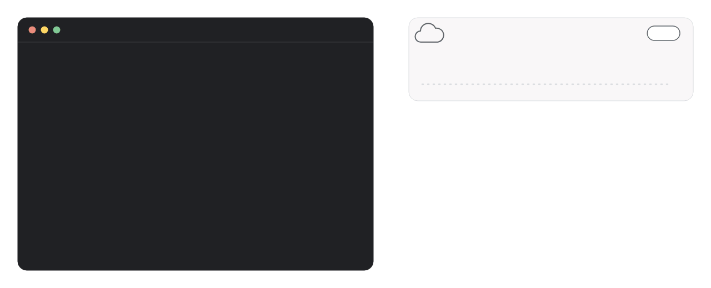
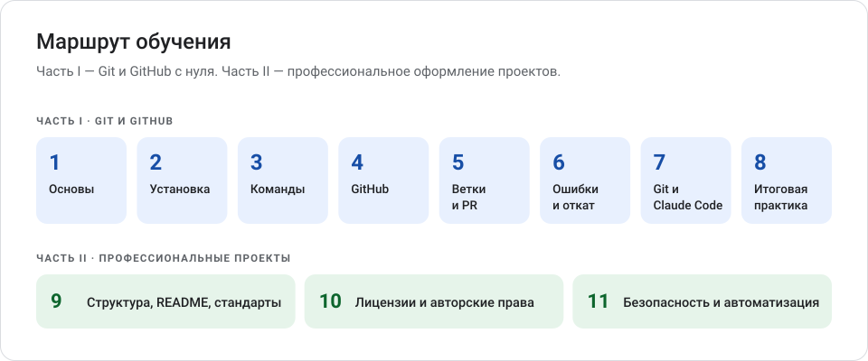

<!-- pdf:skip -->
<div align="center">

<picture>
  <source media="(prefers-color-scheme: dark)" srcset="images/hero-dark.gif">
  
</picture>
<!-- /pdf:skip -->

# Git и GitHub с нуля

**Бесплатная методичка на русском языке: от первого коммита до профессионально оформленного репозитория.**

<!-- pdf:skip -->
[](https://github.com/RuslanKazyradzi13/git-github-guide/actions/workflows/checks.yml)
[](CHANGELOG.md)
[](LICENSE)
[](LICENSE-CODE)
[](https://github.com/RuslanKazyradzi13/git-github-guide/releases/latest/download/git-github-guide.pdf)

[**Начать с главы 1 →**](01_git_i_github.md) &nbsp;·&nbsp; [Скачать PDF](https://github.com/RuslanKazyradzi13/git-github-guide/releases/latest/download/git-github-guide.pdf) &nbsp;·&nbsp; [Шаблоны документов](templates/) &nbsp;·&nbsp; [Пример репозитория](examples/tempconv/)

</div>
<!-- /pdf:skip -->

Методичка для тех, кто начинает изучать разработку программного обеспечения и никогда не работал с Git. Вы научитесь сохранять версии проекта, работать с GitHub, безопасно использовать AI-ассистентов и оформлять проекты по международным практикам.

## Что внутри

- **С нуля и по шагам.** Для каждой команды — зачем она нужна, как её ввести, что вы увидите и какие ошибки встречаются чаще всего.
- **Проверено на практике.** Выводы команд получены в настоящем Git, факты сверены с официальной документацией **11 октября 2026 года**.
- **Для Windows 10 и 11.** PowerShell и Git Bash, установка Git, вход в GitHub из терминала.
- **Наглядно.** 25 схем и диаграммы Mermaid: три области Git, ветки, Pull Request, восстановление изменений, утечка секрета.
- **С практикой.** Вопросы с ответами в каждой главе, упражнения и два итоговых проекта.
- **Как в профессиональных проектах.** README, лицензии, CONTRIBUTING, SECURITY, SemVer, CI, Dependabot, CodeQL — и готовые шаблоны.
- **Git и AI.** Как работать с AI-ассистентом и не потерять контроль над кодом: ветки, контрольные точки, просмотр изменений, откат.



**После части I вы сможете** самостоятельно создать репозиторий, загрузить в него проект, вносить и сохранять изменения, работать с ветками и Pull Request и при необходимости восстановить предыдущую версию.

**После части II вы сможете** оформить репозиторий как профессиональный проект: README, лицензия, документы сопровождения, версии и релизы, автоматические проверки и настройки безопасности.

## Кому подойдёт

- Студентам и начинающим разработчикам, которые ни разу не работали с Git.
- Тем, кто пользуется Git по памяти и хочет понять, что происходит при каждой команде.
- Авторам проектов, которые готовят репозиторий к публикации.
- Преподавателям и наставникам: материалы можно свободно использовать на занятиях с указанием авторства (см. [лицензию](#лицензия)).

## Первый коммит за 10 минут

1. Установите Git — способы описаны в [главе 2](02_ustanovka_i_nastroyka.md#22-установка-git-на-windows). Через winget:

   ```powershell
   winget install --id Git.Git -e --source winget
   ```

2. Откройте **новое** окно PowerShell и представьтесь Git — эти данные попадут в каждый коммит:

   ```powershell
   git config --global user.name "Иван Петров"
   git config --global user.email "ivan.petrov@example.com"
   git config --global init.defaultBranch main
   ```

3. Создайте учебную папку и репозиторий:

   ```powershell
   mkdir ~\projects\git-practice
   cd ~\projects\git-practice
   git init
   notepad hello.txt
   ```

   В Блокноте нажмите **Да**, напишите `Привет, Git!`, сохраните и закройте.

4. Сохраните первую версию и посмотрите историю:

   ```powershell
   git add hello.txt
   git commit -m "Первый коммит"
   git log --oneline
   ```

Получилось? Теперь разберитесь, что произошло, — начните с [главы 1](01_git_i_github.md).

## Содержание

### Часть I. Git и GitHub с нуля

| Глава | Тема | Что внутри |
| --- | --- | --- |
| [1. Основы](01_git_i_github.md) | Git и GitHub: основы | Что такое Git и GitHub, репозиторий, коммит, ветка, история; бытовые аналогии и схемы |
| [2. Установка](02_ustanovka_i_nastroyka.md) | Установка и первая настройка | Терминал, PowerShell и Git Bash, установка Git на Windows, имя и почта, проверка конфигурации |
| [3. Команды](03_osnovnye_komandy.md) | Основные команды Git | Рабочая папка, staging area, история; `init`, `status`, `add`, `commit`, `log`, `diff`, `clone`, `push`, `pull`, `fetch` |
| [4. GitHub](04_rabota_s_github.md) | Работа с GitHub | Аккаунт и 2FA, репозитории, работа через сайт, вход из терминала, отправка проекта на GitHub: два сценария, случай с README |
| [5. Ветки](05_vetki_i_pull_requests.md) | Ветки и Pull Request | `branch`, `switch`, `merge`, Pull Request, ревью, GitHub Flow, командная работа |
| [6. Восстановление](06_oshibki_i_vosstanovlenie.md) | Конфликты, восстановление и типичные ошибки | Конфликты слияния, `restore`, `revert`, `reset`, `reflog`, секреты и `.gitignore`, ошибки push и входа, таблица «ошибка → причина → решение» |
| [7. AI](07_git_s_claude_code.md) | Git и Claude Code | Рабочий цикл с AI, контрольные точки, просмотр изменений, откат, `CLAUDE.md`, оформление AI-проектов |
| [8. Практика](08_praktika_i_zadaniya.md) | Практика и итоговые проекты | Упражнения по главам, проект «Мой первый репозиторий», проект «Профессионально оформленный репозиторий», чек-лист готовности к публикации, контрольный список навыков |

### Часть II. Как создавать, оформлять и публиковать программные проекты по международным практикам

| Глава | Тема | Что внутри |
| --- | --- | --- |
| [9. Оформление](09_standarty_i_oformlenie_proektov.md) | Стандарты и оформление проектов | Стандарты, практики и требования; структура репозитория; README; CONTRIBUTING, CODE_OF_CONDUCT, SECURITY, CHANGELOG; SemVer, теги, релизы; ISO/IEC 12207, 25010, 29148, SPDX, REUSE, Conventional Commits, Scorecard, SLSA, OWASP |
| [10. Лицензии](10_litsenzii_i_avtorskie_prava.md) | Лицензии и авторские права | Авторское право и лицензия; сравнение MIT, Apache-2.0, BSD, GPL, LGPL, AGPL, MPL, Unlicense; выбор и оформление лицензии; NOTICE, сторонние компоненты, CITATION.cff; AI-код |
| [11. Безопасность](11_bezopasnost_i_avtomatizatsiya.md) | Безопасность и автоматизация | GitHub Actions и CI, защита веток, секреты и `.env`, Dependabot, secret scanning, CodeQL, утечка секрета, безопасность CI/CD |

### Справочные материалы

| Материал | Назначение |
| --- | --- |
| [Словарь терминов](glossary.md) | Все термины методички с определениями |
| [Источники](sources.md) | Официальная документация и дата проверки |
| [Шаблоны](templates/) | Готовые шаблоны документов проекта (список ниже) |
| [Учебный проект tempconv](examples/tempconv/) | Эталон профессионально оформленного репозитория: код, тесты, CI, документация |
| [Проверка качества](quality_check.md) | Что и как проверено, известные ограничения |
| [PDF-версия](git-github-guide.pdf) | Вся методичка одним файлом с оглавлением и нумерацией страниц |

**Шаблоны:**
[README](templates/README.template.md) ·
[CONTRIBUTING](templates/CONTRIBUTING.template.md) ·
[SECURITY](templates/SECURITY.template.md) ·
[CHANGELOG](templates/CHANGELOG.template.md) ·
[CODE_OF_CONDUCT](templates/CODE_OF_CONDUCT.template.md) ·
[Issue](templates/ISSUE_TEMPLATE.md) ·
[Pull Request](templates/PULL_REQUEST_TEMPLATE.md) ·
[Выбор лицензии](templates/LICENSE_SELECTION_GUIDE.md) ·
[Чек-лист публикации](templates/PROJECT_RELEASE_CHECKLIST.md)

Пояснения в шаблонах записаны служебными комментариями `<!-- ... -->`. На GitHub они скрыты — чтобы их прочитать, откройте файл в режиме исходного текста (кнопка **Code** или **Raw**) или в редакторе.

## Как пользоваться методичкой

1. **Читайте главы по порядку.** Каждая опирается на предыдущие. Часть II можно начинать после глав 1–6, а проект 2 из главы 8 выполнять после глав 9–11.
2. **Повторяйте команды руками** в учебной папке. Чтение без практики почти не работает.
3. **Сверяйтесь с ожидаемым результатом.** Если результат другой — остановитесь и выполните `git status`. Типичные ошибки разобраны в [главе 6](06_oshibki_i_vosstanovlenie.md).
4. **Отвечайте на вопросы в конце главы.** Ответы спрятаны под спойлером «Ответы» или «Ожидаемый результат».
5. **Закрепите всё в [главе 8](08_praktika_i_zadaniya.md)**: два итоговых проекта, чек-лист готовности к публикации и контрольный список навыков.

Примерное время: часть I — 12–15 часов, часть II — 8–10 часов вместе с практикой.

## Обозначения

| Обозначение | Значение |
| --- | --- |
| Блок `powershell` | Команда, которую нужно ввести в терминале. Приглашение `PS C:\...>` не показано — его не набирают |
| Блок `text` | Ожидаемый вывод. Хеши, даты и пути у вас будут другими |
| `<файл>`, `<коммит>`, `<логин>` | Часть команды или адреса, которую нужно заменить, например `git add <файл>` → `git add hello.txt` |
| `[В КВАДРАТНЫХ СКОБКАХ]` | Заполнитель в шаблонах документов: замените своими данными |
| `OWNER` | Заполнитель в учебном проекте `examples/tempconv`: замените своим логином GitHub |
| ⚠ | Команда может удалить изменения или переписать историю |

Блоки-примечания:

> [!NOTE]
> Полезное уточнение.

> [!TIP]
> Совет, который экономит время.

> [!IMPORTANT]
> То, что важно не пропустить.

> [!WARNING]
> Команда или действие может привести к потере изменений.

> [!CAUTION]
> Опасное действие: потеря данных, утечка или необратимые последствия.

Схемы: картинки в папке [images/](images/) нарисованы для этой методички. Схемы интерфейса GitHub — **схематические изображения, а не снимки экрана**: они помечены надписью «Схема интерфейса · не скриншот». Диаграммы в блоках `mermaid` GitHub рисует автоматически.

## PDF-версия

Файл [git-github-guide.pdf](git-github-guide.pdf) содержит обложку, оглавление с номерами страниц, все главы, словарь, источники и шаблоны. В PDF есть закладки для навигации. Последняя версия файла также прикреплена к [релизу](https://github.com/RuslanKazyradzi13/git-github-guide/releases/latest).

Как пересобрать PDF после правок — в [tools/README.md](tools/README.md).

## Как помочь проекту

- **Нашли ошибку или устаревшие сведения?** [Создайте Issue](https://github.com/RuslanKazyradzi13/git-github-guide/issues/new/choose) — для этого есть готовые формы.
- **Хотите исправить сами?** Прочитайте [CONTRIBUTING.md](CONTRIBUTING.md): как предложить правку, правила текста и проверки.
- **Нашли уязвимость в скриптах или учебном проекте?** Сообщите закрыто по правилам [SECURITY.md](SECURITY.md), а не в открытом Issue.
- **Методичка помогла?** Поставьте звезду репозиторию — так её проще найти другим.

Участвуя в проекте, вы соглашаетесь соблюдать [кодекс поведения](CODE_OF_CONDUCT.md). История версий — в [CHANGELOG.md](CHANGELOG.md).

## Как цитировать

Сведения для цитирования записаны в [CITATION.cff](CITATION.cff). На странице репозитория нажмите **Cite this repository** справа — GitHub покажет готовую ссылку в форматах APA и BibTeX.

## Лицензия

© 2026 Ruslan Kazyradzi.

| Что | Лицензия | Файл |
| --- | --- | --- |
| Тексты методички, схемы и анимация в `images/`, шаблоны в `templates/`, PDF-версия | [CC BY 4.0](https://creativecommons.org/licenses/by/4.0/deed.ru) — можно копировать, распространять и изменять, в том числе в коммерческих целях, если указать автора, дать ссылку на лицензию и отметить внесённые изменения | [LICENSE](LICENSE) |
| Скрипты в `tools/` и код учебного проекта в `examples/tempconv/` | MIT | [LICENSE-CODE](LICENSE-CODE) |

Как указать авторство: «Git и GitHub с нуля», Ruslan Kazyradzi, https://github.com/RuslanKazyradzi13/git-github-guide, лицензия CC BY 4.0.

Файл [examples/tempconv/LICENSE](examples/tempconv/LICENSE) с заполнителями вместо имени — часть учебного задания (образец оформления), а не лицензия этого репозитория. [Кодекс поведения](CODE_OF_CONDUCT.md) — официальный перевод [Contributor Covenant 2.1](https://www.contributor-covenant.org/ru/version/2/1/code_of_conduct/) (CC BY 4.0).
