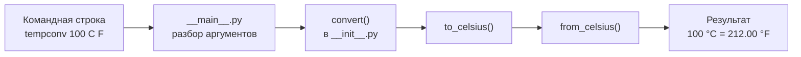

# tempconv

[](https://github.com/OWNER/tempconv/actions/workflows/ci.yml)

Консольная программа для перевода температур между шкалами Цельсия, Фаренгейта и Кельвина.

> [!NOTE]
> Это учебный пример из методички [«Git и GitHub с нуля»](../../README.md). Замените `OWNER` на свой логин GitHub, а заполнители в квадратных скобках — на свои данные.

## Содержание

- [Зачем это нужно](#зачем-это-нужно)
- [Возможности](#возможности)
- [Демонстрация](#демонстрация)
- [Как это устроено](#как-это-устроено)
- [Требования](#требования)
- [Установка](#установка)
- [Быстрый старт](#быстрый-старт)
- [Примеры использования](#примеры-использования)
- [Настройка](#настройка)
- [Тестирование](#тестирование)
- [Документация](#документация)
- [Статус проекта и ограничения](#статус-проекта-и-ограничения)
- [Как сообщить об ошибке или предложить улучшение](#как-сообщить-об-ошибке-или-предложить-улучшение)
- [Лицензия](#лицензия)

## Зачем это нужно

Рецепты, инструкции к технике и научные статьи используют разные шкалы температуры. Пересчитывать в уме неудобно, а онлайн-конвертер требует браузера. `tempconv` переводит значение одной командой в терминале и подходит для использования в скриптах.

## Возможности

- Перевод между шкалами C (Цельсий), F (Фаренгейт) и K (Кельвин) в любом направлении.
- Регистр не важен: `c`, `C`, ` f `.
- Проверка значений ниже абсолютного нуля.
- Настраиваемое число знаков после запятой.
- Понятные сообщения об ошибках и код выхода `2` при неверном вводе.
- Только стандартная библиотека Python — без внешних зависимостей.

## Демонстрация

```text
> tempconv 36.6 C F
36.6 °C = 97.88 °F

> tempconv -40 F C
-40 °F = -40.00 °C

> tempconv 1 X C
Ошибка: неизвестная шкала 'X', допустимо: C, F, K
```

## Как это устроено



Любое значение сначала переводится в градусы Цельсия, затем — в целевую шкалу. Подробнее — в [docs/architecture.md](docs/architecture.md).

## Требования

- Python 3.11 или новее ([python.org](https://www.python.org/downloads/)).
- Git — чтобы скачать проект.

## Установка

```powershell
git clone https://github.com/OWNER/tempconv.git
cd tempconv
python -m venv .venv
.venv\Scripts\Activate.ps1
python -m pip install -e .
```

`python -m venv .venv` создаёт виртуальное окружение — отдельную папку для библиотек проекта. `Activate.ps1` включает его в текущем окне PowerShell. В Linux и macOS вместо этого выполните `source .venv/bin/activate`.

Если PowerShell запрещает запуск скрипта активации, выполните один раз `Set-ExecutionPolicy -Scope CurrentUser RemoteSigned`.

## Быстрый старт

```powershell
tempconv 100 C F
```

```text
100 °C = 212.00 °F
```

Без установки, из папки проекта (PowerShell):

```powershell
$env:PYTHONPATH = "src"
python -m tempconv 100 C F
```

## Примеры использования

| Команда | Результат |
| --- | --- |
| `tempconv 0 C F` | `0 °C = 32.00 °F` |
| `tempconv 451 F C` | `451 °F = 232.78 °C` |
| `tempconv 0 K C` | `0 K = -273.15 °C` |
| `tempconv 25 c k` | `25 °C = 298.15 K` |
| `tempconv --version` | `tempconv 1.0.0` |
| `tempconv --help` | Справка по аргументам |

## Настройка

Программа читает переменные окружения:

| Переменная | Значение по умолчанию | Описание |
| --- | --- | --- |
| `TEMPCONV_PRECISION` | `2` | Число знаков после запятой, от 0 до 6 |

Пример для PowerShell:

```powershell
$env:TEMPCONV_PRECISION = "3"
tempconv 1 C F
```

```text
1 °C = 33.800 °F
```

Образец всех переменных — в файле [.env.example](.env.example). Программа сама не читает файл `.env`: задавайте переменные в окружении.

## Тестирование

```powershell
python -m pip install -r requirements-dev.txt
ruff check .
python -m unittest discover -s tests -v
```

Те же проверки автоматически запускаются в GitHub Actions при каждом push в `main` и в каждом Pull Request: [.github/workflows/ci.yml](.github/workflows/ci.yml).

## Документация

- [docs/architecture.md](docs/architecture.md) — устройство программы.
- [docs/adr/](docs/adr/) — записи архитектурных решений.
- [CHANGELOG.md](CHANGELOG.md) — история изменений по версиям.
- [CONTRIBUTING.md](CONTRIBUTING.md) — как предложить изменение.

## Статус проекта и ограничения

Статус: **стабильный учебный проект**, версия 1.0.0. Номера версий следуют [Semantic Versioning](https://semver.org/lang/ru/).

Ограничения:

- поддерживаются только шкалы C, F и K;
- значения округляются только при выводе; при вычислениях возможна погрешность чисел с плавающей точкой;
- нет графического интерфейса.

## Как сообщить об ошибке или предложить улучшение

- Ошибка или идея: откройте [Issue](https://github.com/OWNER/tempconv/issues/new/choose) и выберите шаблон.
- Изменение кода: прочитайте [CONTRIBUTING.md](CONTRIBUTING.md) и откройте Pull Request.
- Уязвимость: **не публикуйте её в Issue** — следуйте [SECURITY.md](SECURITY.md).

## Лицензия

Распространяется по лицензии MIT — см. файл [LICENSE](LICENSE).

Copyright (c) [ГОД] [ИМЯ ПРАВООБЛАДАТЕЛЯ].
