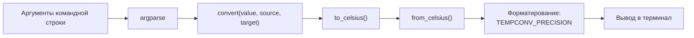

# Архитектура tempconv

## Обзор

Программа состоит из двух модулей пакета `tempconv`:

| Модуль | Ответственность |
| --- | --- |
| `src/tempconv/__init__.py` | Вычисления: проверка шкалы, перевод в градусы Цельсия и обратно |
| `src/tempconv/__main__.py` | Командная строка: разбор аргументов, чтение настроек, вывод результата |

Вычисления не зависят от командной строки. Их можно использовать из другого кода:

```python
from tempconv import convert
convert(100, "C", "F")  # 212.0
```

## Поток данных



## Решения

- Все переводы идут через градусы Цельсия: две формулы на шкалу вместо формулы на каждую пару шкал.
- Настройки читаются из переменных окружения — см. [ADR 0001](adr/0001-config-from-env.md).
- Ошибки ввода — исключение `ValueError` в вычислениях и код выхода `2` в командной строке.
