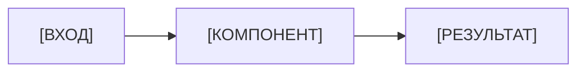

<!--
ШАБЛОН README.md

Как использовать:
1. Скопируйте файл в корень репозитория под именем README.md.
2. Замените все заполнители в квадратных скобках: [НАЗВАНИЕ], [ВЛАДЕЛЕЦ] и т. д.
3. Удалите разделы, которые не относятся к проекту (они отмечены «по ситуации»).
4. Удалите служебные комментарии — такие, как этот блок. На GitHub они не видны, но засоряют файл.
5. Проверьте, что каждая команда из README работает, если её скопировать.

Пример заполненного README: examples/tempconv/README.md
Подробности: глава 9, раздел 9.3.
-->

# [НАЗВАНИЕ ПРОЕКТА]

<!-- По ситуации: 2–4 полезных бейджа. Значок CI появится после настройки workflow (глава 11). -->
[](https://github.com/[ВЛАДЕЛЕЦ]/[РЕПОЗИТОРИЙ]/actions/workflows/ci.yml)

<!-- Одно предложение: что делает программа и для кого. -->
[КРАТКОЕ ОПИСАНИЕ: что делает программа, в одном предложении.]

<!-- По ситуации: содержание нужно, если README длиннее двух-трёх экранов. -->
## Содержание

- [Зачем это нужно](#зачем-это-нужно)
- [Возможности](#возможности)
- [Демонстрация](#демонстрация)
- [Как это устроено](#как-это-устроено)
- [Требования](#требования)
- [Установка](#установка)
- [Быстрый старт](#быстрый-старт)
- [Примеры использования](#примеры-использования)
- [Настройка](#настройка)
- [Тестирование](#тестирование)
- [Документация](#документация)
- [Статус проекта и ограничения](#статус-проекта-и-ограничения)
- [Как сообщить об ошибке или предложить улучшение](#как-сообщить-об-ошибке-или-предложить-улучшение)
- [Лицензия](#лицензия)

## Зачем это нужно

<!-- Какую проблему решает проект. Кто пользователи. Чем он лучше ручного способа или альтернатив. 2–4 предложения. -->
[ОПИСАНИЕ ПРОБЛЕМЫ И ПОЛЬЗОВАТЕЛЕЙ.]

## Возможности

<!-- 3–7 пунктов. Только то, что уже работает. -->
- [ВОЗМОЖНОСТЬ 1]
- [ВОЗМОЖНОСТЬ 2]
- [ВОЗМОЖНОСТЬ 3]

## Демонстрация

<!--
По ситуации:
- программа с интерфейсом — скриншот: 
- процесс, который трудно описать, — короткая GIF-анимация (небольшого размера);
- консольная программа — пример вывода в блоке кода;
- веб-приложение — ссылка на демоверсию, если она работает.
Всегда добавляйте альтернативный текст к изображениям.
-->
```text
[ПРИМЕР КОМАНДЫ И ЕЁ РЕЗУЛЬТАТА]
```

## Как это устроено

<!-- По ситуации: для проектов из нескольких частей. Короткое описание и схема в Mermaid. Подробности — в docs/architecture.md. -->


## Требования

<!-- Операционные системы, версия языка, внешние сервисы, аккаунты. -->
- [НАПРИМЕР: Python 3.11 или новее]
- [НАПРИМЕР: Git]

## Установка

<!-- Пошаговые команды. Укажите, для какой оболочки они (PowerShell, bash). -->
```powershell
git clone https://github.com/[ВЛАДЕЛЕЦ]/[РЕПОЗИТОРИЙ].git
cd [РЕПОЗИТОРИЙ]
[КОМАНДА УСТАНОВКИ ЗАВИСИМОСТЕЙ]
```

## Быстрый старт

<!-- Минимальный сценарий: одна-две команды и ожидаемый результат. -->
```powershell
[КОМАНДА ЗАПУСКА]
```

```text
[ОЖИДАЕМЫЙ РЕЗУЛЬТАТ]
```

## Примеры использования

| Команда или действие | Результат |
| --- | --- |
| `[ПРИМЕР 1]` | [РЕЗУЛЬТАТ] |
| `[ПРИМЕР 2]` | [РЕЗУЛЬТАТ] |

## Настройка

<!-- По ситуации: если программа читает переменные окружения или файлы настроек. Никогда не пишите здесь настоящие ключи. -->
| Переменная | По умолчанию | Описание |
| --- | --- | --- |
| `[ИМЯ_ПЕРЕМЕННОЙ]` | `[ЗНАЧЕНИЕ]` | [ОПИСАНИЕ] |

Образец всех переменных — в файле [.env.example](.env.example). Файл `.env` с настоящими значениями не добавляйте в Git.

## Тестирование

```powershell
[КОМАНДА ЗАПУСКА ТЕСТОВ]
```

<!-- Если проверки запускаются в GitHub Actions, укажите это. -->
Те же проверки запускаются автоматически в GitHub Actions для каждого Pull Request.

## Документация

<!-- По ситуации. -->
- [docs/architecture.md](docs/architecture.md) — устройство программы.
- [CHANGELOG.md](CHANGELOG.md) — история изменений.

## Статус проекта и ограничения

<!-- Честно: стабильность, текущая версия, поддерживается ли проект, чего он не умеет. -->
Статус: **[В РАЗРАБОТКЕ / СТАБИЛЬНЫЙ / НЕ ПОДДЕРЖИВАЕТСЯ]**, версия [X.Y.Z]. Версии следуют [Semantic Versioning](https://semver.org/lang/ru/).

Ограничения:

- [ОГРАНИЧЕНИЕ 1]
- [ОГРАНИЧЕНИЕ 2]

## Как сообщить об ошибке или предложить улучшение

- Ошибка или идея — [Issue](https://github.com/[ВЛАДЕЛЕЦ]/[РЕПОЗИТОРИЙ]/issues/new/choose).
- Изменение кода — прочитайте [CONTRIBUTING.md](CONTRIBUTING.md) и откройте Pull Request.
- Уязвимость — **не публикуйте её в Issue**, следуйте [SECURITY.md](SECURITY.md).

## Лицензия

<!-- Укажите лицензию, только если файл LICENSE действительно добавлен. Выбор лицензии — глава 10. -->
Распространяется по лицензии [НАЗВАНИЕ ЛИЦЕНЗИИ] — см. файл [LICENSE](LICENSE).
